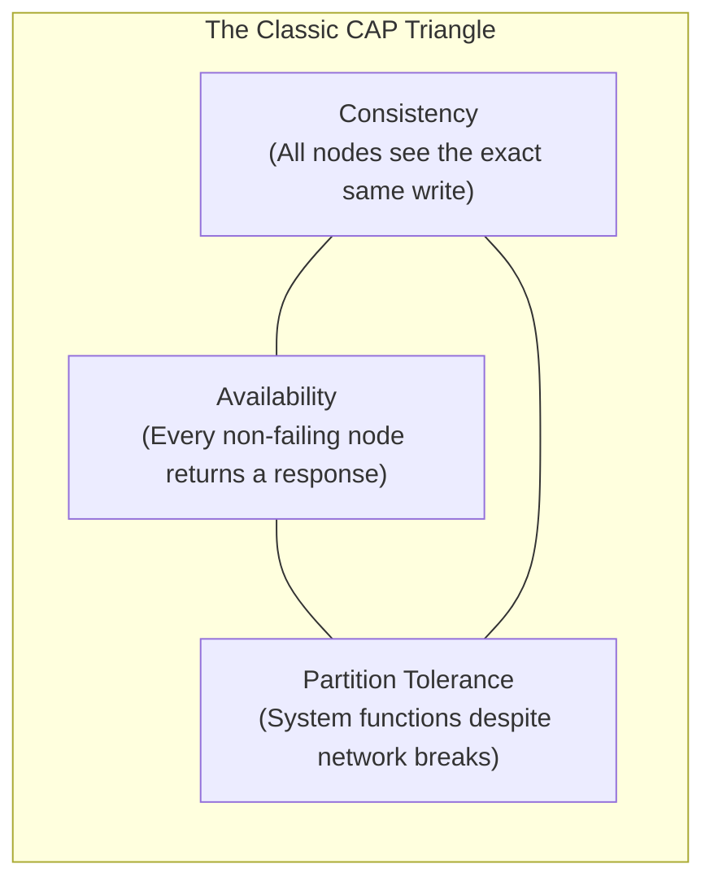

# 03. The CAP Theorem in Distributed Systems

[🏠 Home](../README.md) > [06. Databases](./README.md) > **CAP Theorem**

---

## 1. What is the CAP Theorem?

The **CAP Theorem** (formulated by Eric Brewer) addresses distributed data systems **when a network partition occurs**. It proves that a distributed system can simultaneously provide at most two out of the following three guarantees:

1. **C — Consistency:** Every read receives the most recent write or an error. (In the CAP model, consistency means linearizability—all operations behave as though they access a single, up-to-date copy of data). This is distinct from the broader meaning of consistency in ACID (which refers to schema constraints and integrity).
2. **A — Availability:** Every request received by a non-failing node must receive a non-error response, although that response may not contain the most recent data.
3. **P — Partition Tolerance:** The system continues operating despite dropped, lost, or delayed network messages between nodes caused by a network partition.



---

## 2. What Does CAP Actually Mean in Practice?

In any network spanning multiple physical machines or datacenters, **network partitions ($P$) are an unavoidable physical reality** (undersea fiber cables get cut, switches reboot, routers drop packets).

Because network partitions cannot be prevented:
> [!IMPORTANT]
> **When a network partition occurs, a distributed system CANNOT guarantee both linearizable consistency and availability for every request.**
> It must choose how to handle operations that cannot safely complete with the available information.

```mermaid
sequenceDiagram
    autonumber
    actor ClientA as User A (US West)
    participant NodeA as DB Node 1 (US West)
    participant NodeB as DB Node 2 (US East)
    actor ClientB as User B (US East)
    Note over NodeA,NodeB: Network Partition: Link between Node 1 and Node 2 is severed!
    ClientA->>NodeA: Write: balance = $50
    NodeA--xNodeB: Replication failed! Link is down!
    alt CP Choice: Prioritize Consistency over Availability
        NodeA-->>ClientA: 500 Error: "Cannot reach quorum; write rejected"
        ClientB->>NodeB: Read balance
        NodeB-->>ClientB: 500 Error: "Partition detected; read locked"
        Note over NodeA,NodeB: System rejects/delays operations rather than returning stale data.
    else AP Choice: Prioritize Availability over Consistency
        NodeA-->>ClientA: 200 OK: balance = $50
        ClientB->>NodeB: Read balance
        NodeB-->>ClientB: 200 OK: balance = $100 (Stale Data!)
        Note over NodeA,NodeB: System responds to every request; reconciliation happens later.
    end
```

---

## 3. CP-Oriented vs. AP-Oriented Behavior

* **CP-Oriented Behavior:** A system prioritizes consistency and may reject or delay some requests during a partition.
  * *Example:* A banking service, payment ledger, or ticket reservation engine that must avoid accepting conflicting updates to a critical record.
* **AP-Oriented Behavior:** A system prioritizes responding to requests and may temporarily return stale data or accept updates that require later reconciliation.
  * *Example:* A replicated social media feed, video view counter, or shopping cart where temporary differences between replicas are acceptable.

### Comparison Table

| Property | CP-Oriented Behavior | AP-Oriented Behavior |
|---|---|---|
| **Partition Handling** | Some operations may be rejected or delayed | More operations receive non-error responses |
| **Consistency** | Prioritizes consistent, up-to-date results | May temporarily return divergent or stale results |
| **Availability During Partition** | May be reduced (returns errors) | Prioritized (always returns data) |
| **Typical Requirement** | Avoid conflicting or stale critical decisions | Continue serving users despite temporary divergence |

> [!NOTE]
> **Important Clarification:** CAP does not mean that every system must permanently choose only two of three properties under all circumstances. Its central trade-off specifically concerns **behavior during a network partition**. In normal times when no partition exists, a system can be both consistent and available.

---

## 4. PACELC: Beyond CAP

The PACELC theorem extends CAP to describe system trade-offs when the network is functioning normally:
* **If Partition (P):** Choose **Availability (A)** or **Consistency (C)**.
* **Else (E):** Choose **Latency (L)** or **Consistency (C)**.

| Database | PACELC | Partition Behavior | Normal Behavior |
|---|:---:|---|---|
| **MongoDB** | **PC/EC** | Prioritizes Consistency ($PC$) | Waits for replica acknowledgment for Consistency ($EC$) |
| **Apache Cassandra** | **PA/EL** | Stays Available ($PA$) | Serves from closest node for Lowest Latency ($EL$) |
| **Amazon DynamoDB** | **PA/EL** (Default) | Highly available ($PA$) | Tunable between low latency and strong consistency ($EL$) |

---

## 5. Practical Database Classifications

| Database Engine | Classification | Typical Use Case |
|---|:---:|---|
| **PostgreSQL / MySQL (Single Node)** | **Traditional ACID (Single Machine)** | Financial ledgers, relational transactions |
| **Google Spanner / CockroachDB** | **CP** | Distributed transactions, global banking accounts |
| **etcd / Apache ZooKeeper / Consul** | **CP** | Distributed leader election, configuration management |
| **Apache Cassandra / ScyllaDB** | **AP** | Real-time messaging, IoT sensors, analytics streams |
| **Amazon DynamoDB (Eventual)** | **AP** | E-commerce shopping carts, session management |

---

## 6. Related Topics & Next Steps

* [Database Replication](./replication.md) — Primary-replica topologies, sync vs. async lag.
* [Database Sharding](./sharding.md) — Horizontal partitioning across database nodes.
* [ACID vs. BASE](./acid-vs-base.md) — Relational transactions vs. distributed eventual consistency.
* [Cache Fundamentals](../05-caching/cache-fundamentals.md) — In-memory acceleration layers.

---

| ⬅️ Previous Topic | 🏠 Index | Next Topic ➡️ |
|:--- |:---:| ---:|
| [Database Sharding](./sharding.md) | [06. Databases Index](./README.md) | [ACID vs. BASE ➡️](./acid-vs-base.md) |
