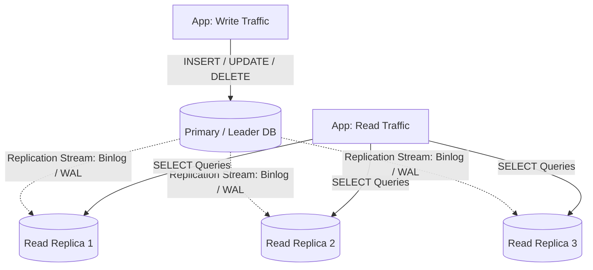
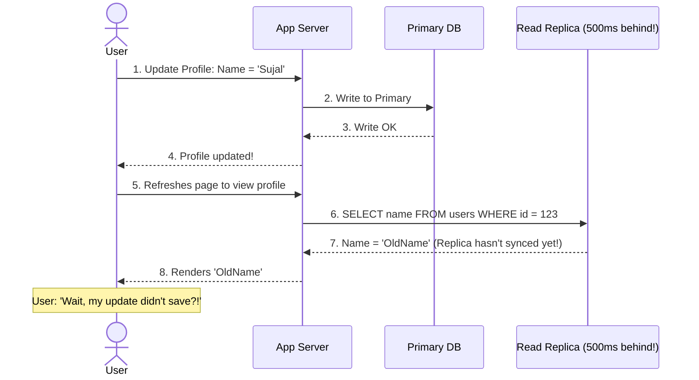

# Database Replication

> High-Level System Design | Databases & Storage

---

### 1. What is it?

* **Plain English:** Replication means keeping identical copies of the same database on multiple physical servers connected over a network.
* **The Core Purpose:**
  1. **Scale Reads:** Offload read traffic from the primary database to read replicas.
  2. **High Availability:** If the primary machine catches fire, promote a replica to primary in seconds.
  3. **Geographic Proximity:** Place replicas in Tokyo, Frankfurt, and Virginia so users read data with single-digit millisecond latency.


---

### 2. Synchronous vs. Asynchronous Replication

```mermaid
sequenceDiagram
    autonumber
    actor Client as  App Server
    participant P as  Primary DB
    participant R as  Replica DB
    Note over P,R: Case A: Synchronous Replication (Zero Data Loss)
    Client->>P: 1. Write user balance = $100
    P->>R: 2. Forward write over network
    R-->>P: 3. ACK: Write committed to disk
    P-->>Client: 4. 200 OK: Transaction Committed
    Note over Client,R: Slower write latency, but replica is guaranteed 100% in sync!
    Note over P,R: Case B: Asynchronous Replication (Ultra-Fast Writes)
    Client->>P: 1. Write user balance = $100
    P-->>Client: 2. Instant 200 OK Response
    P--.)R: 3. Background stream of change log (Replication Lag!)
    Note over Client,R: Fast writes, but if Primary crashes before step 3, data is lost!
```

---

### 3. Detailed Pros & Cons: Synchronous vs. Asynchronous

| Replication Type | Pros | Cons | Best Used For |
|---|---|---|---|
| **Synchronous** | • **Zero data loss** on primary crash<br>• Replicas always have fresh, consistent data | • **High write latency** (must wait for network round-trip)<br>• If a replica slows down or hangs, **all writes freeze** | Banking ledgers, stock exchanges, billing systems |
| **Asynchronous** | • **Blazing fast writes** (Primary commits locally & returns)<br>• Replicas can go offline without blocking primary | • **Replication Lag** (replicas fall behind by 100ms–2s)<br>• Risk of **data loss** on sudden primary power failure | Social media, e-commerce catalog, blog/news feeds |
| **Semi-Synchronous** | • Best of both: 1 replica is synchronous (for safety), others are asynchronous | • Slightly higher latency than pure async | Standard production configuration for MySQL / Postgres |

---

### 4. Replication Topologies

```mermaid
flowchart LR
    subgraph SingleLeader [1. Single-Leader (Primary-Replica)]
        P1[(Primary)] --> R1[(Replica A)] & R2[(Replica B)]
    end
    subgraph MultiLeader [2. Multi-Leader (Active-Active)]
        DC1[(Primary US-East)] <-->|Bidirectional Sync| DC2[(Primary EU-West)]
    end
    subgraph Leaderless [3. Leaderless (Dynamo / Cassandra)]
        N1[(Node 1)] <--> N2[(Node 2)] <--> N3[(Node 3)]
    end
```

#### Pros & Cons of Topologies

1. **Single-Leader (Most Common):**
   * *Pros:* Simple. No write conflicts.
   * *Cons:* Does **NOT** increase write capacity (all writes still funnel through 1 single primary node).
2. **Multi-Leader (Multi-Datacenter):**
   * *Pros:* Survives entire datacenter outages; writes are local in every continent.
   * *Cons:* **Write Conflict Hell.** If User A edits their bio in US and EU simultaneously, which edit wins?
3. **Leaderless (Quorum):**
   * *Pros:* Any node can accept reads and writes. High fault tolerance.
   * *Cons:* Requires Quorum math ($W + R > N$) to ensure you read the latest write.

---

### 5. The #1 Production Trap: Replication Lag & Anomalies

#### The Problem: Read-Your-Own-Writes Anomaly



#### How Production Systems Solve This:

1. **Route User's Own Reads to Primary:** After a user performs a write, set a flag in their session/cookie to route their personal read requests to the **Primary DB for the next 5 seconds**.
2. **Track Replication Monotonic Timestamps:** Only read from replicas whose WAL/binlog timestamp is $\ge$ the timestamp of the user's last write.

---

### 6. Key Takeaway

Replication is for **scaling reads** and **high availability**. It does **NOT** solve write bottlenecks. If your primary database is running out of disk or CPU from too many writes, you need **Sharding**, not more replicas!
