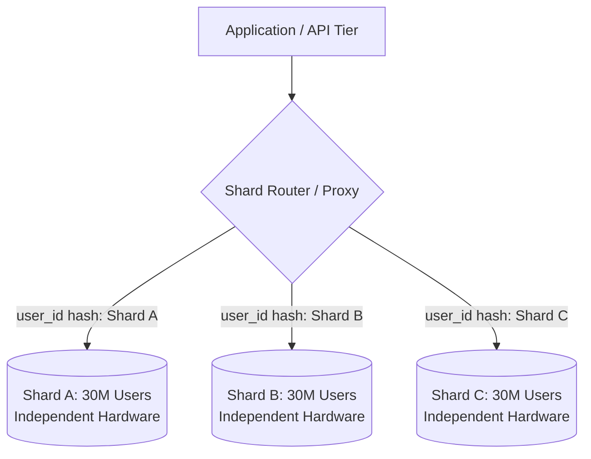
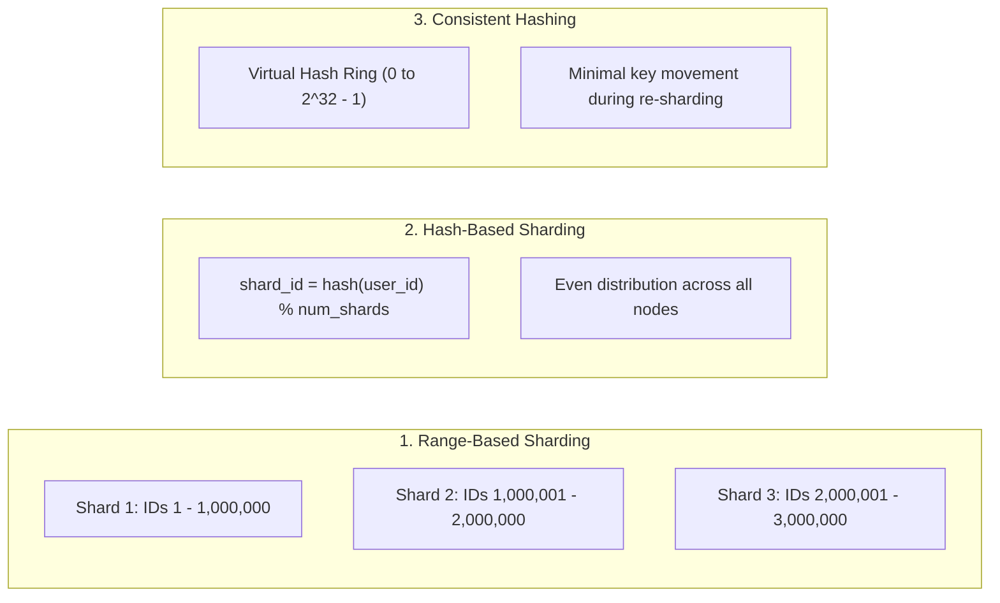

# 02. Database Sharding & Partitioning

[🏠 Home](../README.md) > [06. Databases](./README.md) > **Sharding**

---

## 1. What is Database Sharding?

**Sharding** is the architectural technique of dividing a large dataset into smaller subsets (called **shards**) and distributing them across **multiple independent physical database nodes**.

Each shard stores a distinct subset of the overall data, functioning as an independent database with its own CPU, memory, and disk storage.



### Illustrative Example:
Suppose an application stores **90 million user records**:
* Instead of placing all 90M records on a single database node (which risks memory saturation and slow index traversals), the system distributes them across 3 shards:
  * **Shard A:** Stores 30 million users.
  * **Shard B:** Stores 30 million users.
  * **Shard C:** Stores 30 million users.

---

## 2. Common Sharding Strategies



### 1. Range-Based Sharding
Records are assigned to shards according to contiguous ranges of a key value (e.g., user IDs, letters of the alphabet, or timestamps).
* **Example:**
  * Shard A: `user_id` $1 \text{ – } 1,000,000$
  * Shard B: `user_id` $1,000,001 \text{ – } 2,000,000$
  * Shard C: `user_id` $2,000,001 \text{ – } 3,000,000$
* **Advantages:**
  * Highly efficient for range queries (`WHERE user_id BETWEEN 500 AND 1500`) that align cleanly with shard boundaries.
  * Straightforward and intuitive to understand.
* **Disadvantages:**
  * **Uneven traffic distribution:** If newer users are significantly more active than older users, Shard C will be slammed while Shards A and B sit idle.
  * Sequential auto-incrementing identifiers concentrate 100% of new write traffic onto the highest shard.

### 2. Hash-Based Sharding
A deterministic mathematical hash function is applied to the shard key to calculate which shard stores the record:
$$\text{shard\_id} = \text{hash}(\text{user\_id}) \pmod{\text{number\_of\_shards}}$$

* **Advantages:**
  * Can distribute records and write traffic relatively evenly across all available database nodes.
  * Eliminates traffic concentration caused by sequential or auto-incrementing IDs.
* **Disadvantages:**
  * Range queries become **Scatter-Gather** operations (the application must query all shards and aggregate results).
  * Changing the shard count (e.g., from 3 to 4 nodes) requires migrating a large percentage of data across all shards unless consistent hashing is used.

### 3. Consistent-Hash-Based Partitioning
Consistent hashing places nodes and keys on a virtual circular hash ring ($0 \text{ to } 2^{32}-1$). When a new shard is added or removed, only $K/N$ keys need to be reassigned (where $K$ is total keys and $N$ is total nodes).
* While conceptually clean, real-world database systems often use partition maps, token ranges (like Apache Cassandra), or database-managed routing layers to manage partition movements.

---

## 3. Replication vs. Sharding Comparison

| Feature | Replication | Sharding |
|---|---|---|
| **Main Purpose** | Maintain identical copies of data across nodes | Divide a dataset into discrete partitions across nodes |
| **Data Placement** | Multiple copies of the **same data** | **Different subsets** of data on each shard |
| **Read Scaling** | Often drastically improves read capacity | Can distribute reads across partitions |
| **Write Scaling** | Limited (all writes funnel through primary leader) | Can distribute writes when keys and workloads are partitioned effectively |
| **Operational Complexity** | Consistency, failover, and replication lag | Partition routing, rebalancing, resharding, and cross-shard queries |

---

## 4. Combining Replication and Sharding

Replication and sharding are not mutually exclusive—they are frequently combined in large-scale enterprise production architectures.

```mermaid
flowchart TD
    App[Application Router]
    
    subgraph ShardA_Cluster [Shard A (Users 1 - 30M)]
        PA[(Primary A)] --> RA1[(Replica A1)] & RA2[(Replica A2)]
    end

    subgraph ShardB_Cluster [Shard B (Users 30M - 60M)]
        PB[(Primary B)] --> RB1[(Replica B1)] & RB2[(Replica B2)]
    end

    subgraph ShardC_Cluster [Shard C (Users 60M - 90M)]
        PC[(Primary C)] --> RC1[(Replica C1)] & RC2[(Replica C2)]
    end

    App --> PA & PB & PC
```

* In this hybrid architecture:
  * **Sharding** scales write throughput and total disk storage capacity across Shards A, B, and C.
  * **Replication** provides high availability, fault tolerance, and massive read scaling within each individual shard.

---

## 5. Related Topics & Next Steps

* [Database Replication](./replication.md) — Single-leader, multi-leader, and leaderless topologies.
* [The CAP Theorem](./cap-theorem.md) — CP vs. AP trade-offs during network partitions.
* [ACID vs. BASE](./acid-vs-base.md) — Relational transactions vs. distributed eventual consistency.
* [Consistent Hashing](../04-load-balancing/consistent-hashing.md) — Algorithmic hash ring mechanics.

---

| ⬅️ Previous Topic | 🏠 Index | Next Topic ➡️ |
|:--- |:---:| ---:|
| [Database Replication](./replication.md) | [06. Databases Index](./README.md) | [The CAP Theorem ➡️](./cap-theorem.md) |
