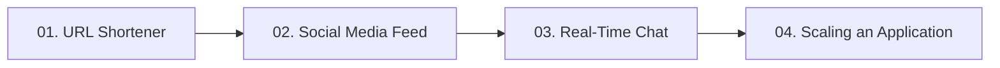

# 07. Real-World System Design Examples

[🏠 Home](../README.md) > **07. System Design Examples**

---

## Overview

Real-world high-level system design synthesizes all foundational principles—load balancing, caching, API protocols, database sharding, and messaging queues—into end-to-end production architectures. 

This module breaks down four classic, high-frequency interview case studies using real-world engineering constraints, capacity estimations, data models, and architectural diagrams.

---

## 🎯 Key Learning Objectives

* **System Design Methodology**: Follow a structured 4-step interview approach: Requirements & Estimations $\rightarrow$ High-Level Design $\rightarrow$ Deep Dive Components $\rightarrow$ Bottlenecks & Failure Modes.
* **Back-of-the-Envelope Estimation**: Calculate read/write QPS, bandwidth consumption, and storage capacity over 5-year horizons.
* **Hashing & Encoding Trade-offs**: Contrast Base62 encoding, MD5/SHA256 truncation, and standalone Key Generation Services (KGS).
* **Feed Distribution Paradigms**: Balance Push (fanout-on-write) vs. Pull (fanout-on-read) models and architect hybrid approaches for high-follower celebrities.
* **Persistent Connection Management**: Scale real-time WebSocket state across distributed connection clusters with Redis Pub/Sub message distribution.
* **Evolutionary Scaling**: Master the 6-stage transition from a single $10/month VPS to an enterprise multi-datacenter distributed cloud serving 10M+ users.

---

## 📚 Module Table of Contents

| # | Case Study | Key Architectural Concepts | Link |
|---|---|---|---|
| **01** | **Design a URL Shortener (TinyURL)** | Base62 encoding, MD5/SHA256 hashing vs. Ticket service (KGS), 100:1 read/write ratio, cache eviction | [Read Guide ➡️](./url-shortener.md) |
| **02** | **Design a Social Media Feed (Twitter/Instagram)** | Fanout-on-write (push) vs. Fanout-on-read (pull), hybrid model for celebrities, timeline caching | [Read Guide ➡️](./social-media-feed.md) |
| **03** | **Design a Real-Time Chat App (WhatsApp/Slack)** | Bidirectional WebSockets, connection manager, Redis Pub/Sub, message queues, presence tracking | [Read Guide ➡️](./chat-application.md) |
| **04** | **Scaling an Application (1 to 10M Users)** | End-to-end 6-stage evolutionary roadmap from single server to distributed enterprise cloud | [Read Guide ➡️](./scaling-an-application.md) |

---

## 🔍 Detailed Topic Breakdown

* 📌 **[01. Design a URL Shortener (TinyURL)](./url-shortener.md)**
  * **Core Problem**: Mapping long URLs to short 7-character aliases (e.g., `https://tiny.url/aZ81bQ`) with sub-10ms redirection.
  * **Capacity Math**: 100:1 read-to-write ratio (500M writes/month $\approx$ 200 writes/sec, 20,000 reads/sec); Base62 ($[a-zA-Z0-9]$) yields $62^7 \approx 3.5\text{ Trillion}$ unique short URLs.
  * **Shortening Approaches**:
    * *MD5 / SHA256 Hashing*: Hashing the long URL + base62 encoding the first 43 bits; requires collision detection and resolution.
    * *Key Generation Service (KGS)*: Standalone service pre-generating random 7-character tokens stored in DB and loaded into memory rings (zero collision risk).
  * **HTTP Redirection**: Using `301 Moved Permanently` (browser caches redirect, reduces server load) vs. `302 Found` (passes through server, enables click analytics).
  * **Caching & Storage**: Caching top 20% hot URLs in Redis (80/20 rule); NoSQL wide-column or key-value store (DynamoDB / Cassandra) for horizontal scale.

* 📌 **[02. Design a Social Media Feed (Twitter/Instagram)](./social-media-feed.md)**
  * **Core Problem**: Generating and rendering personalized chronological or ranked home timelines for millions of active users.
  * **The Two Fundamental Approaches**:
    * *Fanout-on-Write (Push Model)*: When user posts, write the post ID into the home feed cache of all their followers immediately.
      * *Pros*: Reading feed is an ultra-fast $O(1)$ cache lookup.
      * *Cons*: Terrible for celebrities with 50M+ followers (fanout explosion takes minutes and exhausts write queues).
    * *Fanout-on-Read (Pull Model)*: Feed is generated on-demand when the user opens the app by querying posts from all followed users.
      * *Pros*: Zero write fanout overhead.
      * *Cons*: Extremely slow and expensive read queries ($O(N)$ joins across thousands of users).
  * **The Industry Hybrid Model**:
    * Regular users use Push (instant timeline delivery).
    * Celebrities (>100k followers) use Pull (posts are merged into follower timelines dynamically at read time).
  * **Timeline Caching**: Redis Sorted Sets (`ZSET`) keyed by `user_id` with `timestamp` as the score.

* 📌 **[03. Design a Real-Time Chat App (WhatsApp/Slack)](./chat-application.md)**
  * **Core Problem**: Low-latency 1-on-1 and group messaging, online presence indicators, and guaranteed message delivery.
  * **Protocol Choice**: Persistent bidirectional WebSockets for low-latency delivery; HTTP/2 fallback.
  * **Architectural Components**:
    * *WebSocket Gateway*: Maintains hundreds of thousands of open TCP connections per node.
    * *Session / Connection Manager*: Centralized Redis store mapping `user_id -> ws_server_ip`.
    * *Message Fanout Broker*: Redis Pub/Sub or Kafka routing messages to the specific server holding the recipient's open socket.
    * *Offline Messaging Queue*: Storing unread messages in Cassandra/HBase until the user reconnects and receives push notifications via APNs/FCM.
  * **User Presence Tracking**: Heartbeat pings with short Redis TTLs (`SETEX presence:user_123 30 "online"`); if no heartbeat received within 30s, user status flips to offline.

* 📌 **[04. Scaling an Application (1 to 10M Users)](./scaling-an-application.md)**
  * **Stage 1 (1–1,000 Users)**: All-in-one single server (App, DB, Web Server) for rapid prototyping and validation.
  * **Stage 2 (1,000–50,000 Users)**: Decouple database onto a dedicated machine with optimized RAM and NVMe storage.
  * **Stage 3 (50,000–500,000 Users)**: Stateless app tier horizontally scaled behind an Nginx/ALB load balancer.
  * **Stage 4 (500,000–2M Users)**: Introduce Redis caching (cache-aside) and Primary-Replica read replicas to absorb 90% read traffic.
  * **Stage 5 (2M–5M Users)**: Edge CDN acceleration (Cloudflare/CloudFront) and asynchronous background message queues (Kafka/RabbitMQ).
  * **Stage 6 (5M–10M+ Users)**: Database horizontal sharding, microservices decomposition, and multi-region active-active deployments.

---

## 💡 Key Architectural Rules of Thumb

* **Hybrid Fanout is King for Feeds**: Never use pure fanout-on-write if your platform has celebrity users; a hybrid approach (push for regular users, pull for VIPs) prevents fanout queues from choking.
* **Pre-generate Identifiers with KGS**: In URL shorteners or ID generators, pre-generating unique tokens in a standalone Key Generation Service avoids expensive collision detection loops during write bursts.
* **Separate Real-Time Sockets from Business Logic**: Keep WebSocket connection servers lightweight and stateless regarding business rules; offload message parsing and DB persistence to worker pools via message brokers.
* **Scale Progressively**: Never design Stage 6 architectures on Day 1. Every added distributed layer (sharding, Kafka, microservices) incurs significant operational, monitoring, and team overhead.

---

| ⬅️ Previous Module | 🏠 Index | Next Module ➡️ |
|:--- |:---:| ---:|
| [06. Databases & Storage](../06-databases/README.md) | [System Design Hub](../README.md) | [08. Cheat Sheets & Revision ➡️](../08-cheat-sheet/README.md) |
