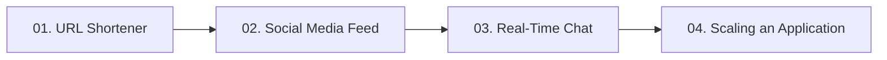

# 07. Real-World System Design Examples

[🏠 Home](../README.md) > **07. System Design Examples**

---

## Overview

Real-world high-level system design synthesizes all foundational principles—load balancing, caching, API protocols, database sharding, and messaging queues—into end-to-end production architectures. 

This module breaks down four classic, high-frequency interview case studies using real-world engineering constraints, capacity estimations, data models, and architectural diagrams.

---

## Module Table of Contents

| # | Case Study | Key Architectural Concepts | Link |
|---|---|---|---|
| **01** | **Design a URL Shortener (TinyURL)** | Base62 encoding, MD5/SHA256 hashing vs. Ticket service (KGS), 100:1 read/write ratio, cache eviction | [Read Guide ➡️](./url-shortener.md) |
| **02** | **Design a Social Media Feed (Twitter/Instagram)** | Fanout-on-write (push) vs. Fanout-on-read (pull), hybrid model for celebrities, timeline caching | [Read Guide ➡️](./social-media-feed.md) |
| **03** | **Design a Real-Time Chat App (WhatsApp/Slack)** | Bidirectional WebSockets, connection manager, Redis Pub/Sub, message queues, presence tracking | [Read Guide ➡️](./chat-application.md) |
| **04** | **Scaling an Application (1 to 10M Users)** | End-to-end 6-stage evolutionary roadmap from single server to distributed enterprise cloud | [Read Guide ➡️](./scaling-an-application.md) |

---

| ⬅️ Previous Module | 🏠 Index | Next Module ➡️ |
|:--- |:---:| ---:|
| [06. Databases & Storage](../06-databases/README.md) | [System Design Hub](../README.md) | [08. Cheat Sheets & Revision ➡️](../08-cheat-sheet/README.md) |
