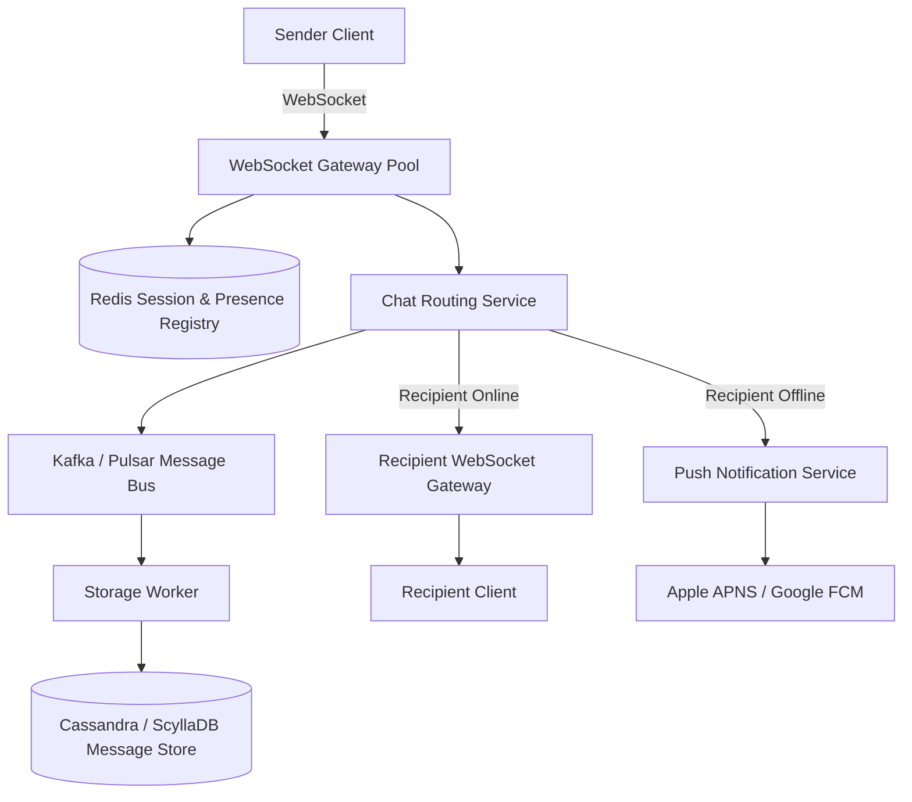

# 03. System Design: Real-Time Chat Application (WhatsApp / Slack)

[🏠 Home](../README.md) > [07. System Design Examples](./README.md) > **Chat Application**

---

### 1. Requirements & Scope
* **Functional Requirements:**
  * 1-on-1 private messaging and group chats (up to 500 members).
  * Real-time message delivery with online/offline presence indicators.
  * Message history persistence and delivery receipts (sent, delivered, read).
* **Non-Functional Requirements:**
  * Sub-100ms message delivery latency.
  * Zero message loss; reliable push notifications for offline users.
  * Massive concurrent persistent connections (millions of active WebSockets).

---

### 2. High-Level Architecture

---

### 3. Key Architectural Decisions

1. **Protocol: WebSockets over HTTP Polling:**
   * Full-duplex persistent TCP connection prevents connection handshake overhead for every message.
2. **Session & Presence Routing:**
   * A distributed Redis cluster maps `user_id -> gateway_server_ip` so messages find the exact socket connection.
3. **Database Selection:**
   * Wide-column NoSQL (Cassandra / ScyllaDB) partitioned by `chat_id` and clustered by `message_id (timeuuid)` for high-velocity append-only writes.

---

## 4. Related Topics & Next Steps

* [WebSockets Protocol](../03-networking/websockets.md) — Persistent bidirectional TCP streams.
* [Social Media News Feed](./social-media-feed.md) — Fanout architecture and caching.
* [Scaling an Application](./scaling-an-application.md) — 6-stage scaling roadmap from 1 to 10M users.
* [Quick Revision Cheat Sheet](../08-cheat-sheet/quick-revision-cheat-sheet.md) — Latency numbers and interview checklist.

---

| ⬅️ Previous Case Study | 🏠 Index | Next Case Study ➡️ |
|:--- |:---:| ---:|
| [Social Media News Feed](./social-media-feed.md) | [07. Examples Index](./README.md) | [Scaling an Application ➡️](./scaling-an-application.md) |
