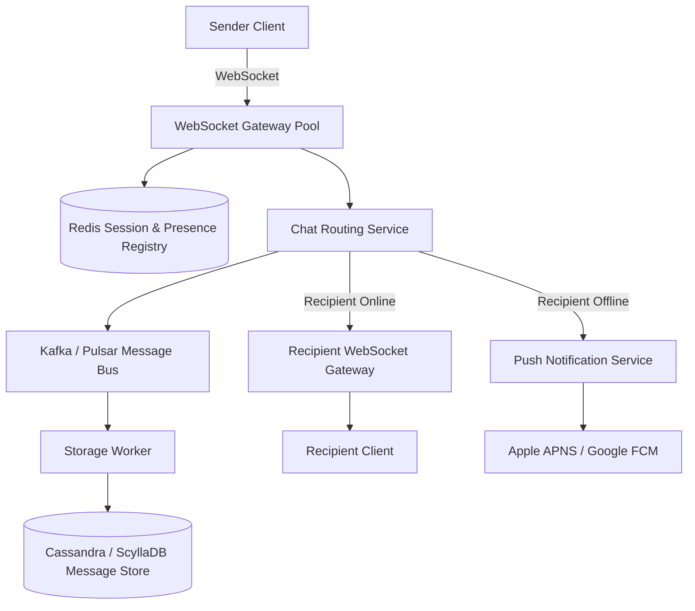

# System Design: Real-Time Chat Application

> High-Level System Design | Real-World Architecture Case Study

---

### 1. Requirements & Scope
* **Functional:**
  * 1-on-1 private messaging and group chats (up to 500 members).
  * Real-time message delivery with online/offline presence indicators.
  * Message history persistence and read receipts (sent, delivered, read).
* **Non-Functional:**
  * Sub-100ms message delivery latency.
  * Zero message loss; reliable push notifications for offline users.
  * Massive concurrent persistent connections (millions of active WebSockets).

---

### 2. High-Level Architecture

---

### 3. Key Architectural Decisions

1. **Protocol: WebSockets over HTTP Polling:**
   * Full-duplex persistent TCP connection prevents connection handshake overhead for every message.
2. **Session & Presence Routing:**
   * A distributed Redis cluster maps `user_id -> gateway_server_ip` so messages find the exact socket connection.
3. **Database Selection:**
   * Wide-column NoSQL (Cassandra / ScyllaDB) partitioned by `chat_id` and clustered by `message_id (timeuuid)` for high-velocity append-only writes.
