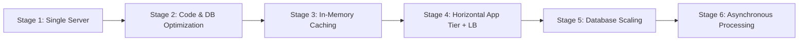
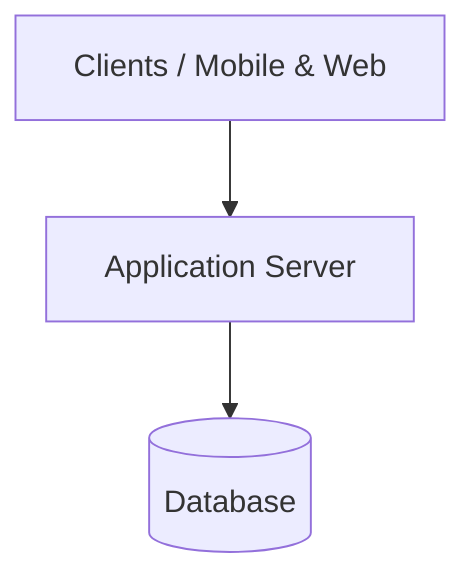
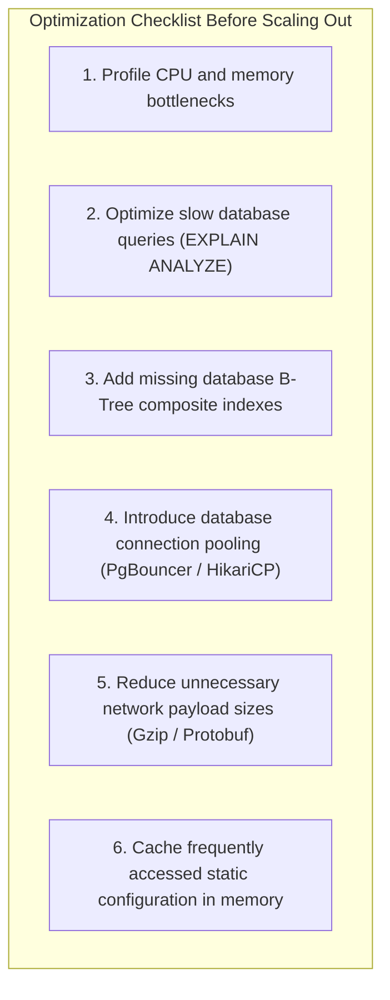
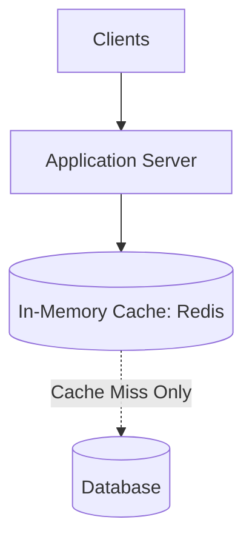
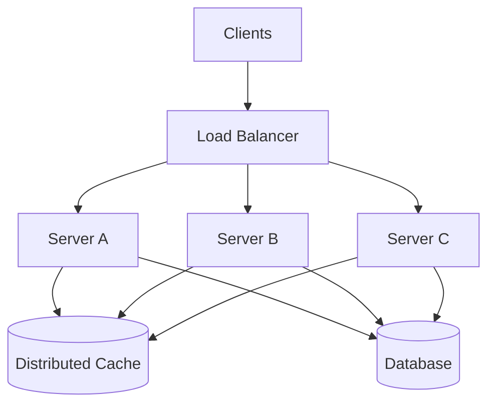
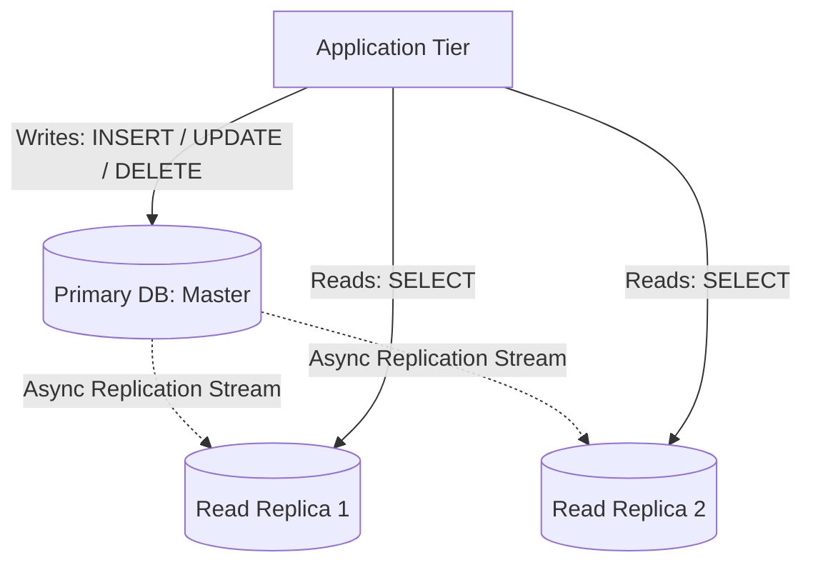
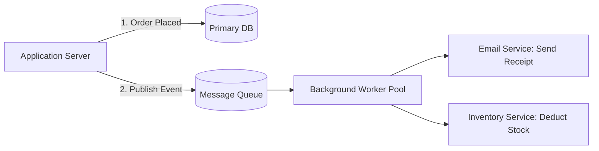
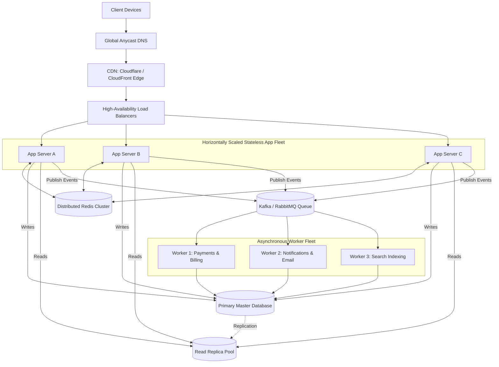

# 04. System Design Case Study: Scaling an Application

[🏠 Home](../README.md) > [07. System Design Examples](./README.md) > **Scaling an Application**

---

## 1. Scenario Overview

Consider an e-commerce application that serves product pages, user accounts, and customer orders. 

This case study traces the evolutionary journey of scaling this system step-by-step from day-one deployment to handling millions of concurrent users.

---

## 2. The 6 Evolutionary Stages

### Stage 1: Single Server Architecture

The system begins with a single physical machine or virtual server hosting both the web application process and the database engine.

* **Pros:** Extremely simple, fastest time to market, zero network latency between application and database, trivial CI/CD deployment.
* **Potential Problems as Traffic Increases:**
  * **Resource Saturation:** CPU or memory saturation as user traffic climbs.
  * **Database Contention:** Heavy write queries lock tables, slowing down simple read queries.
  * **Increased Latency:** High load leads to slow response times and timeouts.
  * **Single Point of Failure (SPOF):** Any hardware crash, OS kernel panic, or reboot causes a 100% total system outage.

---

### Stage 2: Optimize the Application (Before Adding Hardware)

Before spending budget on additional cloud servers and distributed systems complexity:

Optimization frequently multiplies existing machine capacity by $5\times \text{ to } 10\times$ without introducing distributed failure modes.

---

### Stage 3: Add an In-Memory Cache

Frequently accessed read-heavy records (such as product descriptions and category listings) are cached in a dedicated in-memory tier (e.g., Redis).

* **Benefits:**
  * Drastically reduces database CPU utilization and disk read I/O.
  * Sub-millisecond response times for cache hits.
* **Considerations:**
  * Cache invalidation rules must be established.
  * Stale data policies and TTLs must be configured.

---

### Stage 4: Add Multiple Application Servers + Load Balancer

Traffic is distributed across a horizontally scaled pool of stateless application instances behind an intelligent Load Balancer.

* **Prerequisites for Success:**
  * **Stateless Application Servers:** Servers must avoid storing local user session state in process RAM. User sessions live in the shared Redis cache or in signed JWT tokens.
  * **Health Checks:** The load balancer uses active liveness/readiness probes to automatically remove crashed instances from rotation.
  * **Connection Management:** Connection pooling must be carefully tuned so dozens of application instances do not overwhelm database connection limits.

---

### Stage 5: Scale the Database Tier

When the single database becomes the primary bottleneck, scale it systematically:

1. **Add Read Replicas:** Route 90% of read queries (product browsing) to read replicas, reserving the primary database for writes (order placements).
2. **Partitioning & Sharding:** If write volume or disk storage exceeds a single machine's hardware limits, horizontally shard data across multiple database nodes.
3. **Important Design Philosophy:** Sharding is **not** automatically the first step. Query optimization, schema indexing, caching, and read replicas often suffice for millions of active users.

---

### Stage 6: Introduce Asynchronous Processing & Queues

Operations that do not require synchronous completion during the initial user HTTP request are offloaded to an asynchronous message broker (e.g., RabbitMQ, Apache Kafka, or AWS SQS).

* **Benefits:**
  * HTTP responses return immediately ($<50\text{ ms}$), providing a snappy user experience.
  * Spikes in background workload (e.g., promotional blast emails) are buffered in the queue without degrading user-facing API performance.
* **Requirements:** Workers must implement idempotent processing, retries with exponential backoff, and dead-letter queues (DLQ).

---

## 3. Final Architecture (10M+ Users)

> [!NOTE]
> **Engineering Summary:** This is an illustrative architecture, not a rigid template. The optimal system design always depends on your specific traffic patterns, read/write ratios, latency SLAs, consistency constraints, operational team capacity, and infrastructure budget.

---

## 4. Related Topics & Next Steps

* [Scaling: Vertical vs. Horizontal](../01-fundamentals/scaling.md) — Fundamental trade-offs.
* [Database Replication](../06-databases/replication.md) — Scaling read traffic with replicas.
* [Caching Strategies](../05-caching/caching-strategies.md) — In-memory acceleration patterns.
* [Quick Revision Cheat Sheet](../08-cheat-sheet/quick-revision-cheat-sheet.md) — Back-of-the-envelope numbers and interview checklist.

---

| ⬅️ Previous Example | 🏠 Index | Next Example ➡️ |
|:--- |:---:| ---:|
| [Design a Chat Application](./chat-application.md) | [07. Examples Index](./README.md) | [Quick Revision Cheat Sheet ➡️](../08-cheat-sheet/quick-revision-cheat-sheet.md) |
