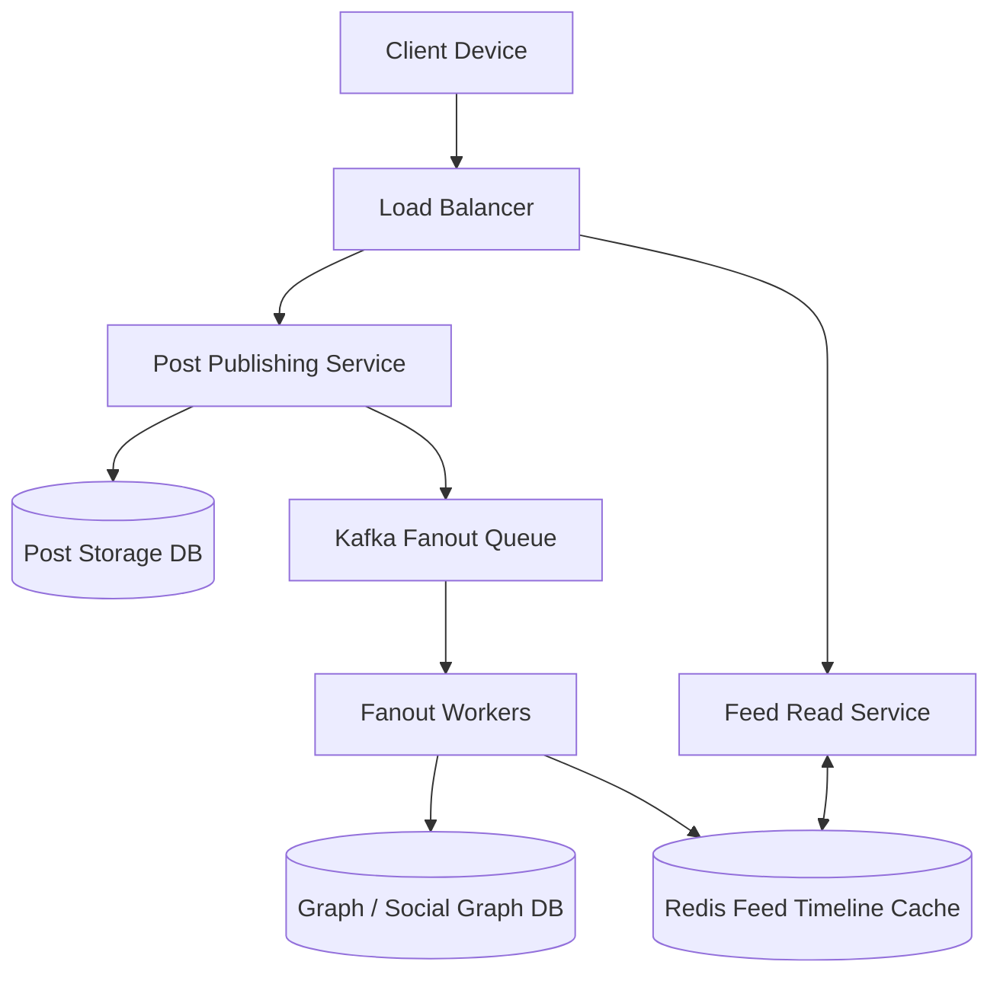

# 02. System Design: Social Media News Feed (Twitter / Instagram)

[🏠 Home](../README.md) > [07. System Design Examples](./README.md) > **Social Media News Feed**

---

### 1. Requirements & Scope
* **Functional Requirements:**
  * Users can publish posts (text, images, video links).
  * Users can follow other users.
  * Users can view a reverse-chronological news feed of posts from people they follow.
* **Non-Functional Requirements:**
  * Feed generation latency < 200ms.
  * Eventual consistency for feed updates (5-10s delay acceptable).
  * High read volume (99% reads, 1% writes; e.g. 500k feed reads/sec vs. 5k posts/sec).

---

### 2. High-Level Architecture

---

### 3. Key Architectural Decisions: Fan-Out on Write vs. Fan-Out on Read

| Approach | How it Works | Pros | Cons |
|---|---|---|---|
| **Fan-Out on Write (Push)** | When User A posts, immediately push `post_id` into all followers' Redis timeline lists | Reading the feed is an instant $O(1)$ memory lookup | **Celebrity Problem:** If an account with 50M followers posts, 50 million Redis writes are triggered! |
| **Fan-Out on Read (Pull)** | Timeline is only assembled when the follower opens the app | No write amplification | Slower feed read latency ($O(N)$ query across all followees) |
| **Hybrid (Production Standard)** | Push for standard users (< 20k followers); Pull for celebrities (> 20k followers) | Fast feed generation without celebrity write storms | Slightly more complex feed aggregation code |

---

## 4. Related Topics & Next Steps

* [URL Shortener](./url-shortener.md) — Base62 encoding and cache sizing.
* [Real-Time Chat App](./chat-application.md) — Full-duplex WebSocket messaging.
* [Scaling an Application](./scaling-an-application.md) — Evolutionary 1 to 10M users guide.
* [Common Caching Problems](../05-caching/common-caching-problems.md) — Mitigating hot key saturation.

---

| ⬅️ Previous Case Study | 🏠 Index | Next Case Study ➡️ |
|:--- |:---:| ---:|
| [URL Shortener](./url-shortener.md) | [07. Examples Index](./README.md) | [Real-Time Chat App ➡️](./chat-application.md) |
