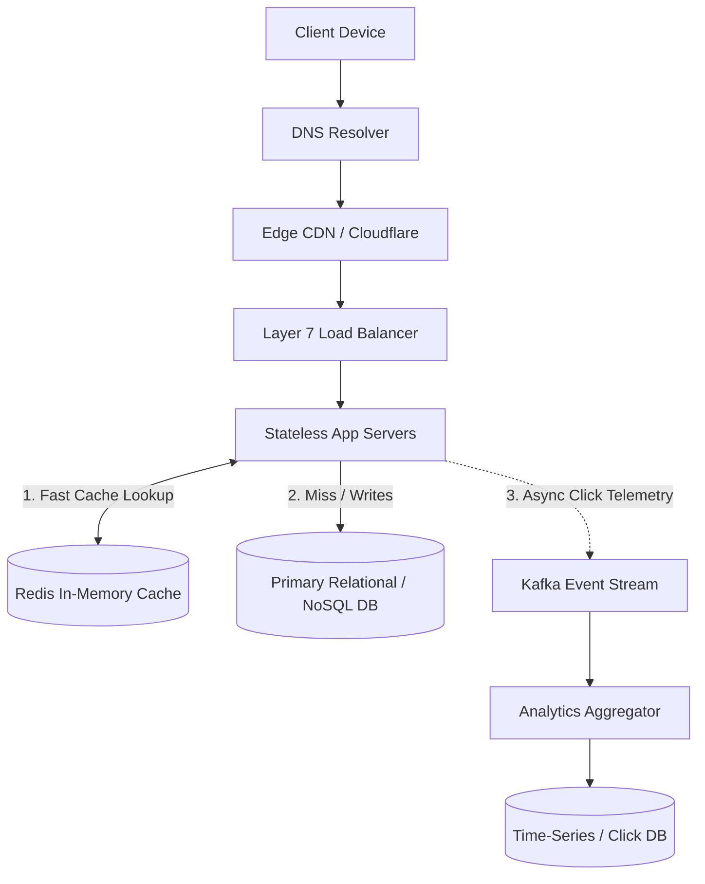

# 01. System Design: URL Shortener (TinyURL)

[🏠 Home](../README.md) > [07. System Design Examples](./README.md) > **URL Shortener**

---

### 1. Requirements & Scope
* **Functional Requirements:**
  * Given a long URL, generate a unique short alias (e.g., `https://short.link/aB92x`).
  * When a user accesses the short URL, redirect them to the original long URL with HTTP 301/302.
  * Custom aliases are optional; analytics (click counts) are tracked.
* **Non-Functional Requirements:**
  * Ultra-low latency redirection (< 20ms).
  * High availability (99.99%).
  * 100:1 Read-to-Write ratio (100 million redirects/day vs. 1 million new URLs/day).

---

### 2. High-Level Architecture

---

### 3. Key Architectural Decisions

1. **Short Key Generation:**
   * Use Base62 encoding (`[a-z, A-Z, 0-9]`). A 7-character Base62 string yields $62^7 \approx 3.5 \text{ Trillion}$ unique URLs.
   * Generate keys using **Pre-generated Unique ID ranges** or a distributed counter (Snowflake ID) to avoid collision checks.
2. **Redirect Status Code:**
   * **HTTP 301 (Permanent Redirect):** Browser caches the redirect locally; subsequent clicks bypass the server completely (reduces server load, but loses click analytics).
   * **HTTP 302 (Temporary Redirect):** Every single click hits the server first; enables 100% accurate click analytics.
3. **Database Schema:**
   * Store `short_key (Primary Key)`, `long_url`, `created_at`, `expires_at`, `user_id`.

---

## 4. Related Topics & Next Steps

* [Social Media News Feed](./social-media-feed.md) — Fanout-on-write vs. fanout-on-read.
* [Real-Time Chat App](./chat-application.md) — WebSocket gateway architecture.
* [Scaling an Application](./scaling-an-application.md) — Evolutionary scaling from 1 to 10M users.
* [Cache Fundamentals](../05-caching/cache-fundamentals.md) — Sizing the Redis caching tier.

---

| ⬅️ Previous Module | 🏠 Index | Next Case Study ➡️ |
|:--- |:---:| ---:|
| [06. Databases](../06-databases/README.md) | [07. Examples Index](./README.md) | [Social Media News Feed ➡️](./social-media-feed.md) |
