# 🚀 Complete System Design Roadmap: Beginner → Expert
> **171 Topics | 12 Phases | 6 Stages | Master High-Level Design (HLD)**
> *Explained in Simple English with Rich Visuals & Diagrams*

---

## 🗺️ Master Curriculum Tracker

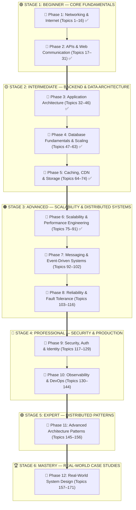

---

## 📑 Detailed Table of Contents

- [🟢 STAGE 1: BEGINNER — CORE FUNDAMENTALS](#-stage-1-beginner--core-fundamentals)
  - [📘 PHASE 1: Networking & Internet Fundamentals (Topics 1–16)](#-phase-1-networking--internet-fundamentals)
    - [1.1 — Network Basics](#11--network-basics)
      - [1. Network](#1-network)
      - [2. Internet](#2-internet)
      - [3. Client](#3-client)
      - [4. Server](#4-server)
      - [5. Client-Server Communication](#5-client-server-communication)
      - [6. IP Address (IPv4 and IPv6)](#6-ip-address-ipv4-and-ipv6)
      - [7. Port Numbers](#7-port-numbers)
      - [8. Domain Name](#8-domain-name)
      - [9. DNS (Domain Name System)](#9-dns-domain-name-system)
    - [1.2 — Internet Protocols](#12--internet-protocols)
      - [10. HTTP](#10-http)
      - [11. HTTPS](#11-https)
      - [12. HTTP Request and Response](#12-http-request-and-response)
      - [13. URL vs URI](#13-url-vs-uri)
      - [14. TCP vs UDP](#14-tcp-vs-udp)
      - [15. Socket Types](#15-socket-types)
      - [16. TLS/SSL](#16-tlsssl)
  - [📘 PHASE 2: APIs & Communication Fundamentals (Topics 17–31)](#-phase-2-apis--communication-fundamentals)
    - [2.1 — API Basics](#21--api-basics)
      - [17. API (Application Programming Interface)](#17-api-application-programming-interface)
      - [18. REST API](#18-rest-api)
      - [19. HTTP Methods (GET, POST, PUT, PATCH, DELETE)](#19-http-methods-get-post-put-patch-delete)
      - [20. HTTP Status Codes](#20-http-status-codes)
      - [21. Request Headers and Body](#21-request-headers-and-body)
      - [22. Response Headers and Body](#22-response-headers-and-body)
      - [23. JSON](#23-json)
    - [2.2 — API Processing](#22--api-processing)
      - [24. API Authentication](#24-api-authentication)
      - [25. Authorization](#25-authorization)
      - [26. Middleware](#26-middleware)
      - [27. API Gateway](#27-api-gateway)
    - [2.3 — Communication Protocols](#23--communication-protocols)
      - [28. WebSocket](#28-websocket)
      - [29. GraphQL](#29-graphql)
      - [30. gRPC](#30-grpc)
      - [31. Synchronous vs Asynchronous Communication](#31-synchronous-vs-asynchronous-communication)
- [🟡 STAGE 2: INTERMEDIATE — BACKEND & DATA ARCHITECTURE](#-stage-2-intermediate--backend--data-architecture)
  - [📘 PHASE 3: Application & Software Architecture (Topics 32–46)](#-phase-3-application--software-architecture)
    - [3.1 — Architecture Fundamentals: 1-Tier to N-Tier](#31--architecture-fundamentals-1-tier-to-n-tier)
    - [3.2 — Architecture Styles: Monolith vs Microservices vs Serverless](#32--architecture-styles-monolith-vs-microservices-vs-serverless)
    - [3.3 — Design Principles: Coupling & Boundaries](#33--design-principles-coupling--boundaries)
  - [📘 PHASE 4: Database Fundamentals & Data Architecture (Topics 47–63)](#-phase-4-database-fundamentals--data-architecture)
    - [4.1 — SQL vs NoSQL Databases](#41--sql-vs-nosql-databases)
    - [4.2 — Transactions & ACID vs BASE](#42--transactions--acid-vs-base)
    - [4.3 — The CAP Theorem & PACELC](#43--the-cap-theorem--pacelc)
    - [4.4 — Database Scaling: Replication & Sharding](#44--database-scaling-replication--sharding)
  - [📘 PHASE 5: Caching, CDN & Storage Systems (Topics 64–74)](#-phase-5-caching-cdn--storage-systems)
    - [5.1 — Caching Fundamentals: Redis vs Memcached](#51--caching-fundamentals-redis-vs-memcached)
    - [5.2 — Caching Strategies (Cache-Aside, Read/Write-Through, Write-Back, Write-Around)](#52--caching-strategies)
    - [5.3 — Cache Eviction: LRU vs LFU & Invalidation](#53--cache-eviction-lru-vs-lfu--invalidation)
    - [5.4 — CDN & Cloud Object Storage (S3)](#54--cdn--cloud-object-storage-s3)
- [🟠 STAGE 3: ADVANCED — SCALABILITY & DISTRIBUTED SYSTEMS](#-stage-3-advanced--scalability--distributed-systems)
  - [📘 PHASE 6: Scalability & Performance Engineering (Topics 75–91)](#-phase-6-scalability--performance-engineering)
    - [6.1 — Vertical vs Horizontal Scaling](#61--vertical-vs-horizontal-scaling)
    - [6.2 — Latency vs Throughput (Performance Formulas)](#62--latency-vs-throughput-performance-formulas)
    - [6.3 — Load Balancing Deep Dive (L4 vs L7 & Algorithms)](#63--load-balancing-deep-dive-l4-vs-l7--algorithms)
    - [6.4 — Reverse Proxy (Nginx / Envoy / HAProxy)](#64--reverse-proxy-nginx--envoy--haproxy)
- [🗺️ Upcoming Phases Overview (Phase 7 to Phase 12)](#️-upcoming-phases-overview-phase-7-to-phase-12)

---

# 🟢 STAGE 1: BEGINNER — CORE FUNDAMENTALS

---

# 📘 PHASE 1: Networking & Internet Fundamentals

Networking is the physical and logical highway of system design. Every request from an iPhone or browser travels across these layers.

---

## 1.1 — Network Basics

### 1. Network
A **Computer Network** is a group of two or more computing devices connected together by cables (fiber, Ethernet) or radio signals (Wi-Fi, 4G/5G) so they can share data, files, and resources.

* **LAN (Local Area Network):** Covers a small local area like your house, a classroom, or an office. Speeds are extremely fast (1 to 10 Gbps) and delay is less than 1 millisecond.
* **WAN (Wide Area Network):** Connects computers across different cities, countries, or continents. The Internet is the world's biggest WAN.

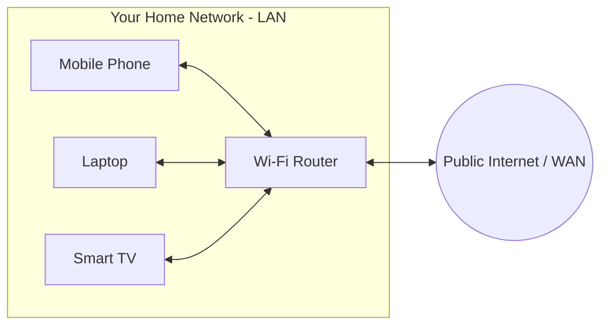

---

### 2. Internet
The **Internet** is a global "network of networks." It connects billions of private, corporate, university, and government networks together using the standardized **TCP/IP** rules.

* **Physical Reality:** Data travels across the planet through thick undersea fiber-optic cables resting on ocean floors.
* **Autonomous Systems (AS):** Huge tech networks (like Google, Cloudflare, Microsoft) connect to each other at Internet Exchange Points (IXPs) using a routing language called **BGP (Border Gateway Protocol)**.

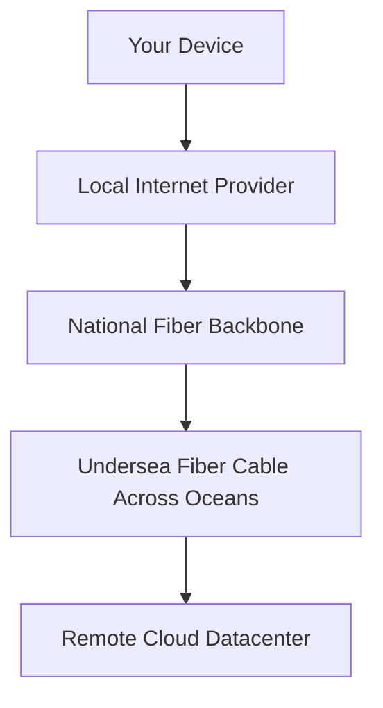

---

### 3. Client
A **Client** is the device or application that initiates a request for data or a service.
* Examples: Google Chrome, an iPhone running Instagram, Spotify desktop app, or a terminal running `curl`.
* **Behavior:** The client does not wait for incoming calls; it wakes up, creates an outbound request, receives the response, and renders it on your screen.

---

### 4. Server
A **Server** is a dedicated computer (or program) running continuously in a datacenter, listening for incoming client requests.
* **Behavior:** It sits passively on a fixed IP address and a specific **Port Number**. When an order arrives, it processes business logic, queries a database, and returns the result.

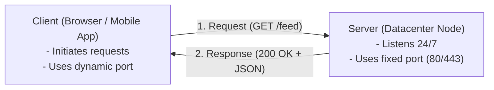

---

### 5. Client-Server Communication
How clients and servers exchange data:

1. **Request-Response (Half-Duplex):** Client sends a question, server sends an answer, connection closes or idles. Standard HTTP model.
2. **Persistent Connection (HTTP Keep-Alive):** Reuses the same underlying TCP connection for multiple back-to-back requests, avoiding repeated handshake delays.
3. **Full-Duplex (WebSockets):** A two-way open pipeline where both client and server can push messages at any split-second (used for chat and gaming).
4. **Server-Sent Events (SSE):** One-way stream where the server continuously pushes updates to the client over standard HTTP.

---

### 6. IP Address (IPv4 and IPv6)
An **IP (Internet Protocol) Address** is the digital address of any machine connected to a network.

```
IPv4: 192 . 168 . 1 . 100
      [8 bits].[8 bits].[8 bits].[8 bits] = 32 bits (~4.3 Billion total addresses)

IPv6: 2001 : 0db8 : 85a3 : 0000 : 0000 : 8a2e : 0370 : 7334
      8 groups of 16-bit hex numbers = 128 bits (~340 Undecillion addresses!)
```

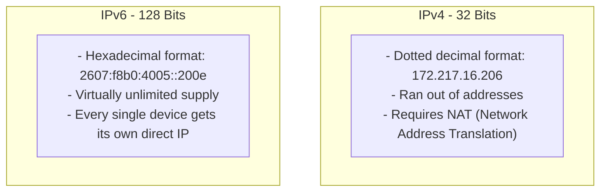

---

### 7. Port Numbers
If the **IP address** is the street address of an apartment building, the **Port Number** is the specific apartment room number.

A single computer can run a web server, a database, and an email service all at the same time. Port numbers make sure incoming packets reach the exact software process intended.

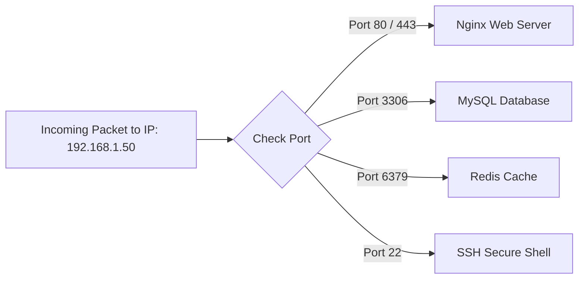

* **Well-Known Ports (0 – 1023):** System/root services (`80` HTTP, `443` HTTPS, `22` SSH, `53` DNS).
* **Registered Ports (1024 – 49151):** Specific software (`3306` MySQL, `5432` Postgres, `6379` Redis, `8000/8080` Dev).
* **Ephemeral / Dynamic Ports (49152 – 65535):** Temporary outgoing ports picked automatically by client operating systems.

---

### 8. Domain Name
A **Domain Name** is a friendly, memorable nickname for a numeric IP address.
* Example: `api.store.example.com`

```
Anatomy of a Domain:
    api    .    store    .    example    .    com    .
     ^            ^              ^             ^     ^
     |            |              |             |     +-- Root Domain (implicit)
     |            |              |             +-------- Top-Level Domain (TLD)
     |            |              +---------------------- Second-Level Domain
     |            +------------------------------------- Subdomain
     +-------------------------------------------------- Host / Service
```

---

### 9. DNS (Domain Name System)
DNS is the **Phonebook of the Internet**. It translates human words (`google.com`) into computer numbers (`142.250.190.46`).

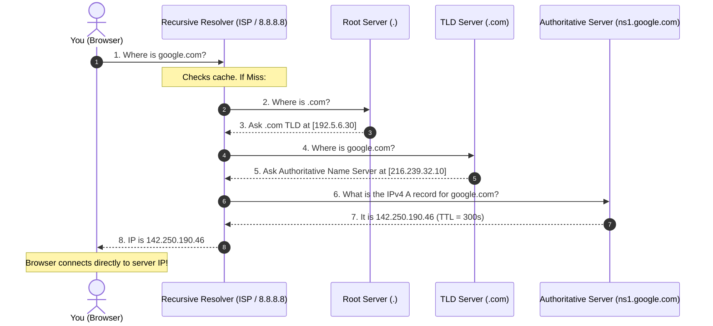

---

## 1.2 — Internet Protocols

---

### 10. HTTP (HyperText Transfer Protocol)
**HTTP** is the universal protocol of the World Wide Web.
* Operates at the **Application Layer (Layer 7)**.
* Text-based, human-readable, and stateless.
* **HTTP/1.1:** Introduced persistent connections (`Connection: keep-alive`).
* **HTTP/2:** Introduced binary framing and multiplexing (multiple requests over one single connection).
* **HTTP/3:** Replaced TCP with **QUIC (running over UDP)** to eliminate Head-of-Line packet blocking.

---

### 11. HTTPS (Secure HTTP)
$$\text{HTTPS} = \text{HTTP} + \text{TLS Encryption}$$

* In plain HTTP, any attacker on your Wi-Fi router can read your passwords, cookies, and tokens.
* In HTTPS, every character is encrypted using math before it leaves your device.
* **Three Guarantees:**
  1. **Confidentiality:** No eavesdropping.
  2. **Integrity:** Packets cannot be modified in transit.
  3. **Authentication:** Proves you are talking to the real server, not an imposter.

---

### 12. HTTP Request and Response

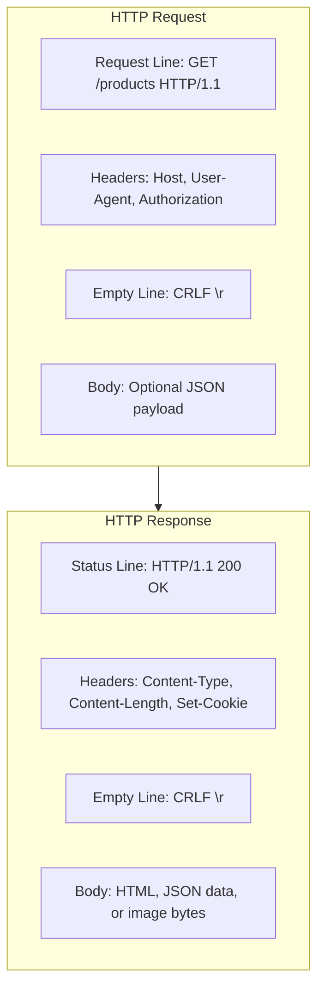

---

### 13. URL vs URI

```
                   URI (Uniform Resource Identifier)
                   [Identifies ANY resource by name or location]
                                    |
      +-----------------------------+-----------------------------+
      |                                                           |
     URL (Uniform Resource Locator)                  URN (Uniform Resource Name)
    [Tells WHAT and HOW to find it]                  [Identifies purely by name]
https://example.com/books/index.html                     urn:isbn:0451450523
```

---

### 14. TCP vs UDP

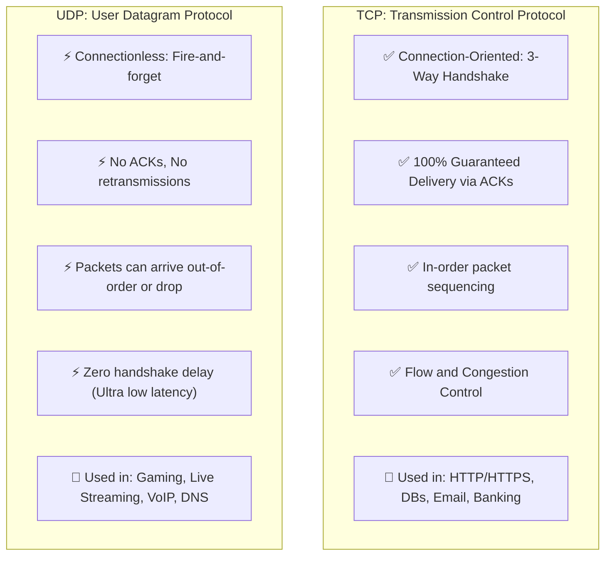

---

### 15. Socket Types
A **Socket** is an endpoint created by the operating system for network input/output:
* **Stream Sockets (`SOCK_STREAM` / TCP):** Continuous, reliable, two-way byte stream.
* **Datagram Sockets (`SOCK_DGRAM` / UDP):** Independent, bounded packets with no connection state.
* **Raw Sockets (`SOCK_RAW`):** Bypasses transport layer to craft raw IP packets directly (used by `ping` for ICMP).

---

### 16. TLS/SSL
**TLS (Transport Layer Security)** is the cryptographic protocol powering HTTPS.

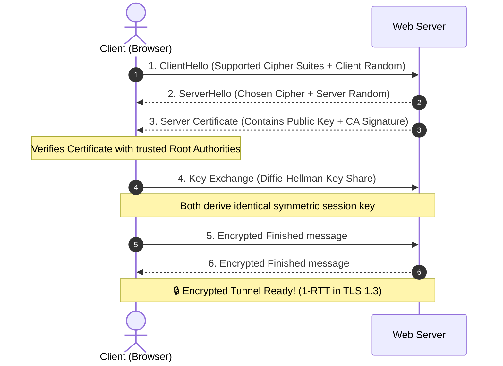

---

# 📘 PHASE 2: APIs & Communication Fundamentals

---

## 2.1 — API Basics

### 17. API (Application Programming Interface)
An **API** is a software contract. It defines the operations, inputs, outputs, and data formats one program allows other programs to use without exposing its internal code.

* **The Restaurant Analogy:**
  - You = Client
  - Kitchen = Backend Database & Business Logic
  - Waiter = **API** (takes your order menu request to the kitchen, brings back your food response)

---

### 18. REST API (Representational State Transfer)
**REST** is an architectural style designed around **Resources** identified by URLs.
* **Stateless:** The server stores no client session state; every request contains full context.
* **Client-Server Separation:** UI logic separated from data storage.
* **Cacheable:** Responses declare caching headers.

---

### 19. HTTP Methods (GET, POST, PUT, PATCH, DELETE)

| Method | Purpose | Typical URL | Has Body? | Idempotent? | Safe? |
| :--- | :--- | :--- | :--- | :--- | :--- |
| **GET** | Read/Fetch data | `/api/users/42` | No | ✅ Yes | ✅ Yes |
| **POST** | Create new resource | `/api/users` | ✅ Yes | ❌ No | ❌ No |
| **PUT** | Replace entire resource | `/api/users/42` | ✅ Yes | ✅ Yes | ❌ No |
| **PATCH** | Partially update resource | `/api/users/42` | ✅ Yes | ❌ No | ❌ No |
| **DELETE** | Remove resource | `/api/users/42` | No | ✅ Yes | ❌ No |

---

### 20. HTTP Status Codes
* **1xx (Informational):** `100 Continue`, `101 Switching Protocols` (WebSockets).
* **2xx (Success):** `200 OK`, `201 Created`, `204 No Content`.
* **3xx (Redirection):** `301 Moved Permanently`, `302 Found`, `304 Not Modified` (Cache hit).
* **4xx (Client Error):** `400 Bad Request`, `401 Unauthorized`, `403 Forbidden`, `404 Not Found`, `429 Too Many Requests`.
* **5xx (Server Error):** `500 Internal Error`, `502 Bad Gateway`, `503 Unavailable`, `504 Gateway Timeout`.

---

### 21. Request Headers and Body & 22. Response Headers and Body
Headers carry metadata (authorization, content format, cookies), while the Body carries the raw data (JSON/HTML).

---

### 23. JSON (JavaScript Object Notation)
The universal, lightweight text standard for data exchange:
```json
{
  "id": 101,
  "name": "Sujal",
  "is_admin": true,
  "roles": ["developer", "architect"]
}
```

---

## 2.2 — API Processing

### 24. API Authentication & 25. Authorization
* **Authentication ("Who are you?"):** Verifying identity (API Keys, JWT Tokens, OAuth 2.0).
* **Authorization ("What can you do?"):** Checking permissions (RBAC: Admin vs Viewer).

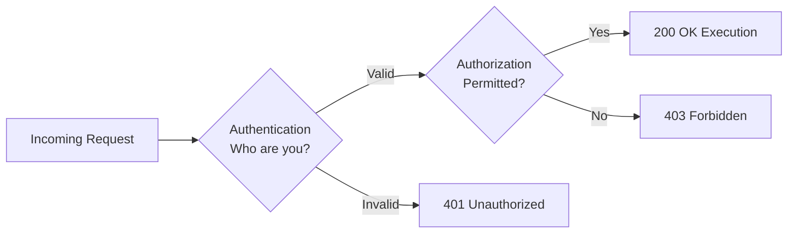

---

### 26. Middleware & 27. API Gateway
* **Middleware:** Processing functions executed in a chain (Logging $\rightarrow$ Rate Limiting $\rightarrow$ Auth $\rightarrow$ Handler).
* **API Gateway:** The single front-door entry point into a microservices cluster.

---

## 2.3 — Communication Protocols: REST vs RPC vs GraphQL vs WebSockets

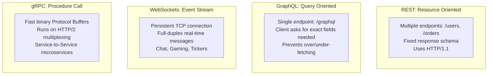

---

# 🟡 STAGE 2: INTERMEDIATE — BACKEND & DATA ARCHITECTURE

---

# 📘 PHASE 3: Application & Software Architecture

How you organize your software components determines how easy it is to scale, deploy, and maintain your system.

---

## 3.1 — Architecture Fundamentals: 1-Tier to N-Tier

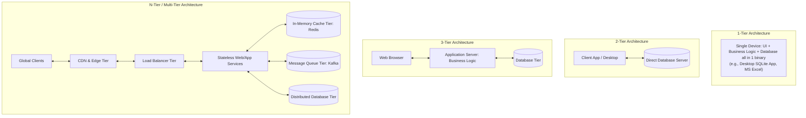

### The Evolution:
* **1-Tier:** Everything runs on the client's local computer. Fast for a single user, but impossible to share real-time data across users.
* **2-Tier (Client-Server):** Client talks directly to the database. Security risk (database credentials embedded in client software) and business logic cannot be updated without reinstalling the app.
* **3-Tier:** Introduced the **Application Server**. Business logic lives safely on the server. Clients never touch the database directly.
* **N-Tier:** Breaks large systems into specialized tiers (Presentation, Gateway, Application, Caching, Messaging, Database). Each tier can scale independently on separate server clusters!

---

## 3.2 — Architecture Styles: Monolith vs Microservices vs Serverless

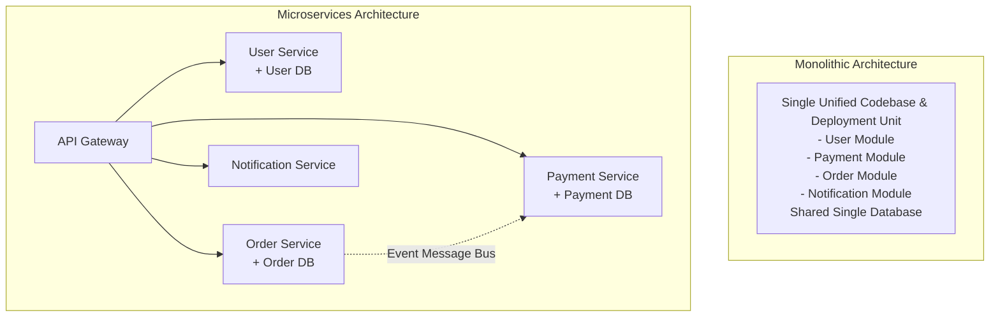

### Comparison Matrix:

| Dimension | Monolithic Architecture | Microservices Architecture | Serverless (FaaS) |
| :--- | :--- | :--- | :--- |
| **Codebase** | Single shared repository | Multiple decoupled repositories | Small standalone functions (AWS Lambda) |
| **Deployment** | All-or-nothing deployment | Each service deployed independently | Automatic event-triggered deployment |
| **Scaling** | Scale the whole app together | Scale only the bottleneck service | Automatic micro-scaling per request |
| **Tech Stack** | Single language & framework | Polyglot (Service A = Go, Service B = Python) | Cloud provider runtime |
| **Network Overhead**| Zero (In-memory function calls) | Network latency (HTTP/gRPC calls) | Cold-start latency |
| **Best For** | Startups, MVP, small teams, low complexity | Large teams, complex domains, massive scale | Sporadic workloads, background jobs |

---

## 3.3 — Design Principles: Coupling & Boundaries

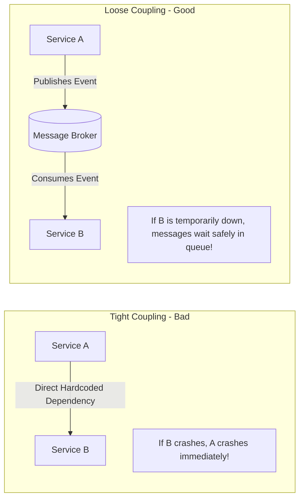

* **Tight Coupling:** Components know too much about each other. Modifying Service B breaks Service A.
* **Loose Coupling:** Components communicate through abstract contracts, APIs, or message brokers. Services can be replaced, updated, or rebooted without affecting others.

---

# 📘 PHASE 4: Database Fundamentals & Data Architecture

Data is the most valuable and difficult component to scale in high-level design.

---

## 4.1 — SQL vs NoSQL Databases

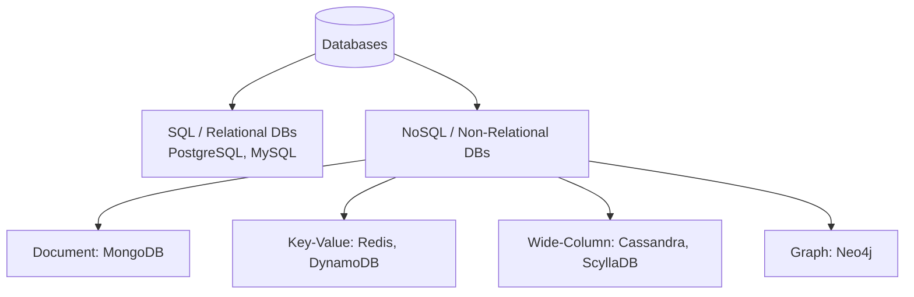

| Dimension | SQL (Relational) | NoSQL (Non-Relational) |
| :--- | :--- | :--- |
| **Data Schema** | Rigid, predefined schema (Tables, Rows, Columns) | Flexible, dynamic schema (JSON, Key-Value) |
| **Relationships** | First-class support via Foreign Keys & `JOIN`s | Denormalized data; joins avoided in application code |
| **Transactions** | Strong **ACID** guarantees | Typically **BASE** (Eventual consistency) |
| **Scaling** | Primarily Vertical (Bigger CPU/RAM); read replicas | Naturally Horizontal (Distributed sharding across nodes) |
| **Ideal Use Case** | Financial ledgers, ERP, E-commerce transactions | Clickstreams, IoT logs, Social feeds, Big Data |

---

## 4.2 — Transactions & ACID vs BASE

### The ACID Properties (The Bank Standard):
When transferring \$100 from Alice to Bob, both operations must succeed or both must fail:
* **A — Atomicity ("All or Nothing"):** If debiting Alice succeeds but crediting Bob fails, the whole transaction rolls back.
* **C — Consistency:** Database constraints (e.g. balance cannot be negative) are strictly enforced before and after the transaction.
* **I — Isolation:** Concurrent transactions do not interfere with each other (simulated sequential execution).
* **D — Durability:** Once committed, data survives power outages and hardware crashes.

### The BASE Properties (The Distributed Standard):
Used by massive distributed NoSQL systems (Amazon DynamoDB, Cassandra):
* **BA — Basically Available:** The system guarantees availability, answering requests even during node failures.
* **S — Soft State:** The state of data may change over time without user interaction due to background synchronization.
* **E — Eventual Consistency:** If no new updates are made, all replicas will eventually become identical.

---

## 4.3 — The CAP Theorem & PACELC

### The CAP Theorem:
In any distributed data store, you can only pick **two out of three** guarantees:

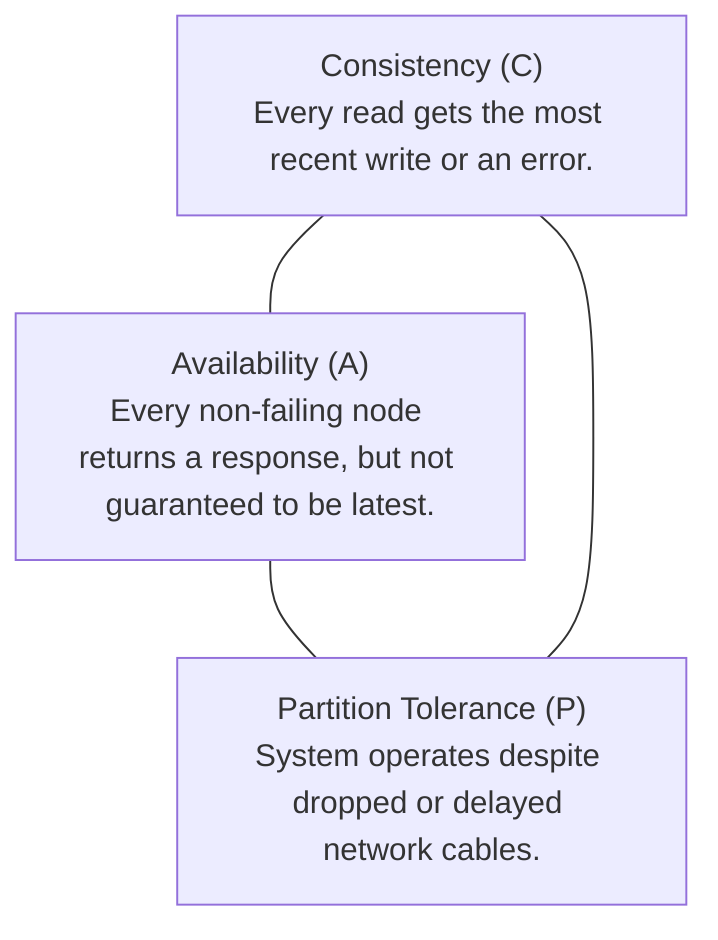

> [!IMPORTANT]
> **Network cables and switches will inevitably fail.** Therefore, **Partition Tolerance (P) is mandatory** in distributed systems. Your real-world choice is between **CP** and **AP**:
> * **CP (Consistency + Partition Tolerance):** The system blocks or rejects requests until nodes sync. (e.g., Banks, MongoDB, HBase).
> * **AP (Availability + Partition Tolerance):** The system always answers immediately using available local replica data, even if it is slightly stale. (e.g., Cassandra, CouchDB, DynamoDB).

### The PACELC Theorem (Extending CAP):
* **P-A / C:** If there is a **P**artition, trade off **A**vailability vs **C**onsistency.
* **E-L / C:** **E**lse (normal operation), trade off **L**atency vs **C**onsistency.

---

## 4.4 — Database Scaling: Replication & Sharding

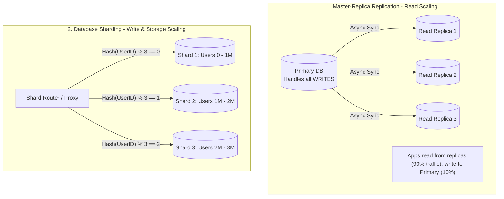

### 1. Database Replication
* Copies data across multiple servers.
* **Master-Replica (Primary-Secondary):** Writes go to Master, reads are distributed across Replicas.
* **Multi-Master:** Multiple servers accept writes (requires complex conflict resolution).

### 2. Database Sharding (Horizontal Partitioning)
* Splits one massive table across multiple independent physical machines.
* **Shard Key:** The column used to determine where a row lives (e.g. `user_id` or `country_code`).
* **Consistent Hashing:** Used to ensure that adding or removing a shard node only migrates $k/N$ keys rather than reshuffling the entire database!

---

# 📘 PHASE 5: Caching, CDN & Storage Systems

Caching stores hot data in fast volatile memory (RAM) to shield the slow persistent database from read traffic.

---

## 5.1 — Caching Fundamentals: Redis vs Memcached

```
Speed Hierarchy:
CPU L1 Cache:       ~0.5 ns
CPU L2/L3 Cache:    ~5 - 10 ns
RAM (Redis/Memcached): ~100 ns      <-- 100,000x faster than disk!
SSD (Flash Drive):  ~150,000 ns (0.15 ms)
HDD (Hard Disk):    ~10,000,000 ns (10 ms)
```

| Feature | Redis | Memcached |
| :--- | :--- | :--- |
| **Data Structures** | Strings, Lists, Sets, Hashes, Sorted Sets, Bitmaps | Simple Key-Value Strings only |
| **Persistence** | Yes (RDB snapshots & AOF write logs) | No (Pure in-memory, lost on reboot) |
| **Clustering** | Native Redis Cluster & Sentinel High-Availability | Client-side consistent hashing |
| **Multi-Threading** | Single-threaded event loop (I/O threads in v6+) | Native multi-threaded |
| **Best For** | Leaderboards, sessions, pub/sub, complex caching | Simple, massive object caching |

---

## 5.2 — Caching Strategies

Understanding how data moves between Client, App, Cache, and Database is a core HLD interview topic.

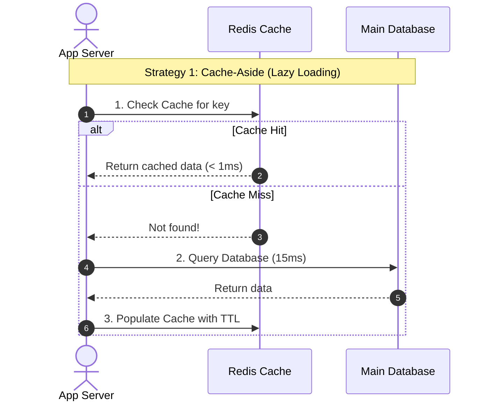

### Complete Strategy Comparison:

1. **Cache-Aside (Lazy Loading):**
   * The application is responsible for reading and writing to both cache and database.
   * *Pros:* Cache only contains data that is actually requested. Node failure does not crash the app (it falls back to DB).
   * *Cons:* Cache miss penalty on first read; potential stale data if DB is updated directly.

2. **Read-Through:**
   * The app treats the cache as the main data store. On miss, the **cache library itself** fetches from DB, saves, and returns.

3. **Write-Through:**
   * The app writes to the cache; the cache immediately writes synchronously to the DB before returning success.
   * *Pros:* Data is never stale.
   * *Cons:* Higher write latency (waits for both cache and DB write).

4. **Write-Back (Write-Behind):**
   * The app writes to the cache immediately; the cache acknowledges instantly and queues an asynchronous background batch write to the DB.
   * *Pros:* Blazing-fast write performance.
   * *Cons:* Risk of data loss if cache crashes before writing to disk.

5. **Write-Around:**
   * The app writes directly to the DB, bypassing the cache entirely. The cache is only populated on subsequent reads.

---

## 5.3 — Cache Eviction: LRU vs LFU & Invalidation

When cache RAM is full, what data gets kicked out?

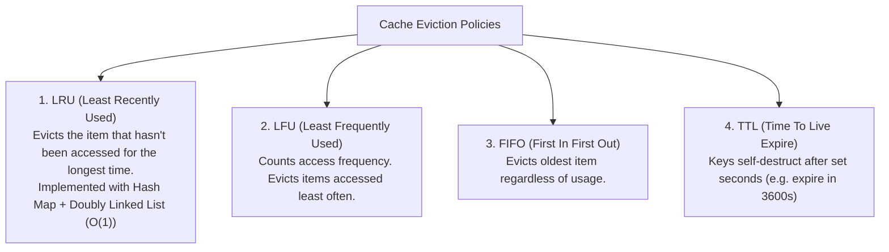

### Critical Cache Gotchas:
* **Cache Stampede (Dog-piling):** A hot key expires; 10,000 concurrent requests miss the cache at the exact same millisecond and bombard the DB simultaneously. *Fix: Mutex locks, pre-computation.*
* **Cache Avalanche:** Many cache keys expire at the exact same second. *Fix: Add random jitter to TTL (`TTL = 3600s + rand(0, 300s)`).*
* **Cache Penetration:** Attackers query keys that do not exist in DB or cache (e.g. `id = -999`), bypassing cache. *Fix: Cache empty/null results, use **Bloom Filters**.*

---

## 5.4 — CDN & Cloud Object Storage (S3)
* **Object Storage (Amazon S3, Google Cloud Storage):** Flat file storage designed for billions of unstructured files (photos, videos, backups). Accessed via HTTP REST APIs.
* **CDN (Content Delivery Network):** Edge proxies caching S3 static assets in hundreds of global cities close to users.

---

# 🟠 STAGE 3: ADVANCED — SCALABILITY & DISTRIBUTED SYSTEMS

---

# 📘 PHASE 6: Scalability & Performance Engineering

---

## 6.1 — Vertical vs Horizontal Scaling

```mermaid
graph LR
    subgraph Vertical [Vertical Scaling: Scale UP]
        V1["Upgrade 1 Computer\n- Add more CPU cores\n- Add more RAM\n- Hardware limits\n- Single Point of Failure (SPOF)"]
    end

    subgraph Horizontal [Horizontal Scaling: Scale OUT]
        H1["Add Multiple Commodity Nodes\n- Unlimited scale potential\n- Fault tolerant: if 1 server dies, 99 others run\n- Requires Load Balancer & Stateless apps"]
    end
```

---

## 6.2 — Latency vs Throughput (Performance Formulas)

* **Latency:** How *fast* a single packet or request completes its journey. Measured in milliseconds (ms).
* **Throughput:** How *much* work or how many requests the system processes per unit of time. Measured in Requests Per Second (RPS) or Queries Per Second (QPS).

### The Highway Analogy:
* **Latency = The Speed Limit.** (How long it takes 1 car to travel from City A to City B).
* **Throughput = The Number of Highway Lanes.** (How many cars can pass through the toll booth per minute).
* Adding more lanes (horizontal scaling) increases throughput, but does not increase the car's top speed (latency)!

### Little's Law:
$$L = \lambda \times W$$
* $L$ = Average number of concurrent requests in the system.
* $\lambda$ = Arrival rate (Throughput in Requests per Second).
* $W$ = Average response time (Latency in seconds).

---

## 6.3 — Load Balancing Deep Dive: L4 vs L7 & Algorithms

```mermaid
graph TD
    Client[Global Clients] --> LB[Load Balancer]

    subgraph Layer4 [Layer 4 Load Balancer: Transport Layer]
        L4["- Inspects only IP Address and TCP/UDP Port\n- Ultra fast packet-level forwarding\n- Cannot inspect HTTP URLs or headers\n- Examples: AWS NLB, IPVS"]
    end

    subgraph Layer7 [Layer 7 Load Balancer: Application Layer]
        L7["- Inspects HTTP Request Line, URL Path, Cookies, Headers\n- Intelligent routing: /images -> Static Cluster, /checkout -> Pay Cluster\n- SSL Termination & Cookie-based Sticky Sessions\n- Examples: AWS ALB, Nginx, Envoy, HAProxy"]
    end

    LB --> Layer4
    LB --> Layer7
```

### Load Balancing Routing Algorithms:

1. **Round Robin:** Sequentially routes request 1 to Server A, request 2 to Server B, request 3 to Server C.
2. **Weighted Round Robin:** Assigns higher request quotas to more powerful machines.
3. **Least Connections:** Forwards the new request to whichever server is currently handling the fewest active connections (ideal for long-lived WebSocket or database connections).
4. **IP Hash:** Hashes the client's IP address to ensure a user always hits the same backend server.
5. **Consistent Hashing (The Hash Ring):**
   * Maps both servers and request keys onto a virtual $360^\circ$ ring ($0$ to $2^{32}-1$).
   * A key is assigned to the first server encountered moving clockwise.
   * **Why it matters:** When a server is added or crashes, **only a fraction of keys ($1/N$) need to be moved**, preventing system-wide cache wipes!

```mermaid
graph TD
    subgraph HashRing [Consistent Hashing Ring: 0 to 2^32 - 1]
        Ring["(Server A: Angle 0°) ---> [Key 1] ---> [Key 2] --->\n(Server B: Angle 120°) ---> [Key 3] --->\n(Server C: Angle 240°) ---> [Key 4]"]
    end
```

---

## 6.4 — Reverse Proxy (Nginx / Envoy / HAProxy)

A **Reverse Proxy** sits directly in front of backend servers and shields them:

```mermaid
graph LR
    Internet((Internet)) --> Proxy[Reverse Proxy: Nginx]

    subgraph ProtectiveShield [Proxy Responsibilities]
        Proxy --> P1[SSL / TLS Termination]
        Proxy --> P2[Gzip / Brotli Response Compression]
        Proxy --> P3[Static Asset Caching]
        Proxy --> P4[DDoS Mitigation & IP Blacklisting]
    end

    Proxy --> InternalServers[Protected Private Backend Cluster]
```

---

# 🗺️ Upcoming Phases Overview (Phase 7 to Phase 12)

| Stage | Phase | Core Topics Covered |
| :--- | :--- | :--- |
| **Stage 3** | **Phase 7: Messaging & Event-Driven** | Apache Kafka, RabbitMQ, Pub/Sub, Producer/Consumer, Idempotency |
| **Stage 3** | **Phase 8: Reliability & Fault Tolerance** | Circuit Breaker, Retries with Exponential Backoff, Dead-Letter Queues |
| **Stage 4** | **Phase 9: Security & Identity** | JWT, OAuth 2.0, CORS, SQL Injection, Secrets Management |
| **Stage 4** | **Phase 10: Observability & DevOps** | Distributed Tracing, Prometheus, p99 Latency, SLA/SLO, Docker, K8s |
| **Stage 5** | **Phase 11: Advanced Architecture Patterns** | CQRS, Event Sourcing, Saga Pattern, Outbox Pattern, Strangler Fig |
| **Stage 6** | **Phase 12: Real-World Case Studies** | TinyURL, News Feed, Video Streaming, Payment Systems, Ticket Booking |
