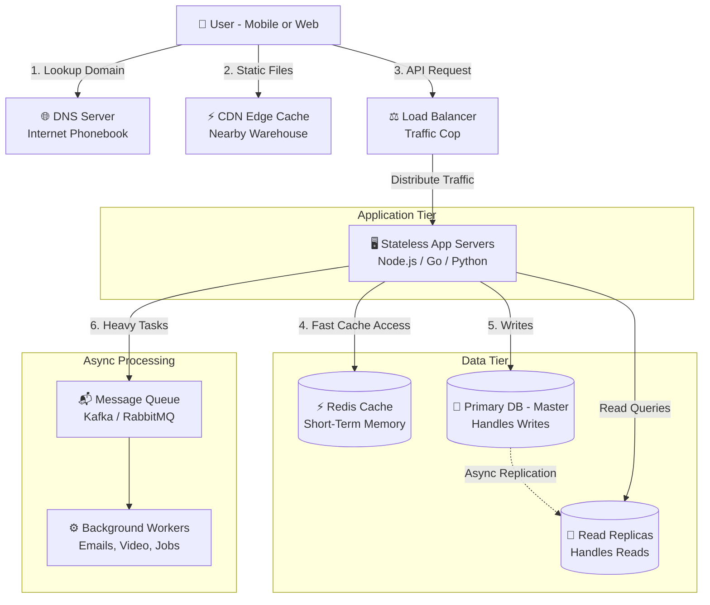
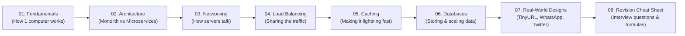

# High-Level Design (HLD) — Practical Engineering Guide

  
  
  

A clear, visual, and practical guide to **High-Level System Design (HLD)**. 

No confusing academic jargon or boring walls of text—just simple English explanations, clear diagrams, and practical knowledge of how massive systems (like Netflix, Instagram, and Uber) actually work and connect together.

---

## 💡 What is High-Level Design (In Simple English)?

Think of building a software system like building a large city:
* **Low-Level Design (LLD)** is like choosing the bricks, door hinges, and room paint (classes, variables, algorithms, data structures).
* **High-Level Design (HLD)** is the city master plan. It decides where the roads, power plants, water pipes, and bridges go (servers, databases, caches, and how they talk to each other).

> **The Goal of HLD:** Make sure your application stays **fast**, **reliable**, and **never crashes**—even when millions of people use it at the exact same second.

---

## 🌐 The Big Picture: How Everything Connects

Here is how all the pieces of a modern system connect when a user taps a button on their phone:

---

## 🧩 Each Component Explained Simply (And How They Connect)

Here is what each component does, explained in plain English:

* **1. User / Client (Mobile App or Browser)**
  * **What it is:** The device in the user's hand.
  * **How it connects:** It sends requests over the internet using protocols like HTTP/HTTPS or WebSockets.

* **2. DNS (Domain Name System) — "The Internet Phonebook"**
  * **What it is:** Translates human-friendly names (like `google.com`) into computer IP addresses (like `142.250.190.46`).
  * **How it connects:** Before your phone can send data to any server, it asks DNS: *"What is the IP address of this website?"*

* **3. CDN (Content Delivery Network) — "The Local Warehouse"**
  * **What it is:** A network of servers placed in hundreds of cities worldwide storing static files (images, videos, CSS, JavaScript).
  * **How it connects:** Sits between the user and your main servers. A user in Tokyo downloads images from a Tokyo CDN server in 5ms, instead of waiting 200ms to fetch it from a server in New York.

* **4. Load Balancer — "The Traffic Cop"**
  * **What it is:** A smart traffic distributor that spreads incoming requests evenly across multiple backend servers.
  * **How it connects:** Sits right in front of your app servers. If you have 3 servers, it gives request #1 to Server 1, request #2 to Server 2, and request #3 to Server 3. If Server 2 crashes, the Load Balancer instantly sends traffic only to Servers 1 and 3 so users never notice downtime.

* **5. Application Servers — "The Brain"**
  * **What it is:** The computers that run your actual code (Node.js, Go, Python, Java) and business logic.
  * **How it connects:** Receives clean requests from the load balancer, reads/writes data to the cache and database, and returns JSON responses.
  * **Golden Rule:** App servers must be **stateless** (they store no user sessions in their own memory). That way, any server can answer any request.

* **6. Cache (e.g., Redis) — "The Short-Term Memory"**
  * **What it is:** An ultra-fast data store that keeps popular data in computer RAM instead of on a slow hard drive.
  * **How it connects:** Sits right next to the app servers. When data is needed, the app checks Redis first (takes 1ms). If found (Cache Hit), it returns it immediately. If missing (Cache Miss), it reads from the database (takes 20ms) and saves a copy in Redis for next time.

* **7. Database (SQL / NoSQL) — "The Permanent File Cabinet"**
  * **What it is:** The durable storage on disk that keeps your accounts, passwords, orders, and financial records safe forever.
  * **How it connects:** Connected to the app servers. To prevent the database from slowing down:
    * **Read Replicas:** One Primary database handles writes (`INSERT`/`UPDATE`), and several copy databases handle reads (`SELECT`).
    * **Sharding:** If the data gets too big for one disk, it is split across multiple database machines (e.g., Users A–M on DB 1, Users N–Z on DB 2).

* **8. Message Queues (Kafka / RabbitMQ) — "The Post Office"**
  * **What it is:** A buffer that holds slow, background tasks so the user doesn't have to wait.
  * **How it connects:** Connected to background workers. For example, when you place an order, the app saves the order, drops a message into Kafka (*"Send receipt email"*), and instantly tells the user *"Order Placed!"* in 50ms. Background workers pick up the email task and send it a few seconds later.

---

## 🗺️ How This Repository Is Organized

This repository is split into 8 focused, hands-on modules. Here is how they connect into your learning journey:

---

## 📚 Complete Modular Curriculum

| Module | Title | What You Will Learn | Direct Link |
|:---:|---|---|:---:|
| **01** | **[Fundamentals](./01-fundamentals/README.md)** | Client-server model, life of a web request, single server limits, latency vs. throughput, and vertical vs. horizontal scaling. | [Explore Module ➡️](./01-fundamentals/README.md) |
| **02** | **[System Architecture](./02-architecture/README.md)** | Monolithic architecture, modular monoliths, N-tier layers, and when to break into microservices. | [Explore Module ➡️](./02-architecture/README.md) |
| **03** | **[Networking & APIs](./03-networking/README.md)** | REST APIs, high-speed gRPC (Protobuf), client-driven GraphQL, and real-time WebSockets. | [Explore Module ➡️](./03-networking/README.md) |
| **04** | **[Load Balancing](./04-load-balancing/README.md)** | Layer 4 vs. Layer 7 routing, Round Robin, Least Connections, and Consistent Hashing rings. | [Explore Module ➡️](./04-load-balancing/README.md) |
| **05** | **[Caching & Acceleration](./05-caching/README.md)** | Cache-Aside, Write-Through, LRU/LFU eviction, Redis vs. Memcached, and fixing cache stampedes. | [Explore Module ➡️](./05-caching/README.md) |
| **06** | **[Databases & Storage](./06-databases/README.md)** | Primary-replica replication, database sharding, the CAP theorem made simple, and ACID vs. BASE. | [Explore Module ➡️](./06-databases/README.md) |
| **07** | **[Real-World Case Studies](./07-system-design-examples/README.md)** | End-to-end designs for TinyURL, a Social Media Feed (Twitter/Insta), Real-Time Chat (WhatsApp), and scaling from 1 to 10M users. | [Explore Module ➡️](./07-system-design-examples/README.md) |
| **08** | **[Revision Cheat Sheet](./08-cheat-sheet/README.md)** | Rapid revision tables, essential latency numbers, capacity formulas, and top 20 interview Q&A. | [Explore Module ➡️](./08-cheat-sheet/README.md) |
| **⭐** | **[Complete Server Engineering Guide](./server.md)** | In-depth breakdown of server capacity, formulas, concurrency (epoll), k6 load testing, scaling to 10M DAU, and troubleshooting. | [Read Master Guide ➡️](./server.md) |

---

## 🎯 The 4 Golden Rules of System Design

Whenever you are designing any software system or answering an interview question, follow these 4 simple rules:

* **1. Keep It Simple (YAGNI — You Aren't Gonna Need It)**
  * Never add Kafka, microservices, or database sharding on Day 1 if a simple single database handles your users. Start simple, scale as you grow.
* **2. Keep App Servers Stateless**
  * Never store user login sessions in server memory. Store sessions in Redis or use JWT tokens. That way, any server can handle any request.
* **3. Eliminate Single Points of Failure (SPOF)**
  * Never rely on a single machine for anything critical. Always have at least 2 servers, a database replica, and redundant load balancers.
* **4. Assume Everything Will Eventually Fail**
  * Hard drives will crash, networks will drop packets, and servers will reboot. Design your software to retry gracefully, timeout quickly, and never freeze the entire system.

---

## 📋 The 5-Step System Design Interview Framework

When asked to design a system in an interview or at work, use this simple 5-step checklist:

* **Step 1: Clarify Requirements (5 mins)**
  * Ask questions: *Who is using this? What features are must-have? What is the scale (Daily Active Users, read-to-write ratio)?*
* **Step 2: Capacity Estimation (5 mins)**
  * Calculate rough numbers: *Requests per second (QPS), bandwidth needed, and 5-year storage size.*
* **Step 3: Draw High-Level Architecture (15 mins)**
  * Draw the end-to-end flow: `User -> DNS -> Load Balancer -> App Servers -> Cache -> Database`.
* **Step 4: Deep Dive Key Components (15 mins)**
  * Explain the tricky parts: *How does the cache stay fresh? What is the database shard key? How do we handle heavy spikes?*
* **Step 5: Identify Bottlenecks & Failure Modes (5 mins)**
  * Point out weak links: *What happens if the primary database dies? How do we monitor errors? Where are the single points of failure?*

---

> 🚀 **Ready to start?** Jump into **[Module 01: Fundamentals of System Design ➡️](./01-fundamentals/README.md)** or check out the **[Quick Revision Cheat Sheet ➡️](./08-cheat-sheet/quick-revision-cheat-sheet.md)**!
