# High-Level Design (HLD) — Practical Engineering Guide

<p align="center">
  
  
  
</p>
A clean, visual, and practical guide to **High-Level System Design (HLD)**. No boring walls of academic theory—just high-signal mental models, interactive diagrams, real-world FAANG architectures, and production trade-offs.

---

### Quick Navigation

| # | Topic | Core Focus |

|---|---|---|
| **01** | [What is High-Level Design?](#01-what-is-high-level-design) | The 30,000-ft view & core principles |
| **02** | [Life of a Web Request](#02-life-of-a-web-request) | End-to-end journey from click to database |
| **03** | [System Evolution (1 to 10M Users)](#03-system-evolution-1-to-10-million-users) | Step-by-step scaling roadmap with diagrams |
| **04** | [Scalability: Vertical vs. Horizontal](#04-scalability-vertical-vs-horizontal) | Scaling limits, statelessness, and concurrency |
| **05** | [Communication Protocols](#05-communication-protocols) | REST vs. gRPC vs. WebSockets vs. GraphQL |
| **06** | [Load Balancing & Proxies](#06-load-balancing-and-proxies) | Layer 4 vs. Layer 7, Consistent Hashing |
| **07** | [Caching & Edge Acceleration](#07-caching-and-edge-acceleration) | Cache-aside, Eviction (LRU), Stampede fixes, CDNs |
| **08** | [Databases: SQL vs. NoSQL & Scaling](#08-databases-sql-vs-nosql-and-scaling) | Indexes, Replication Lag, Partitioning & Sharding |
| **09** | [Distributed Guarantees: CAP Simplified](#09-distributed-guarantees-cap-simplified) | CP vs. AP in plain English (No academic jargon) |
| **10** | [Asynchronous Messaging & Streaming](#10-asynchronous-messaging-and-streaming) | RabbitMQ vs. Apache Kafka & Event-driven patterns |
| **11** | [Reliability & Rate Limiting](#11-reliability-and-rate-limiting) | Circuit Breakers, Token Bucket, Retries with Jitter |
| **12** | [The 10 Deadly Design Anti-Patterns](#12-the-10-deadly-system-design-anti-patterns) | What NOT to do in interviews and production |
| **13** | [Engineering Cheat Sheets](#13-quick-engineering-cheat-sheets) | Latency numbers & Back-of-the-envelope math |

---

# 01. What is High-Level Design?

**High-Level Design (HLD)** defines the overall architecture of a system: its services, data boundaries, communication protocols, and how it survives server failures and traffic surges.
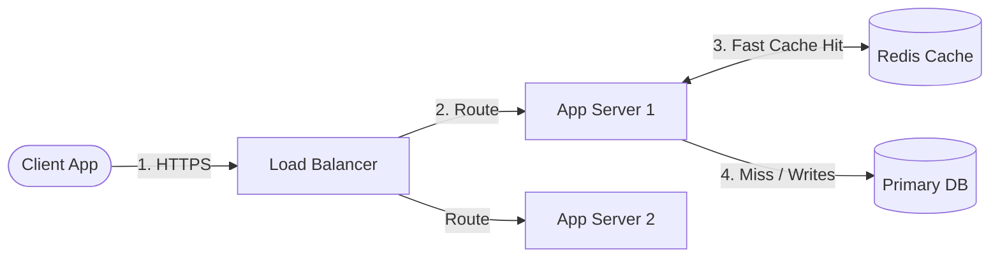

### Rule: The 4 Rules of Good System Design

1. **YAGNI (You Aren't Gonna Need It):** Never add Kafka, sharding, or Kubernetes on Day 1 if a single PostgreSQL instance handles your load.
2. **Stateless App Servers:** Store no sessions in server memory. Delegate state to Redis or the Database.
3. **Eliminate Single Points of Failure (SPOF):** Every critical component must have a fallback or replica.
4. **Design for Failure:** Disks will fill up, networks will drop packets, and servers will reboot. Your system must degrade gracefully.

---

# 02. Life of a Web Request

When a user visits `https://api.app.com/v1/feed`, here is the exact path the request takes:
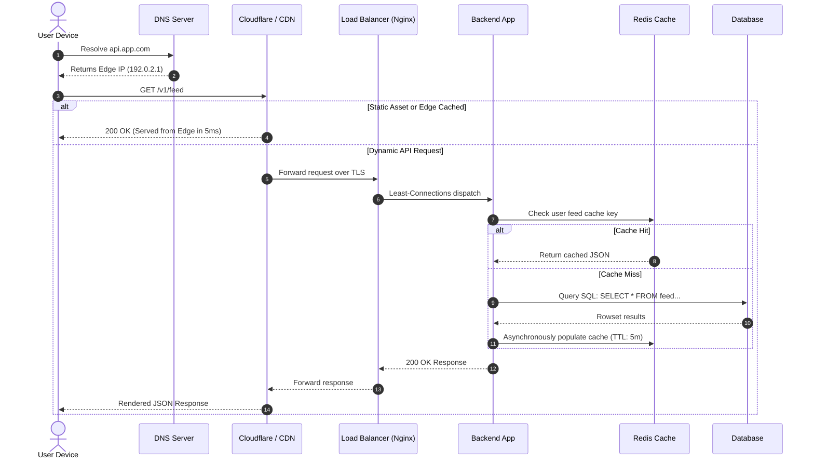

---

# 03. System Evolution (1 to 10 Million Users)

Systems are not designed for 10 million users overnight. They evolve in stages as traffic grows:

### Stage 1: The Monolith (1 – 1,000 Users)

Everything (Web Server, Business Logic, Database) lives on a single machine.
* **Good:** Fastest time to market, zero network latency between app and DB, trivial deployments.
* **Bottleneck:** If the server runs out of RAM or crashes, the entire business goes offline.
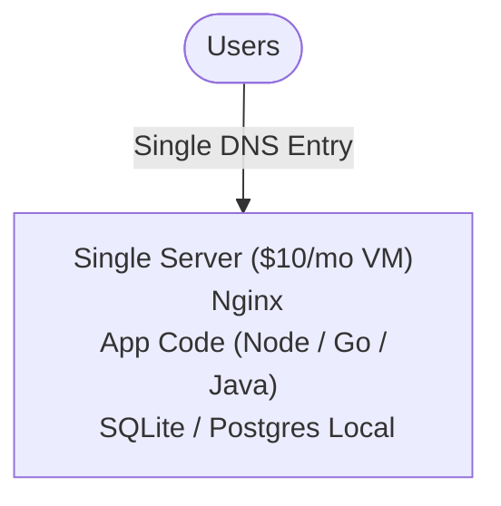

---

### Stage 2: Decouple the Database (1,000 – 50,000 Users)

Separate the App Server from the Database onto two distinct machines.
* **Why:** The app server is CPU-heavy; the database is RAM- and Disk-heavy. Giving each dedicated resources doubles your headroom immediately.
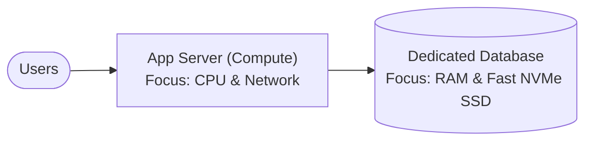

---

### Stage 3: Load Balancing & Horizontal Scaling (50k – 500k Users)

Make the App Server **stateless** and place a **Load Balancer** in front of multiple server instances.
* **Why:** If App Server A crashes, the Load Balancer routes traffic to Server B with zero downtime.
```mermaid
flowchart TD
    User([Users]) --> LB[Load Balancer (HAProxy / ALB)]
    LB --> App1[App Server 1]
    LB --> App2[App Server 2]
    LB --> App3[App Server 3]
    App1 & App2 & App3 --> DB[(Primary Database)]
```

---

### Stage 4: Caching & Read Replicas (500k – 2 Million Users)

Most apps have **90% Reads and 10% Writes**. Scaling the primary database directly is wasteful:
* **Redis Cache:** Put popular data in RAM (response time drops from 20ms to 1ms).
* **Read Replicas:** Primary DB handles `INSERT/UPDATE/DELETE`; Replicas handle `SELECT` queries.
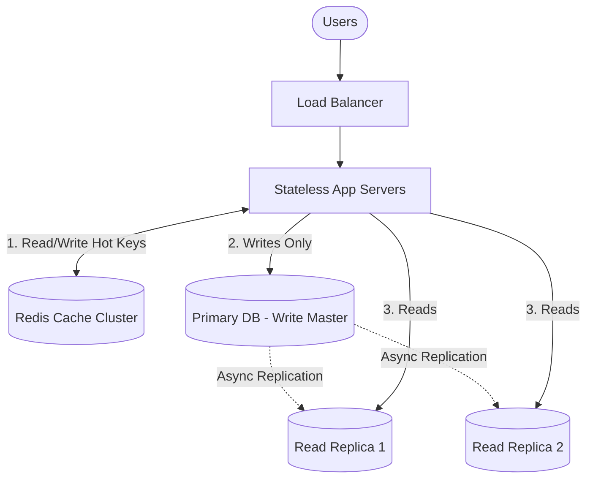

---

### Stage 5: Global Scale & Asynchronous Queues (2M – 10M+ Users)

* **CDN (Cloudflare/CloudFront):** Serves static files, images, and edge cache worldwide.
* **Message Queues (Kafka/RabbitMQ):** Offload heavy tasks (emails, notifications, analytics, video processing) to background workers.
* **Database Sharding:** Split rows across multiple database servers when a single disk cannot fit all data.
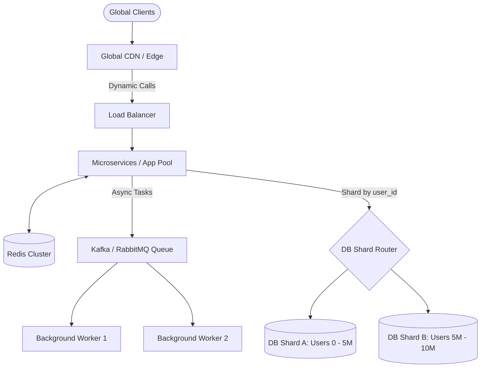

---

# 04. Scalability: Vertical vs. Horizontal

| Metric | Vertical Scaling (Scale Up) | Horizontal Scaling (Scale Out) |
|---|---|---|
| **What it means** | Buy a bigger machine (e.g. 128 vCPUs, 512GB RAM) | Add more small machines (e.g. 20x 4-vCPU VMs) |
| **Downtime** | Requires restart/downtime to resize instance | **Zero downtime**; dynamically add/remove nodes |
| **Cost Curve** | Becomes exponentially expensive at the high end | Linear and cost-effective (Commodity cloud hardware) |
| **Hard Limit** | Physical hardware ceiling (cannot exceed top AWS instance) | **Virtually unlimited** |
| **Architecture** | Simple (no code changes needed) | Requires stateless design + load balancers |
| **Single Point of Failure** | **Yes** (if the big machine dies, all dies) | **No** (redundancy built-in) |
> Rule: **Practical Rule:** Start with vertical scaling for your database until it costs too much or hits limits; scale your app servers horizontally from Day 1.

---

# 05. Communication Protocols

Choosing how services talk to each other directly impacts latency and simplicity:
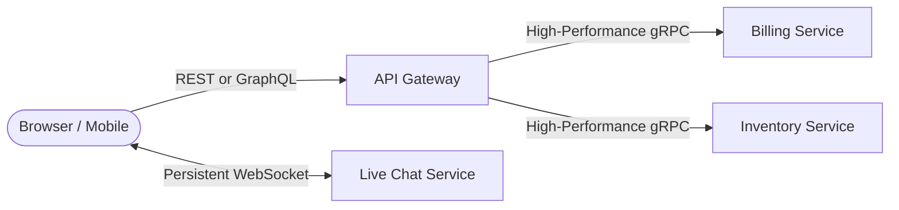

### Quick Protocol Decision Matrix

| Protocol | Transport | Best For | Pros | Cons |
|---|---|---|---|---|
| **REST** | HTTP/1.1 or HTTP/2 | Public Web APIs, CRUD | Universal, easy to debug, caching works out of the box | Over-fetching data, higher JSON overhead |
| **gRPC** | HTTP/2 + Protobuf | **Internal microservices** | 7-10x faster than REST, binary serialization, strict types | Hard to inspect in browser, binary payload |
| **WebSockets** | TCP (Full-duplex) | **Real-time apps** (Chat, Gaming, Stock tickers) | Bi-directional, single connection, zero polling overhead | Difficult to load-balance, stateful connections |
| **GraphQL** | HTTP (POST) | Complex mobile apps, multi-client UIs | Client requests exact fields needed, single endpoint | Complex server caching, N+1 query risks |

---

# 06. Load Balancing and Proxies

A **Load Balancer** sits between clients and backend servers to distribute incoming traffic, prevent hotspots, and failover when a server dies.

### Layer 4 vs. Layer 7 Load Balancing

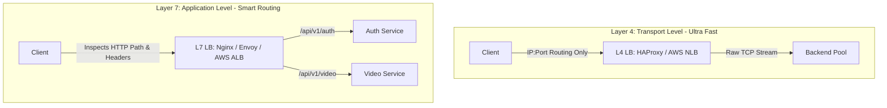
* **Layer 4 (Transport):** Operates on IP and TCP Port. Does not read HTTP headers or cookies. Super fast (millions of packets/sec).
* **Layer 7 (Application):** Decrypts TLS, inspects HTTP URLs, headers, and cookies. Can route `/users` to Server A and `/checkout` to Server B.

### Consistent Hashing (The Smart Hashing Algorithm)

Standard `hash(key) % N` breaks completely when a cache server is added or removed (almost every key moves, causing a 100% cache stampede).
* **Consistent Hashing Solution:** Arrange both servers and keys on a virtual ring ($0$ to $2^{32}-1$).
* When a node fails, **only $1/N$ of keys are remapped** to the next clockwise node!
* **Virtual Nodes:** Add 100–250 virtual positions per server to evenly balance data and prevent hotspots.
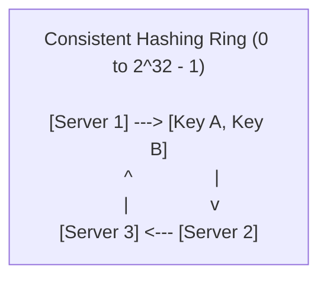

---

# 07. Caching and Edge Acceleration

Caching stores the results of expensive calculations or database queries in fast RAM.

### Core Caching Strategies

```mermaid
flowchart LR
    subgraph CacheAside [1. Cache-Aside / Lazy Loading (Most Popular)]
        direction TB
        App1[App] -->|1. Check Cache| C1[(Cache)]
        App1 -->|2. On Miss: Read DB| DB1[(Database)]
        App1 -->|3. Write Back to Cache| C1
    end
    subgraph WriteThrough [2. Write-Through (Consistent)]
        direction TB
        App2[App] -->|1. Write Data| C2[(Cache)]
        C2 -->|2. Synchronously Writes| DB2[(Database)]
    end
```
| Strategy | Read Path | Write Path | Best Used For |
|---|---|---|---|
| **Cache-Aside (Lazy)** | Check cache $\to$ If miss, read DB $\to$ Populate cache | Write directly to DB $\to$ Invalidate/evict cache key | General web apps (90% read workloads) |
| **Write-Through** | Read directly from cache | App writes to cache $\to$ Cache writes to DB synchronously | Systems where data loss is intolerable |
| **Write-Back (Write-Behind)** | Read from cache | App writes to cache $\to$ Asynchronously batched to DB | High write-volume apps (e.g., IoT, Game leaderboards) |

### Note: The 3 Classic Cache Gotchas & Fixes

1. **Cache Stampede (Thundering Herd):** A popular key expires. 10,000 requests hit the database simultaneously to recompute it.
   * *Fix:* Use a mutex/distributed lock (only 1 thread queries DB; others wait), or probabilistic early expiration (XFetch).
2. **Cache Penetration:** Attackers query keys that do not exist (e.g., `user_id = -9999`), bypassing cache and hitting DB every time.
   * *Fix:* Cache null values (`user:-9999 = null`, TTL 60s) or put a **Bloom Filter** in front of the cache.
3. **Cache Breakdown:** An ultra-hot key expires.
   * *Fix:* Set background cron jobs to refresh the key before its TTL expires.

---

# 08. Databases: SQL vs NoSQL and Scaling

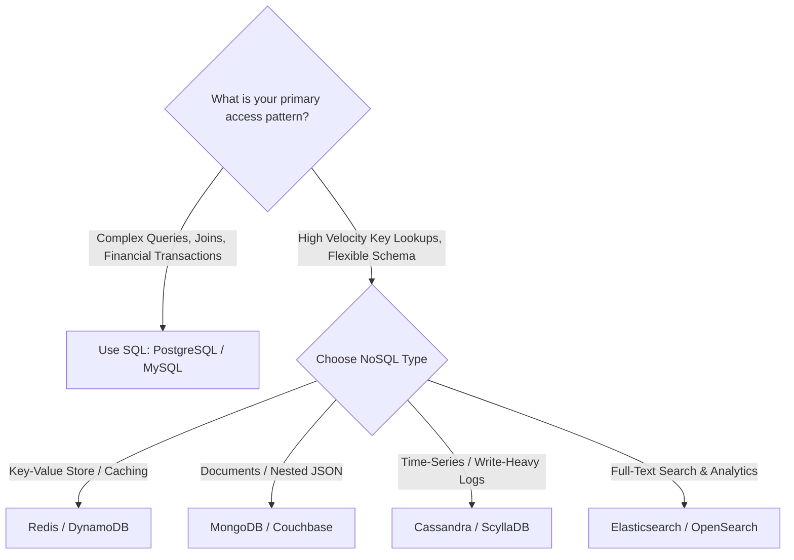

### Scaling the Database: Replication vs. Sharding

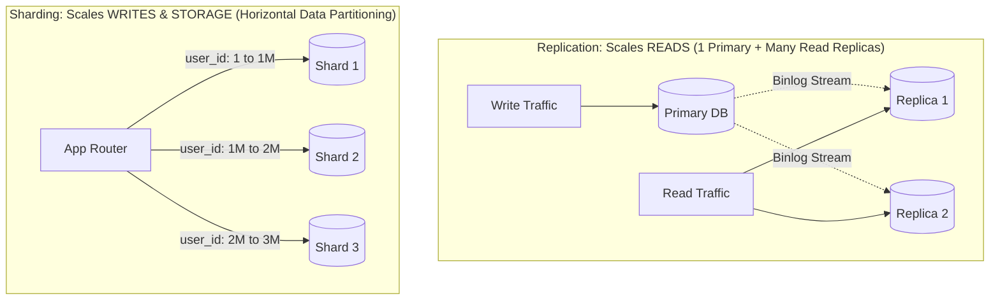
* **Replication:** Solves read bottlenecks. Write to Primary, read from Replicas.
  * *Watch out for:* **Replication Lag** (user updates profile, refreshes page, reads from stale replica, sees old data). Fix: Read user's own updates from Primary for 3 seconds.
* **Sharding:** Solves write and storage bottlenecks. Splits rows across physical machines using a **Shard Key**.
  * *Watch out for:* **Cross-shard joins** (avoid them by picking high-cardinality shard keys like `user_id`).

---

# 09. Distributed Guarantees: CAP Simplified

In a distributed network, **Network Partitions ($P$) are inevitable** (cables get cut, switches fail). When a partition occurs, you must choose:
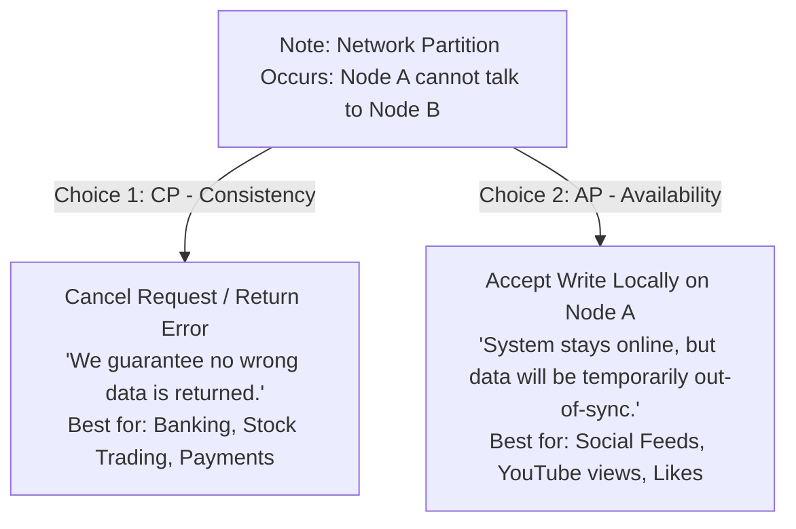
> Key Decision: **Key Rule:** You do NOT choose between C, A, and P. You **always have P**. Your architectural decision is **CP vs. AP**.

---

# 10. Asynchronous Messaging and Streaming

When an operation takes more than 100ms (sending emails, video encoding, push notifications), **never make the user wait on the HTTP request**. Offload it to a message broker.
```mermaid
flowchart LR
    User([User]) -->|POST /order/checkout| API[App Server]
    API -->|1. Save Order| DB[(DB)]
    API -->|2. Publish 'OrderPlaced' Event| Queue[Event Broker]
    API -->>|3. Instant 200 OK Response| User
    Queue -->|Consume| EmailWorker[Email Service]
    Queue -->|Consume| InventoryWorker[Inventory Service]
    Queue -->|Consume| FraudWorker[Fraud Detector]
```

### RabbitMQ vs. Apache Kafka

| Feature | RabbitMQ (Message Queue) | Apache Kafka (Event Streaming Log) |
|---|---|---|
| **Model** | Smart broker, dumb consumer (Queue disappears on ACK) | Dumb broker, smart consumer (**Append-only commit log**) |
| **Message Replay** | No (messages deleted after consumption) | **Yes** (consumers can replay events from 7 days ago) |
| **Throughput** | High (~50k - 100k msgs/sec) | **Extreme** (1M+ events/sec via batching and zero-copy) |
| **Ordering** | Per-queue | **Strictly ordered within a Partition** |
| **Best For** | Task queues, complex routing, background jobs | Event sourcing, clickstreams, distributed log pipeline |

---

# 11. Reliability and Rate Limiting

### The Circuit Breaker Pattern

Prevents a failing downstream service from cascading and taking down your entire backend.
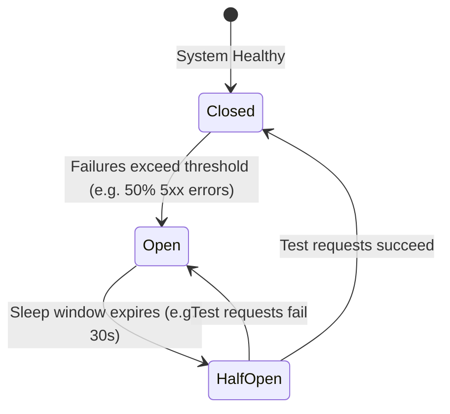
* **Closed:** Normal operation. Requests flow freely.
* **Open:** Service is down. Fails immediately without calling downstream service. Fallback executed.
* **Half-Open:** Allows a small test batch through. If they succeed, resumes normal operation.

### Rate Limiting Algorithms

| Algorithm | How it Works | Pros / Cons | Where Used |
|---|---|---|---|
| **Token Bucket** | Tokens refill at fixed rate; request consumes 1 token | Allows short bursts; memory-efficient | Stripe, GitHub API |
| **Leaky Bucket** | Requests enter queue; processed at strict constant rate | Smooths traffic bursts, prevents spikes | Traffic shaping, Nginx |
| **Sliding Window** | Tracks timestamps in a Redis sorted set | 100% accurate, no boundary spikes | Tiered user plans |

---

# 12. The 10 Deadly System Design Anti-Patterns

| # | Anti-Pattern | Why It Breaks in Production | Correct Pattern |

|---|---|---|---|
| **1** | **Scaling Without Measuring** | Adding microservices & Kafka for 50 requests/sec adds massive debugging pain | Measure with Prometheus/APM; optimize queries first |
| **2** | **Cache as Source of Truth** | Caches can evict or restart at any moment | Always persist canonical data to durable disk storage |
| **3** | **Writing to Read Replicas** | Desynchronizes replica state from primary | Strictly enforce `read-only = true` on all replica users |
| **4** | **Unbounded Database Queries** | `SELECT * FROM orders` crashes server memory when table reaches 1M rows | Always enforce `LIMIT` and pagination using Cursor keys |
| **5** | **No Connection Pooling** | Creating a new TCP + TLS database handshake on every HTTP request takes 50ms | Use PgBouncer / HikariCP to reuse connection pools |
| **6** | **Uncontrolled Retries** | When a database slows down, thousands of clients retry immediately, killing it | Always use **Exponential Backoff with Random Jitter** |
| **7** | **Non-Idempotent Payments** | A network timeout makes the user click "Pay" twice, charging them double | Pass an `Idempotency-Key` header with unique UUID |
| **8** | **Sharding Prematurely** | Sharding eliminates cross-table joins and makes migrations painful | Scale vertically, add read replicas, and index first |
| **9** | **Hardcoding Timeouts** | Missing timeouts cause hanging worker threads and thread pool exhaustion | Always set aggressive connection & read timeouts (e.g. 2s) |
| **10** | **Ignoring Failure Domains** | Placing all instances in `us-east-1a` means one datacenter outage kills your app | Always deploy across at least 3 Availability Zones |

---

# 13. Quick Engineering Cheat Sheets

### Latency Numbers to Memorize

```
Operation                                 Latency         Scale
L1 CPU Cache reference                    0.5 ns           Fast
Main Memory (RAM) reference               100 ns          (~200x slower than L1)
Read 1 MB sequentially from RAM           3,000 ns (3 µs)
Read 1 MB sequentially from NVMe SSD      25 µs           (8x slower than RAM)
Same Datacenter Network Round Trip        500 µs (0.5 ms)
Read 1 MB sequentially from Spinning Disk 1,000 µs (1 ms)
Cross-Country Network RTT (NY to LA)      40 ms           (80x slower than local DC)
Intercontinental RTT (US to Europe)       150 ms           Dominates latency!
```

### Fast Capacity Math Formulas

* **Seconds in a Day:** $24 \times 60 \times 60 \approx \mathbf{100,000 \text{ seconds}}$ *(Quick approximation)*
* **QPS Calculation:**
  $$\text{QPS} = \frac{\text{Daily Active Users} \times \text{Requests per User}}{100,000}$$
* **Peak QPS:** $\approx \text{Average QPS} \times 2$ (or $3$)
* **Storage for 5 Years:**
  $$\text{5-Year Storage} = \text{Daily Writes} \times \text{Size per Write} \times 365 \times 5$$
* **The 80/20 RAM Cache Rule:** 20% of your data generates 80% of read traffic. Size your Redis cluster to fit **20% of your daily read working set** in memory.

---

## Summary Checklist for Any System Design Interview

- [] **Step 1 (5 mins):** Clarify requirements, define Scope, and establish scale (DAU, Read:Write ratio).
- [] **Step 2 (5 mins):** Calculate back-of-the-envelope math (QPS, storage, bandwidth).
- [] **Step 3 (15 mins):** Draw the High-Level Architecture (Client $\to$ DNS $\to$ LB $\to$ Stateless App $\to$ Cache $\to$ DB).
- [] **Step 4 (15 mins):** Deep dive into bottlenecks (Caching strategy, Partitioning/Sharding, Concurrency, Failover).
- [] **Step 5 (5 mins):** Identify Single Points of Failure and discuss observability (Metrics, Alerting, Retries).

---

**Star  this repository** if you find it helpful for your system design interview prep and backend engineering work!
