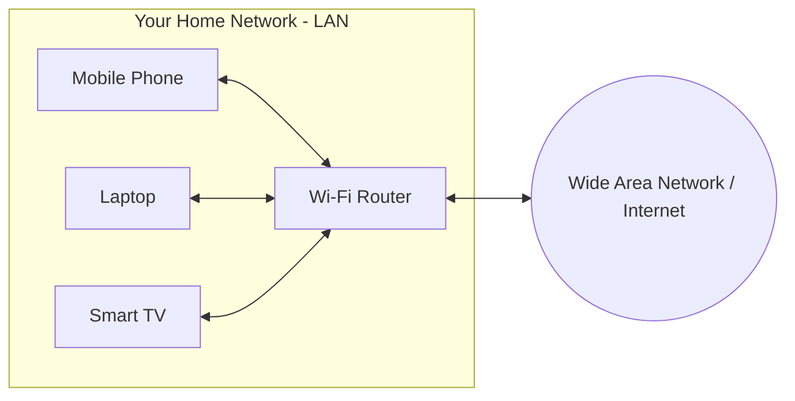
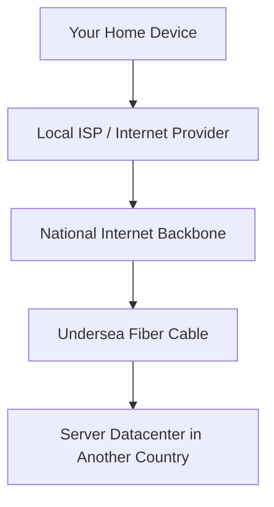
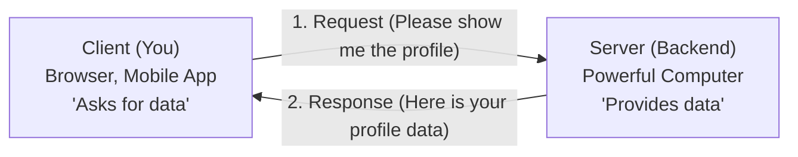
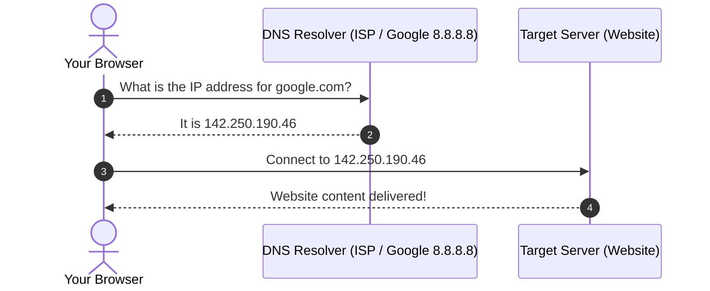
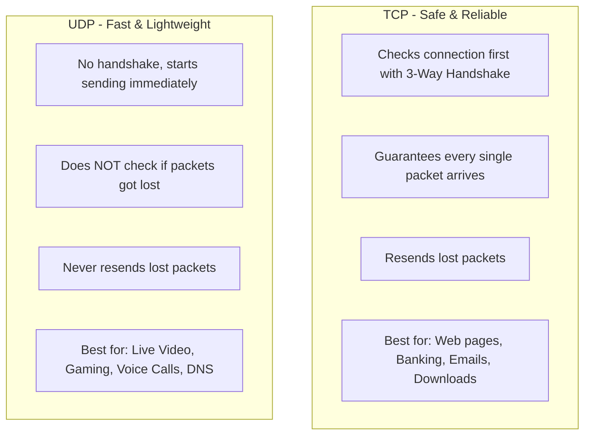
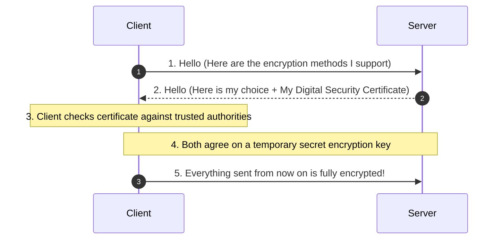
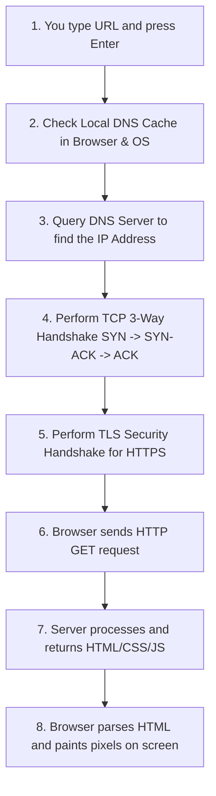
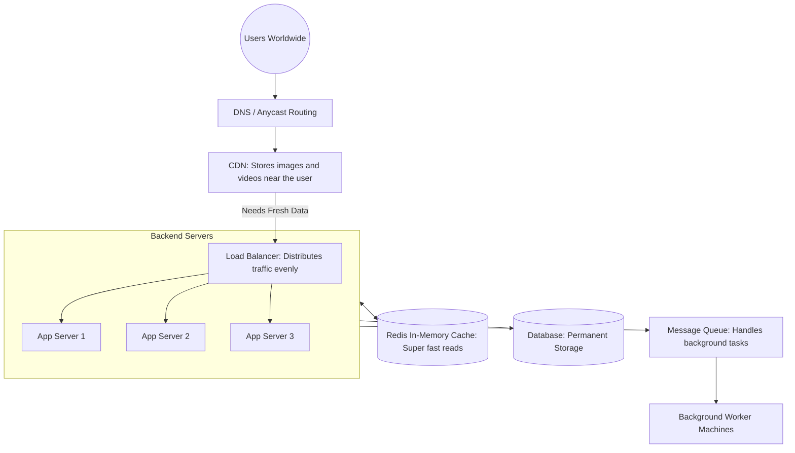
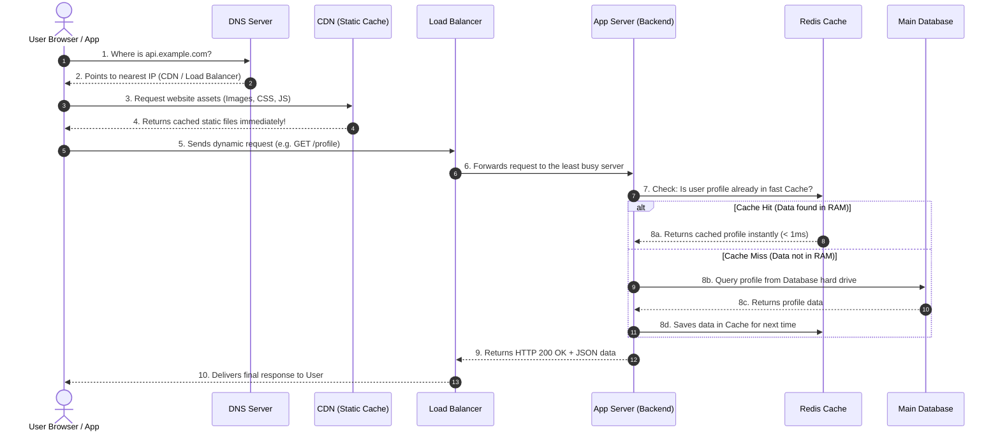

# 🌐 Stage 1: Networking & High-Level Design (HLD) Fundamentals
> A beginner-friendly guide to how the internet works, how computers talk to each other, and the core basics of High-Level System Design (HLD). Explained in simple English with clear diagrams.

---

## 📑 Table of Contents
- [1. Module 1.1 — Internet Basics](#1-module-11--internet-basics)
  - [1. What is a Network?](#1-what-is-a-network)
  - [2. What is the Internet?](#2-what-is-the-internet)
  - [3. Client and Server](#3-client-and-server)
  - [4. Client-Server Communication](#4-client-server-communication)
  - [5. IP Address (IPv4 and IPv6)](#5-ip-address-ipv4-and-ipv6)
  - [6. Port Numbers](#6-port-numbers)
  - [7. Domain Names](#7-domain-names)
  - [8. DNS (Domain Name System)](#8-dns-domain-name-system)
- [2. Module 1.2 — Web Communication](#2-module-12--web-communication)
  - [9. HTTP (HyperText Transfer Protocol)](#9-http-hypertext-transfer-protocol)
  - [10. HTTPS (Secure HTTP)](#10-https-secure-http)
  - [11. HTTP Request and Response](#11-http-request-and-response)
  - [12. URL vs URI](#12-url-vs-uri)
  - [13. TCP vs UDP](#13-tcp-vs-udp)
  - [14. Socket Types](#14-socket-types)
  - [15. TLS / SSL](#15-tls--ssl)
- [3. 🛠️ Practical Tasks](#3-practical-tasks)
  - [What Happens When You Type a URL in a Browser?](#what-happens-when-you-type-a-url-in-a-browser)
  - [Useful Network Commands (ping, tracert, nslookup, curl)](#useful-network-commands)
  - [Inspecting Network Requests in Browser DevTools](#inspecting-network-requests-in-browser-devtools)
- [4. 🏛️ High-Level Design (HLD) Basics](#4-high-level-design-hld-basics)
  - [What is HLD? (High-Level Design)](#what-is-hld-high-level-design)
  - [HLD vs LLD (The Difference)](#hld-vs-lld-the-difference)
  - [Core Building Blocks of System Design](#core-building-blocks-of-system-design)
  - [The Complete Request-Response Lifecycle in HLD](#the-complete-request-response-lifecycle-in-hld)
  - [Important Rules: CAP Theorem & Scaling](#important-rules-cap-theorem--scaling)
  - [How Networking Shapes High-Level Design](#how-networking-shapes-high-level-design)

---

# 1. Module 1.1 — Internet Basics

### 1. What is a Network?
A **network** is simply two or more computers connected together so they can share files, data, and hardware (like printers).

* **LAN (Local Area Network):** A small network inside a single home, school lab, or office.
* **WAN (Wide Area Network):** A large network that connects computers across cities or countries.



---

### 2. What is the Internet?
The **Internet** is a giant global network connecting millions of smaller networks together. 

* Think of your home network as a small house.
* The internet is the global system of highways, underwater fiber cables, and satellite links connecting all houses and cities across the entire world.



---

### 3. Client and Server
Every interaction on the web is between two sides: a **Client** and a **Server**.



* **Client:** The device or program you use (like Google Chrome, an iPhone app, or Spotify). It asks for information.
* **Server:** A computer located in a datacenter that runs 24/7. It waits for requests, processes business logic, and sends data back.

---

### 4. Client-Server Communication
How do the client and server talk? There are three common ways:

1. **Request-Response (Standard Web):** The client asks a question, the server answers, and the conversation is done. (Example: Loading a web page).
2. **Keep-Alive (Reusing Connection):** The client keeps the same connection open to ask multiple questions without starting from scratch each time.
3. **WebSockets (Real-time Chat):** Both client and server can send messages to each other at any time without waiting. (Example: WhatsApp or multiplayer games).

---

### 5. IP Address (IPv4 and IPv6)
An **IP Address** is like a home postal address, but for a computer on the internet. Without an IP address, computers wouldn't know where to send messages.

```
IPv4 Example:   192 . 168 . 1 . 1
                (Made of 4 numbers, total 32 bits. Limited to ~4.3 billion addresses)

IPv6 Example:   2001 : 0db8 : 85a3 : 0000 : 0000 : 8a2e : 0370 : 7334
                (Made of 8 hexadecimal parts, total 128 bits. Has virtually unlimited addresses)
```

* **IPv4:** The older format. The world ran out of free IPv4 addresses, which is why IPv6 was created.
* **IPv6:** The new format with enough unique addresses for every grain of sand on Earth.

---

### 6. Port Numbers
If the **IP address** is the address of an apartment building, the **Port Number** is the specific apartment room number.

A single computer can run multiple programs (like a website, an email server, and a database) all at the same time. Port numbers make sure the incoming data goes to the correct program.

```
Common Ports you should remember:
+--------+------------------------------------+
| Port   | Service / Program                  |
+--------+------------------------------------+
| 80     | HTTP (Normal unencrypted websites) |
| 443    | HTTPS (Secure encrypted websites)  |
| 22     | SSH (Remote server login)          |
| 53     | DNS (Domain name lookup)           |
| 3306   | MySQL Database                     |
| 6379   | Redis Cache                        |
| 8000   | Common local development server    |
+--------+------------------------------------+
```

---

### 7. Domain Names
Computers love numbers (`142.250.190.46`), but humans love friendly names (`google.com`). A **Domain Name** is the human-friendly name for a website.

```
Domain Anatomy:
      www  .  google  .  com
       |         |        |
   Subdomain    Name     Top-Level Domain (TLD)
```

---

### 8. DNS (Domain Name System)
**DNS** is the phonebook of the internet. It translates human names into computer IP addresses.



#### Common DNS Records:
* **A Record:** Points a name to an **IPv4** address (`mywebsite.com -> 93.184.216.34`).
* **AAAA Record:** Points a name to an **IPv6** address.
* **CNAME Record:** Points a nickname to another name (`blog.mywebsite.com -> mywebsite.com`).
* **MX Record:** Tells the internet where to send emails for that domain.

---

# 2. Module 1.2 — Web Communication

### 9. HTTP (HyperText Transfer Protocol)
**HTTP** is the rulebook that web browsers and backend servers use to speak to each other.
* It is text-based (you can read it with your eyes).
* It is **stateless**: each request is independent; the server doesn't remember who you were on the previous request unless you send an ID (like a cookie or token).

---

### 10. HTTPS (Secure HTTP)
**HTTPS** is HTTP with an encryption guard (**TLS/SSL**).
* In plain **HTTP**, anyone on your Wi-Fi network could sniff your password or credit card details.
* In **HTTPS**, all data is scrambled into secret code before leaving your computer. Only the destination server has the secret key to unlock it.

---

### 11. HTTP Request and Response

Every web interaction follows this two-part structure:

#### Part 1: The Request (Sent by your browser)
```http
GET /products HTTP/1.1
Host: myshop.com
User-Agent: Chrome
Accept: text/html
```
* **Method:** Action you want (`GET` = read data, `POST` = create data, `PUT` = update, `DELETE` = remove).
* **Path:** What resource you want (`/products`).
* **Headers:** Helpful extra details (like your browser type or language).

#### Part 2: The Response (Sent by the server)
```http
HTTP/1.1 200 OK
Content-Type: text/html
Content-Length: 120

<html><body><h1>Welcome to My Shop!</h1></body></html>
```
* **Status Code:** Result of the request:
  - `200 OK`: Everything worked fine!
  - `301 / 302`: Redirect (moved to a different link).
  - `400 Bad Request`: Client sent bad data.
  - `404 Not Found`: Page does not exist.
  - `500 Internal Server Error`: Server crashed or encountered a bug.

---

### 12. URL vs URI

* **URI (Uniform Resource Identifier):** An umbrella term for anything that identifies a resource.
* **URL (Uniform Resource Locator):** A specific type of URI that tells you **where** the resource is and **how** to get it (using `http://`, `https://`, `ftp://`).

```
                URI (The general idea: Identify something)
                                    |
      +-----------------------------+-----------------------------+
      |                                                           |
     URL (How to get it + Location)                 URN (Just a unique name)
https://example.com/books/page1                 urn:isbn:0451450523
```

---

### 13. TCP vs UDP

The internet uses two main transport styles to send packets:



---

### 14. Socket Types
A **Socket** is an internal software plug inside your operating system that code uses to read and write network data.

* **Stream Socket (`SOCK_STREAM`):** Uses **TCP**. Reliable, continuous stream of bytes.
* **Datagram Socket (`SOCK_DGRAM`):** Uses **UDP**. Sends individual, self-contained packets.
* **Raw Socket (`SOCK_RAW`):** Advanced socket that bypasses standard layers (used for building tools like `ping`).

---

### 15. TLS / SSL
**TLS (Transport Layer Security)** is the modern version of SSL. It creates a secure tunnel between client and server:



---

# 3. 🛠️ Practical Tasks

### What Happens When You Type a URL in a Browser?
Imagine you open Chrome and type `https://google.com` and press Enter:



---

### Useful Network Commands

Open your terminal (PowerShell or Command Prompt) and try these everyday diagnostic tools:

#### 1. `ping`
Tests whether a remote server is alive and measures the round-trip delay (latency):
```powershell
ping google.com
```

#### 2. `tracert` (Windows)
Shows every intermediate router (hop) your data passes through on its way to the destination:
```powershell
tracert google.com
```

#### 3. `nslookup`
Asks the DNS server what IP address belongs to a domain:
```powershell
nslookup google.com
```

#### 4. `curl`
Downloads and displays the raw HTTP response from a website right inside your terminal:
```powershell
curl -i https://httpbin.org/get
```

---

### Inspecting Network Requests in Browser DevTools
1. Open any browser (Chrome, Edge, Brave).
2. Press **`F12`** on your keyboard (or right-click $\rightarrow$ **Inspect**).
3. Click on the **Network** tab at the top.
4. Refresh the page (`Ctrl + R`).
5. You will see every single file your browser requested:
   * **Status:** (e.g., `200 OK` or `404 Not Found`).
   * **Headers:** Request headers and Response headers.
   * **Waterfall:** A visual bar showing how many milliseconds were spent on DNS Lookup, Connecting, and Downloading.

---

# 4. 🏛️ High-Level Design (HLD) Basics

### What is HLD? (High-Level Design)
When a system needs to serve millions of users without crashing, you cannot just run one computer with one database. 

**High-Level Design (HLD)** is the bird's-eye architectural blueprint of an entire software system. It describes:
* How different computers and services work together.
* Where data is stored.
* How traffic flows when millions of people log in at the same time.

---

### HLD vs LLD (The Difference)

* **HLD (High-Level Design):** Designing the whole city (where the bridges, highways, water pipes, and power plants go).
* **LLD (Low-Level Design):** Designing a specific room in a house (what classes, functions, variables, and design patterns are used inside the code).

| Question | High-Level Design (HLD) | Low-Level Design (LLD) |
| :--- | :--- | :--- |
| **Main Question** | "How do 10 million users stream videos smoothly?" | "How does the video player class validate authentication?" |
| **Scope** | Servers, Load Balancers, Databases, Caches | Functions, Classes, OOP Design Patterns |
| **Output** | Architecture Diagrams, Data Flow Charts | UML Class Diagrams, Code Structure |

---

### Core Building Blocks of System Design

Here is how modern large-scale applications (like Instagram, Netflix, or Uber) are built:



1. **CDN (Content Delivery Network):** Servers placed close to users in different cities so pictures and videos load instantly without traveling across the world.
2. **Load Balancer (Traffic Cop):** Sits in front of your servers and spreads incoming visitor traffic across multiple servers so no single machine gets overloaded.
3. **Stateless App Servers:** Web servers that do not store user sessions in local memory. If Server 1 dies, Server 2 immediately takes over without the user noticing.
4. **Cache (Redis / Memcached):** Ultra-fast temporary memory (RAM). Keeps popular answers ready so the slow database does not get asked the same question millions of times.
5. **Database (SQL / NoSQL):** The safe, permanent home for your data on hard drives.
6. **Message Queue (Kafka / RabbitMQ):** Holds slow jobs (like sending welcome emails or processing video uploads) so the user's web page responds instantly without waiting.

---

### The Complete Request-Response Lifecycle in HLD

Here is the exact journey of a single user request flowing through a full High-Level Design system:



---

### Important Rules: CAP Theorem & Scaling

#### 1. Vertical vs Horizontal Scaling
* **Vertical Scaling (Scale Up):** Buying a bigger, more expensive computer with more RAM and CPU. (Has a physical limit; when it crashes, everything crashes).
* **Horizontal Scaling (Scale Out):** Adding more ordinary computers in parallel. (No limit; if one computer dies, others keep working).

#### 2. The CAP Theorem
In any distributed system, when network cables or connections between servers fail (Partition), you must choose between:
* **Consistency (C):** Every user sees the exact same latest data immediately, or gets an error if servers cannot synchronize in time (e.g., Bank Account Balances).
* **Availability (A):** The system always answers every user immediately, even if the data is a few seconds old (e.g., Social Media Likes, YouTube view counts).

---

### How Networking Shapes High-Level Design

All big architecture decisions come directly from basic networking realities:

| Network Reality | Why It Shapes System Design |
| :--- | :--- |
| **TCP handshakes take time** | We use **Connection Pooling** so servers don't waste time repeating handshakes for every small request. |
| **Light takes time to travel across the earth** | We use **CDNs and Edge Caching** so content is stored physically close to the user's city. |
| **One server port cannot handle unlimited traffic** | We use **Load Balancers** to spread requests across hundreds of servers. |
| **Datacenters occasionally lose power or connectivity** | We use **DNS Geo-Routing** to instantly send traffic to a different datacenter in another region. |

---


