# 🚀 Complete System Design Roadmap: Beginner → Expert
> **171 Topics | 12 Phases | 6 Stages | Master High-Level Design (HLD)**
> *Explained in Simple English with Rich Visuals & Diagrams*

---

## 🗺️ Master Curriculum Tracker

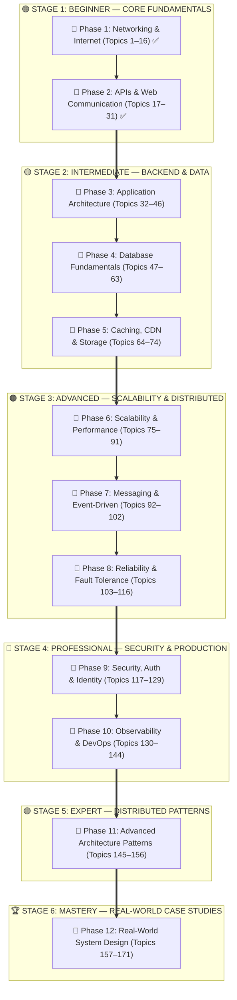

---

## 📑 Detailed Table of Contents

- [🟢 STAGE 1: BEGINNER — CORE FUNDAMENTALS](#-stage-1-beginner--core-fundamentals)
  - [📘 PHASE 1: Networking & Internet Fundamentals (Topics 1–16)](#-phase-1-networking--internet-fundamentals)
    - [1.1 — Network Basics](#11--network-basics)
      - [1. Network](#1-network)
      - [2. Internet](#2-internet)
      - [3. Client](#3-client)
      - [4. Server](#4-server)
      - [5. Client-Server Communication](#5-client-server-communication)
      - [6. IP Address (IPv4 and IPv6)](#6-ip-address-ipv4-and-ipv6)
      - [7. Port Numbers](#7-port-numbers)
      - [8. Domain Name](#8-domain-name)
      - [9. DNS (Domain Name System)](#9-dns-domain-name-system)
    - [1.2 — Internet Protocols](#12--internet-protocols)
      - [10. HTTP](#10-http)
      - [11. HTTPS](#11-https)
      - [12. HTTP Request and Response](#12-http-request-and-response)
      - [13. URL vs URI](#13-url-vs-uri)
      - [14. TCP vs UDP](#14-tcp-vs-udp)
      - [15. Socket Types](#15-socket-types)
      - [16. TLS/SSL](#16-tlsssl)
  - [📘 PHASE 2: APIs & Communication Fundamentals (Topics 17–31)](#-phase-2-apis--communication-fundamentals)
    - [2.1 — API Basics](#21--api-basics)
      - [17. API (Application Programming Interface)](#17-api-application-programming-interface)
      - [18. REST API](#18-rest-api)
      - [19. HTTP Methods (GET, POST, PUT, PATCH, DELETE)](#19-http-methods-get-post-put-patch-delete)
      - [20. HTTP Status Codes](#20-http-status-codes)
      - [21. Request Headers and Body](#21-request-headers-and-body)
      - [22. Response Headers and Body](#22-response-headers-and-body)
      - [23. JSON](#23-json)
    - [2.2 — API Processing](#22--api-processing)
      - [24. API Authentication](#24-api-authentication)
      - [25. Authorization](#25-authorization)
      - [26. Middleware](#26-middleware)
      - [27. API Gateway](#27-api-gateway)
    - [2.3 — Communication Protocols](#23--communication-protocols)
      - [28. WebSocket](#28-websocket)
      - [29. GraphQL](#29-graphql)
      - [30. gRPC](#30-grpc)
      - [31. Synchronous vs Asynchronous Communication](#31-synchronous-vs-asynchronous-communication)
- [🗺️ Upcoming Phases Overview (Phase 3 to Phase 12)](#️-upcoming-phases-overview-phase-3-to-phase-12)

---

# 🟢 STAGE 1: BEGINNER — CORE FUNDAMENTALS

---

# 📘 PHASE 1: Networking & Internet Fundamentals

Networking is the physical and logical highway of system design. Every request from an iPhone or browser travels across these layers.

---

## 1.1 — Network Basics

### 1. Network
A **Computer Network** is a group of two or more computing devices connected together by cables (fiber, Ethernet) or radio signals (Wi-Fi, 4G/5G) so they can share data, files, and resources.

* **LAN (Local Area Network):** Covers a small local area like your house, a classroom, or an office. Speeds are extremely fast (1 to 10 Gbps) and delay is less than 1 millisecond.
* **WAN (Wide Area Network):** Connects computers across different cities, countries, or continents. The Internet is the world's biggest WAN.

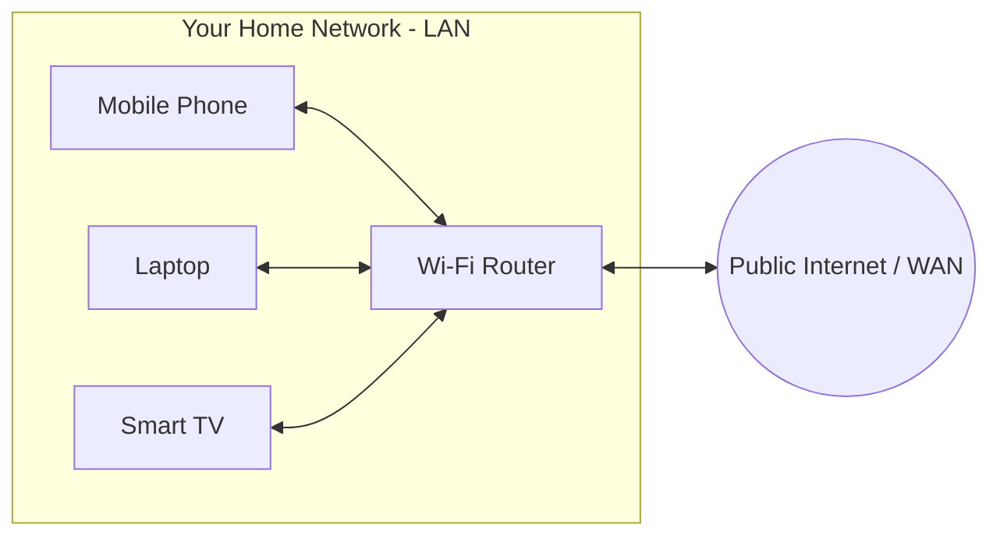

---

### 2. Internet
The **Internet** is a global "network of networks." It connects billions of private, corporate, university, and government networks together using the standardized **TCP/IP** rules.

* **Physical Reality:** Data travels across the planet through thick undersea fiber-optic cables resting on ocean floors.
* **Autonomous Systems (AS):** Huge tech networks (like Google, Cloudflare, Microsoft) connect to each other at Internet Exchange Points (IXPs) using a routing language called **BGP (Border Gateway Protocol)**.

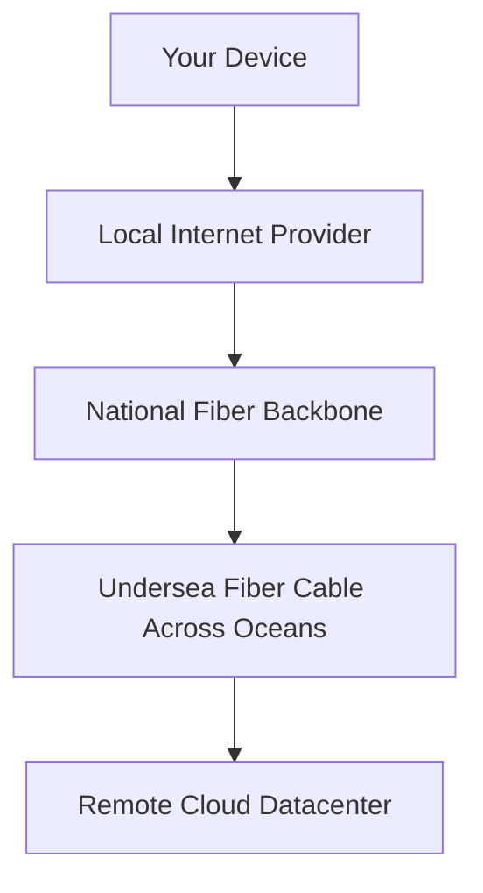

---

### 3. Client
A **Client** is the device or application that initiates a request for data or a service.
* Examples: Google Chrome, an iPhone running Instagram, Spotify desktop app, or a terminal running `curl`.
* **Behavior:** The client does not wait for incoming calls; it wakes up, creates an outbound request, receives the response, and renders it on your screen.

---

### 4. Server
A **Server** is a dedicated computer (or program) running continuously in a datacenter, listening for incoming client requests.
* **Behavior:** It sits passively on a fixed IP address and a specific **Port Number**. When an order arrives, it processes business logic, queries a database, and returns the result.

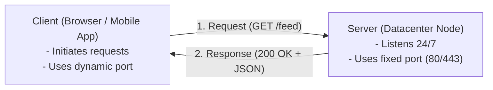

---

### 5. Client-Server Communication
How clients and servers exchange data:

1. **Request-Response (Half-Duplex):** Client sends a question, server sends an answer, connection closes or idles. Standard HTTP model.
2. **Persistent Connection (HTTP Keep-Alive):** Reuses the same underlying TCP connection for multiple back-to-back requests, avoiding repeated handshake delays.
3. **Full-Duplex (WebSockets):** A two-way open pipeline where both client and server can push messages at any split-second (used for chat and gaming).
4. **Server-Sent Events (SSE):** One-way stream where the server continuously pushes updates to the client over standard HTTP.

---

### 6. IP Address (IPv4 and IPv6)
An **IP (Internet Protocol) Address** is the digital address of any machine connected to a network.

```
IPv4: 192 . 168 . 1 . 100
      [8 bits].[8 bits].[8 bits].[8 bits] = 32 bits (~4.3 Billion total addresses)

IPv6: 2001 : 0db8 : 85a3 : 0000 : 0000 : 8a2e : 0370 : 7334
      8 groups of 16-bit hex numbers = 128 bits (~340 Undecillion addresses!)
```

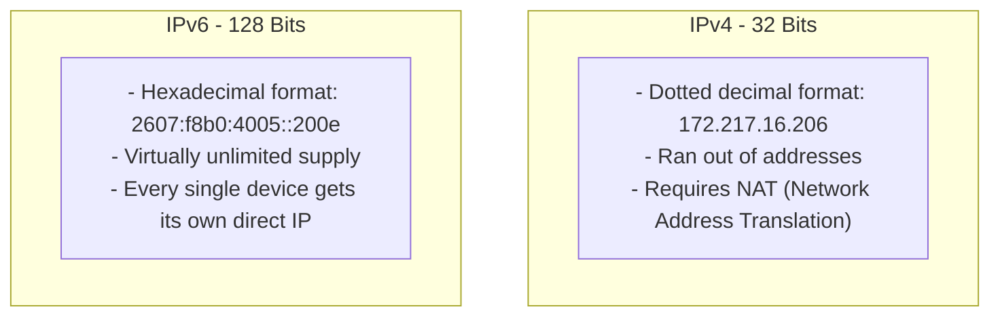

---

### 7. Port Numbers
If the **IP address** is the street address of an apartment building, the **Port Number** is the specific apartment room number.

A single computer can run a web server, a database, and an email service all at the same time. Port numbers make sure incoming packets reach the exact software process intended.

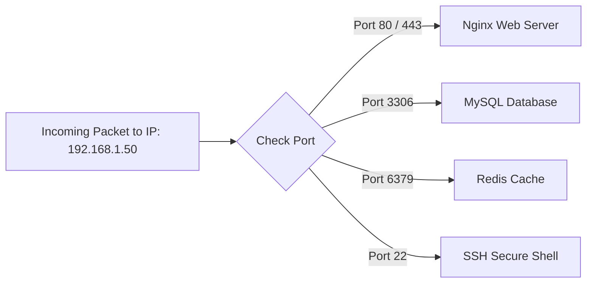

* **Well-Known Ports (0 – 1023):** System/root services (`80` HTTP, `443` HTTPS, `22` SSH, `53` DNS).
* **Registered Ports (1024 – 49151):** Specific software (`3306` MySQL, `5432` Postgres, `6379` Redis, `8080` Dev).
* **Ephemeral / Dynamic Ports (49152 – 65535):** Temporary outgoing ports picked automatically by client operating systems.

---

### 8. Domain Name
A **Domain Name** is a friendly, memorable nickname for a numeric IP address.
* Example: `api.store.example.com`

```
Anatomy of a Domain:
    api    .    store    .    example    .    com    .
     ^            ^              ^             ^     ^
     |            |              |             |     +-- Root Domain (implicit)
     |            |              |             +-------- Top-Level Domain (TLD)
     |            |              +---------------------- Second-Level Domain
     |            +------------------------------------- Subdomain
     +-------------------------------------------------- Host / Service
```

---

### 9. DNS (Domain Name System)
DNS is the **Phonebook of the Internet**. It translates human words (`google.com`) into computer numbers (`142.250.190.46`).

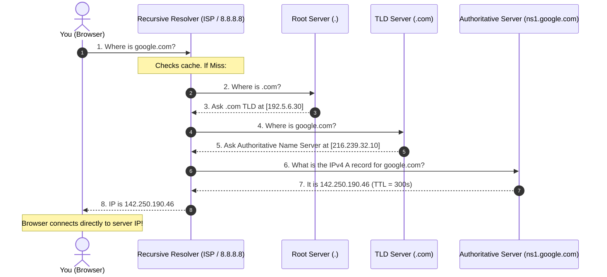

#### Important DNS Record Types:
* **A Record:** Maps a domain name to an **IPv4** address.
* **AAAA Record:** Maps a domain name to an **IPv6** address.
* **CNAME (Canonical Name):** Maps an alias name to another domain name (`www.example.com` $\rightarrow$ `example.com`).
* **MX (Mail Exchange):** Directs incoming emails to mail servers.
* **TTL (Time to Live):** Number of seconds a DNS answer can be saved in cache before asking again.

---

## 1.2 — Internet Protocols

---

### 10. HTTP (HyperText Transfer Protocol)
**HTTP** is the universal protocol of the World Wide Web.
* Operates at the **Application Layer (Layer 7)**.
* Text-based, human-readable, and stateless.
* **HTTP/1.1:** Introduced persistent connections (`Connection: keep-alive`).
* **HTTP/2:** Introduced binary framing and multiplexing (multiple requests over one single connection).
* **HTTP/3:** Replaced TCP with **QUIC (running over UDP)** to eliminate Head-of-Line packet blocking.

---

### 11. HTTPS (Secure HTTP)
$$\text{HTTPS} = \text{HTTP} + \text{TLS Encryption}$$

* In plain HTTP, any attacker on your Wi-Fi router can read your passwords, cookies, and tokens.
* In HTTPS, every character is encrypted using math before it leaves your device.
* **Three Guarantees:**
  1. **Confidentiality:** No eavesdropping.
  2. **Integrity:** Packets cannot be modified in transit.
  3. **Authentication:** Proves you are talking to the real server, not an imposter.

---

### 12. HTTP Request and Response

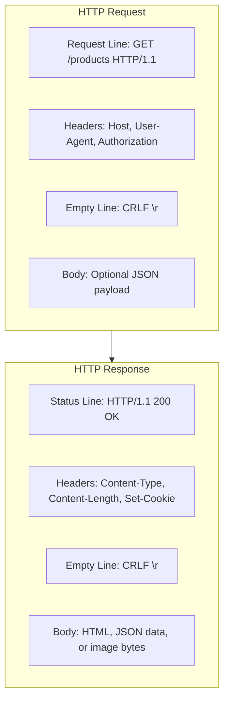

---

### 13. URL vs URI

```
                   URI (Uniform Resource Identifier)
                   [Identifies ANY resource by name or location]
                                    |
      +-----------------------------+-----------------------------+
      |                                                           |
     URL (Uniform Resource Locator)                  URN (Uniform Resource Name)
    [Tells WHAT and HOW to find it]                  [Identifies purely by name]
https://example.com/books/index.html                     urn:isbn:0451450523
```

---

### 14. TCP vs UDP

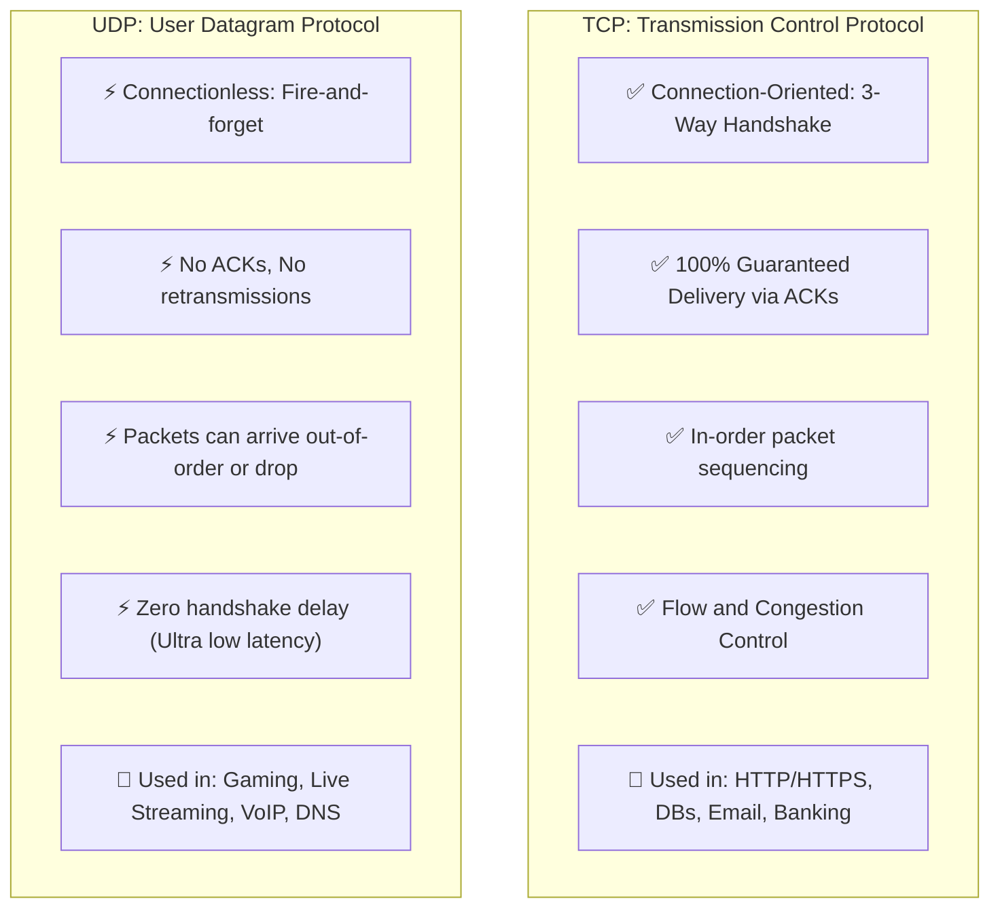

#### The TCP 3-Way Handshake:
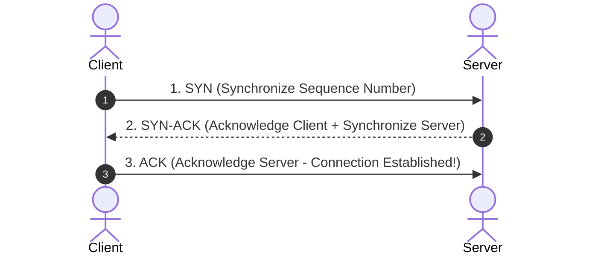

---

### 15. Socket Types
A **Socket** is an endpoint created by the operating system for network input/output:
* **Stream Sockets (`SOCK_STREAM` / TCP):** Continuous, reliable, two-way byte stream.
* **Datagram Sockets (`SOCK_DGRAM` / UDP):** Independent, bounded packets with no connection state.
* **Raw Sockets (`SOCK_RAW`):** Bypasses transport layer to craft raw IP packets directly (used by `ping` for ICMP).

---

### 16. TLS/SSL
**TLS (Transport Layer Security)** is the cryptographic protocol powering HTTPS.

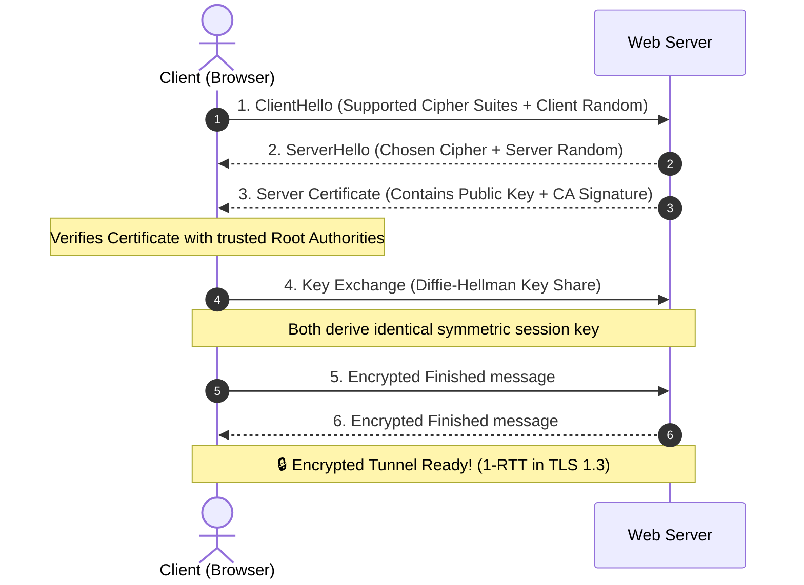

---

# 📘 PHASE 2: APIs & Communication Fundamentals

APIs are the contracts through which software components talk to each other in modern distributed systems.

---

## 2.1 — API Basics

### 17. API (Application Programming Interface)
An **API** is a software contract. It defines the operations, inputs, outputs, and data formats one program allows other programs to use without exposing its internal code.

* **The Restaurant Analogy:**
  - You = Client
  - Kitchen = Backend Database & Business Logic
  - Waiter = **API** (takes your order menu request to the kitchen, brings back your food response)

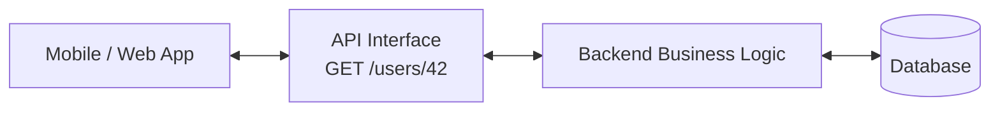

---

### 18. REST API (Representational State Transfer)
**REST** is an architectural style designed around **Resources** identified by URLs.

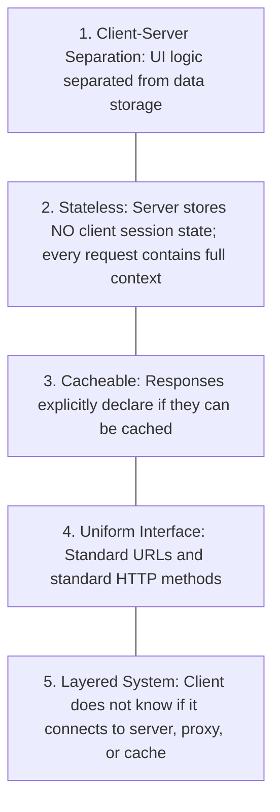

---

### 19. HTTP Methods (GET, POST, PUT, PATCH, DELETE)

| Method | Purpose | Typical URL | Has Body? | Idempotent? | Safe? |
| :--- | :--- | :--- | :--- | :--- | :--- |
| **GET** | Read/Fetch data | `/api/users/42` | No | ✅ Yes | ✅ Yes |
| **POST** | Create new resource | `/api/users` | ✅ Yes | ❌ No | ❌ No |
| **PUT** | Replace entire resource | `/api/users/42` | ✅ Yes | ✅ Yes | ❌ No |
| **PATCH** | Partially update resource | `/api/users/42` | ✅ Yes | ❌ No | ❌ No |
| **DELETE** | Remove resource | `/api/users/42` | No | ✅ Yes | ❌ No |

* **Idempotent:** Calling the exact same request 1 time or 100 times results in the exact same server state.

---

### 20. HTTP Status Codes

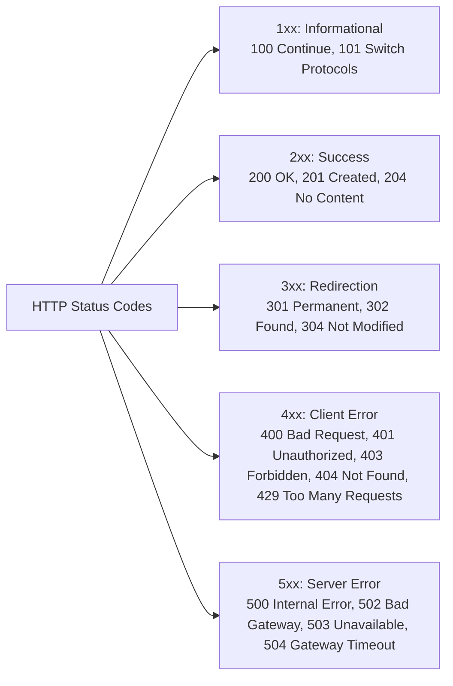

---

### 21. Request Headers and Body
* **Request Headers:** Metadata describing the client and payload format.
  - `Host: api.example.com`
  - `Content-Type: application/json`
  - `Authorization: Bearer <token>`
  - `Accept: application/json`
* **Request Body:** The actual data payload sent to the server (common in `POST`, `PUT`, `PATCH`).

```http
POST /api/v1/orders HTTP/1.1
Host: store.example.com
Authorization: Bearer eyJhbGciOi...
Content-Type: application/json

{
  "item_id": 1042,
  "quantity": 2,
  "shipping_address": "456 Silicon Ave"
}
```

---

### 22. Response Headers and Body
* **Response Headers:** Metadata sent back by the server.
  - `Content-Type: application/json`
  - `Content-Length: 128`
  - `Cache-Control: max-age=3600`
  - `Set-Cookie: session_id=xyz; Secure; HttpOnly`
* **Response Body:** The data payload returned to the client (JSON, HTML, XML, or binary).

```http
HTTP/1.1 201 Created
Content-Type: application/json
Date: Tue, 27 Oct 2026 14:00:00 GMT

{
  "order_id": "ORD-9981",
  "status": "confirmed",
  "estimated_delivery": "2026-10-30"
}
```

---

### 23. JSON (JavaScript Object Notation)
**JSON** is the lightweight, universal, human-readable text standard for exchanging structured data over web APIs.

```json
{
  "id": 101,
  "name": "Sujal",
  "is_admin": true,
  "roles": ["developer", "architect"],
  "profile": {
    "city": "Dehradun",
    "country": "India"
  }
}
```
* **Supported Data Types:** String, Number, Boolean (`true`/`false`), Array (`[...]`), Object (`{...}`), and `null`.
* Replaced verbose XML due to smaller payload size, zero parsing complexity, and native JavaScript support.

---

## 2.2 — API Processing

---

### 24. API Authentication
**Authentication** answers: *"Who are you?"* It verifies the caller's identity.

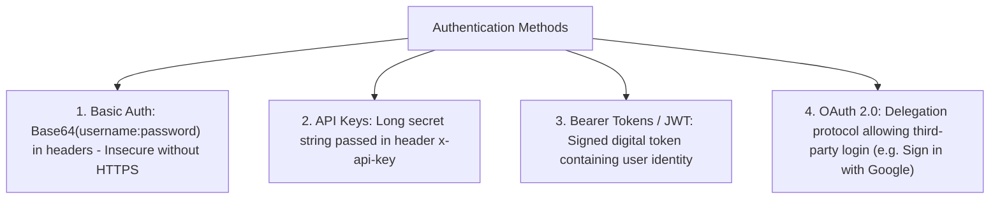

---

### 25. Authorization
**Authorization** answers: *"What are you allowed to do?"* It enforces permissions after identity is confirmed.

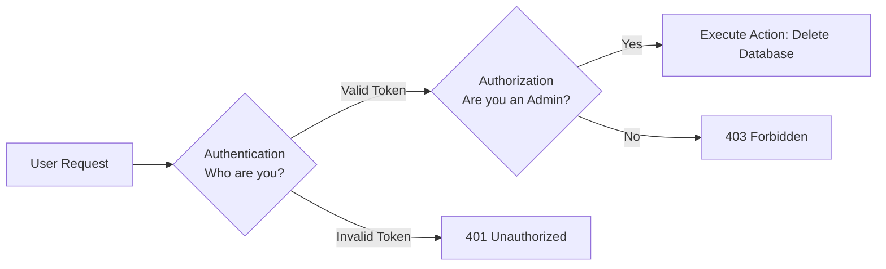

* **401 Unauthorized:** You did not provide valid credentials (Authentication failed).
* **403 Forbidden:** The server knows who you are, but you do not have permission (Authorization failed).

---

### 26. Middleware
**Middleware** is a chain of processing functions that inspect, alter, or block incoming requests before they reach your main business logic handler.

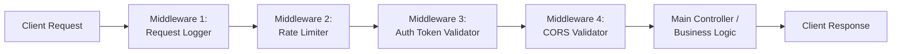

---

### 27. API Gateway
An **API Gateway** is a single, centralized reverse proxy that sits in front of all internal microservices.

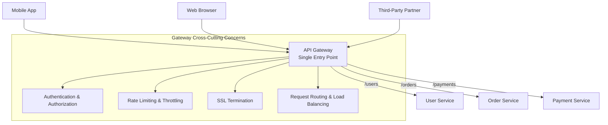

---

## 2.3 — Communication Protocols

---

### 28. WebSocket
**WebSocket** is a computer communications protocol providing **full-duplex, bidirectional, persistent communication** over a single TCP connection.

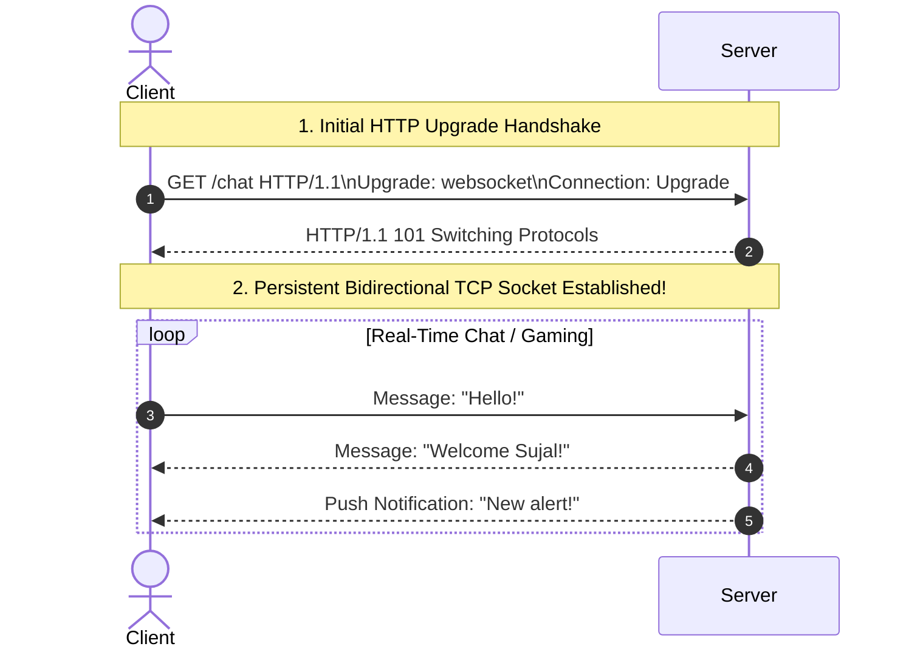

| Feature | HTTP Polling | WebSocket |
| :--- | :--- | :--- |
| **Connection** | Opens new connection repeatedly | Keeps single connection open |
| **Direction** | Client $\rightarrow$ Server only | Bidirectional (Both can send anytime) |
| **Header Overhead** | ~1 KB on every request | 2 to 10 bytes per frame |
| **Latency** | High | Ultra Low (< 5ms) |

---

### 29. GraphQL
Created by Facebook. Unlike REST (which forces you to fetch fixed data from multiple endpoints), **GraphQL** uses a single endpoint (`POST /graphql`) and lets the client specify the exact fields it needs.

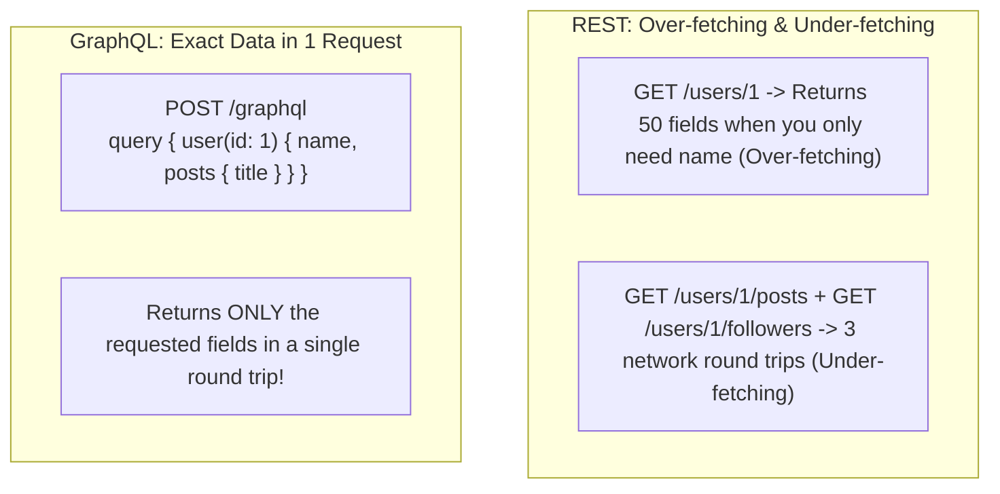

---

### 30. gRPC (Google Remote Procedure Call)
**gRPC** is an open-source, high-performance remote procedure call framework developed by Google.
* Uses **HTTP/2** for multiplexed streaming.
* Uses **Protocol Buffers (Protobuf)** instead of JSON for compact, binary serialization (up to 7x–10x faster than JSON).
* Universally chosen for high-speed **service-to-service communication** inside microservice clusters.

```mermaid
graph LR
    subgraph JSON_REST [Standard REST over HTTP/1.1]
        C1[Client] -- Heavy Plaintext JSON: 500 bytes --> S1[Server]
    end

    subgraph gRPC_Protobuf [gRPC over HTTP/2]
        C2[Microservice A] -- Compact Binary Protobuf: 60 bytes --> S2[Microservice B]
    end
```

---

### 31. Synchronous vs Asynchronous Communication

```mermaid
sequenceDiagram
    autonumber
    actor Client
    participant ServiceA as Service A
    participant Queue as Message Queue / Service B

    Note over Client,ServiceA: Synchronous (Blocking)
    Client->>ServiceA: 1. Request: Process Payment
    Note over ServiceA: Service A waits and blocks execution...
    ServiceA-->>Client: 2. Response: Done! (Client blocked during wait)

    Note over Client,Queue: Asynchronous (Non-Blocking)
    Client->>ServiceA: 3. Request: Generate Video Report
    ServiceA->>Queue: 4. Push Task to Background Queue
    ServiceA-->>Client: 5. 202 Accepted: "We are processing it, here is job ID #88"
    Note over Client: Client continues working immediately!
    Queue-->>Client: 6. Webhook / Notification pushes result when finished
```

| Dimension | Synchronous Communication | Asynchronous Communication |
| :--- | :--- | :--- |
| **Execution** | Caller blocks and waits for response | Caller continues immediately |
| **Coupling** | Tight coupling (both services must be online) | Loose coupling (broker buffers messages) |
| **Protocols** | HTTP/REST, gRPC | Kafka, RabbitMQ, AWS SQS |
| **Best For** | User login, balance checks | Video processing, order confirmation emails |

---

# 🗺️ Upcoming Phases Overview (Phase 3 to Phase 12)

| Stage | Phase | Core Topics Covered |
| :--- | :--- | :--- |
| **Stage 2** | **Phase 3: Application Architecture** | Monoliths, Microservices, N-Tier, SOA, Serverless, Coupling |
| **Stage 2** | **Phase 4: Database Architecture** | SQL vs NoSQL, Indexing, Transactions, ACID, Sharding, Replication |
| **Stage 2** | **Phase 5: Caching & Storage** | Redis, Cache Invalidation, CDNs, Object Storage, S3 |
| **Stage 3** | **Phase 6: Scalability & Performance** | Vertical/Horizontal, L4/L7 Load Balancers, Latency, RPS, Bottlenecks |
| **Stage 3** | **Phase 7: Messaging & Event-Driven** | Kafka, RabbitMQ, Pub/Sub, Idempotency, Eventual Consistency |
| **Stage 3** | **Phase 8: Reliability & Fault Tolerance** | Circuit Breakers, Retries, Exponential Backoff, Dead-Letter Queues |
| **Stage 4** | **Phase 9: Security & Identity** | JWT, OAuth 2.0, CORS, SQL Injection, Secrets Management |
| **Stage 4** | **Phase 10: Observability & DevOps** | Distributed Tracing, Prometheus, p99 Latency, SLA/SLO, Docker, K8s |
| **Stage 5** | **Phase 11: Advanced Architecture Patterns** | CQRS, Event Sourcing, Saga Pattern, Outbox Pattern, Strangler Fig |
| **Stage 6** | **Phase 12: Real-World Case Studies** | TinyURL, News Feed, Video Streaming, Payment Systems, Ticket Booking |
