# 🚀 The Ultimate High-Level Design (HLD) Roadmap: From Beginner to Advanced
> **Master Distributed Systems & High-Level Architecture with Visuals & Simple English**

Welcome to the **Complete High-Level System Design (HLD) Master Repository**! 

Whether you are preparing for system design interviews at FAANG/top tech companies or learning how to build apps that scale to tens of millions of users without crashing, this repository covers the entire journey—from basic networking foundations to advanced distributed systems.

---

## 🗺️ Visual Architecture Roadmap

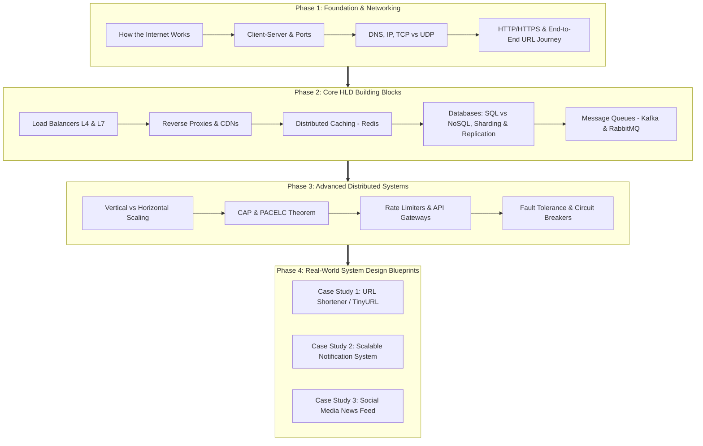

---

## 📑 Table of Contents
1. [📘 Phase 1: Networking & Internet Foundation](#1-phase-1-networking--internet-foundation)
   - [1.1 What is a Network & The Internet?](#11-what-is-a-network--the-internet)
   - [1.2 The Client-Server Model](#12-the-client-server-model)
   - [1.3 IP Address: IPv4 vs IPv6](#13-ip-address-ipv4-vs-ipv6)
   - [1.4 Port Numbers (The Apartment Analogy)](#14-port-numbers-the-apartment-analogy)
   - [1.5 DNS: The Phonebook of the Internet](#15-dns-the-phonebook-of-the-internet)
   - [1.6 TCP vs UDP (Safety vs Speed)](#16-tcp-vs-udp-safety-vs-speed)
   - [1.7 HTTP vs HTTPS & Security Handshake](#17-http-vs-https--security-handshake)
   - [1.8 The Journey: What Happens When You Type a URL?](#18-the-journey-what-happens-when-you-type-a-url)
2. [🧱 Phase 2: Core Building Blocks of HLD](#2-phase-2-core-building-blocks-of-hld)
   - [2.1 Load Balancers (The Traffic Cop)](#21-load-balancers-the-traffic-cop)
   - [2.2 Reverse Proxy vs Forward Proxy](#22-reverse-proxy-vs-forward-proxy)
   - [2.3 Content Delivery Networks (CDNs)](#23-content-delivery-networks-cdns)
   - [2.4 Distributed Caching (Redis / Memcached)](#24-distributed-caching-redis--memcached)
   - [2.5 Databases: SQL vs NoSQL](#25-databases-sql-vs-nosql)
   - [2.6 Database Scaling: Replication & Sharding](#26-database-scaling-replication--sharding)
   - [2.7 Message Queues & Event-Driven Architecture](#27-message-queues--event-driven-architecture)
3. [⚡ Phase 3: Advanced Distributed Systems Architecture](#3-phase-3-advanced-distributed-systems-architecture)
   - [3.1 Scaling Up vs Scaling Out](#31-scaling-up-vs-scaling-out)
   - [3.2 The CAP Theorem Made Simple](#32-the-cap-theorem-made-simple)
   - [3.3 API Gateways & Rate Limiting](#33-api-gateways--rate-limiting)
   - [3.4 Resiliency: Circuit Breaker & Retries](#34-resiliency-circuit-breaker--retries)
4. [📐 Phase 4: Real-World System Design Blueprints](#4-phase-4-real-world-system-design-blueprints)
   - [Case Study 1: Design a URL Shortener (TinyURL)](#case-study-1-design-a-url-shortener-tinyurl)
   - [Case Study 2: Design a Global Notification System](#case-study-2-design-a-global-notification-system)
5. [🎯 Phase 5: The 4-Step System Design Interview Framework](#5-phase-5-the-4-step-system-design-interview-framework)

---

# 1. 📘 Phase 1: Networking & Internet Foundation

Every high-level system runs on top of computer networking. If you understand how data moves across wires, system design becomes 10x easier.

### 1.1 What is a Network & The Internet?
* **Network:** Two or more devices connected together to share data.
* **The Internet:** A global "network of networks." Millions of computers connected by undersea cables, fiber optics, and satellites.

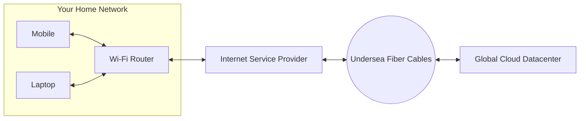

---

### 1.2 The Client-Server Model
* **Client (The Customer):** Your browser, mobile app, or smart TV asking for information.
* **Server (The Restaurant Kitchen):** A computer in a datacenter waiting 24/7 to receive orders, cook data, and send it back.

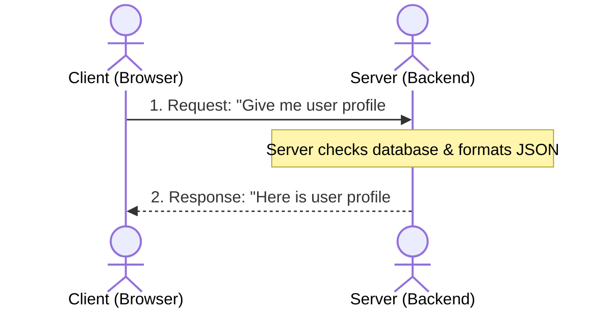

---

### 1.3 IP Address: IPv4 vs IPv6
An **IP Address** is a digital mailing address. It tells the internet where to deliver your packets.

```
IPv4: 192 . 168 . 1 . 1       --> 32 bits (Only ~4.3 billion addresses - All used up!)
IPv6: 2001:0db8:85a3::7334    --> 128 bits (Virtually unlimited - enough for every atom on Earth)
```

---

### 1.4 Port Numbers (The Apartment Analogy)
* **IP Address = The Apartment Building Address.**
* **Port Number = The Specific Apartment Door Number.**

A computer runs dozens of programs at the same time. The port number ensures the message reaches the right program:

```
+---------------+----------------------------------------+
| Port Number   | Standard Service / Application         |
+---------------+----------------------------------------+
| 80            | HTTP (Unencrypted web traffic)         |
| 443           | HTTPS (Secure encrypted web traffic)   |
| 22            | SSH (Secure server login)              |
| 53            | DNS (Domain Name Lookup)               |
| 3306          | MySQL Database                         |
| 5432          | PostgreSQL Database                    |
| 6379          | Redis In-Memory Cache                  |
| 8000 / 8080   | Web application development servers    |
+---------------+----------------------------------------+
```

---

### 1.5 DNS: The Phonebook of the Internet
Humans remember names (`google.com`); computers only understand numbers (`142.250.190.46`). **DNS (Domain Name System)** translates names to numbers.

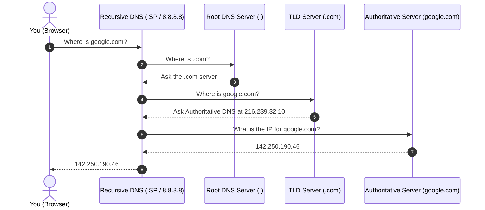

---

### 1.6 TCP vs UDP (Safety vs Speed)

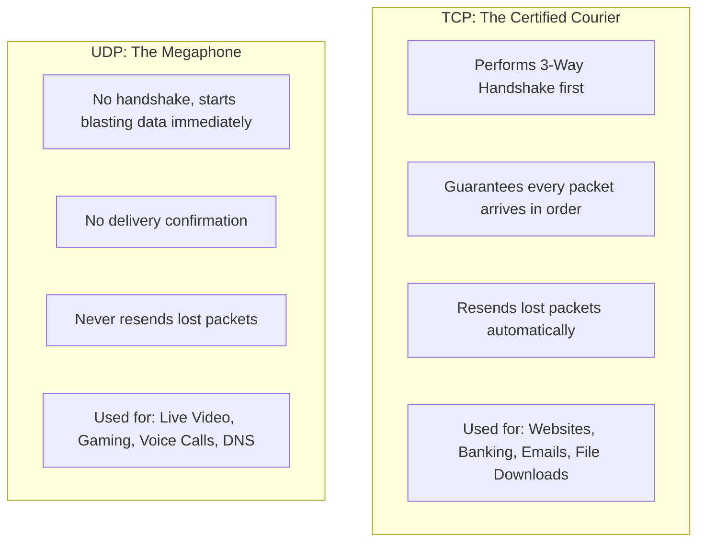

---

### 1.7 HTTP vs HTTPS & Security Handshake
* **HTTP:** Transmits plaintext. Anyone on your coffee-shop Wi-Fi can see passwords and cookies.
* **HTTPS:** HTTP inside an encrypted **TLS (Transport Layer Security)** tunnel.

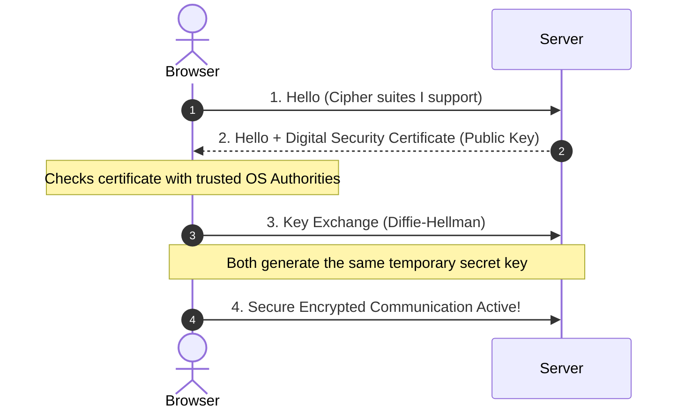

---

### 1.8 The Journey: What Happens When You Type a URL?

When you type `https://www.google.com` into your browser and hit **Enter**:

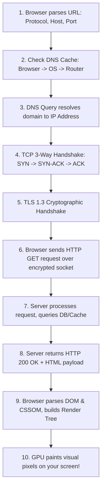

---

# 2. 🧱 Phase 2: Core Building Blocks of HLD

Every real-world distributed system is constructed by combining standard building blocks.

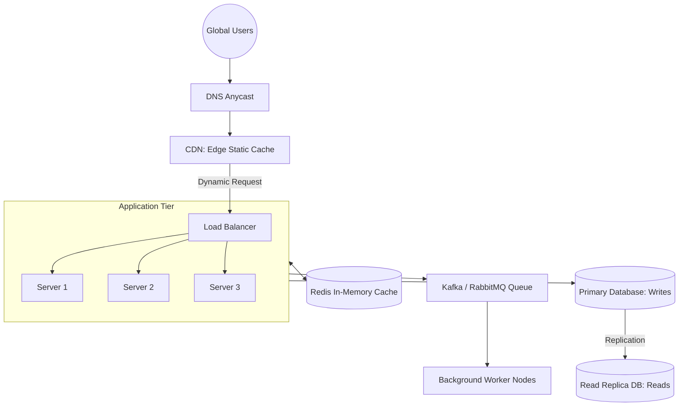

---

### 2.1 Load Balancers (The Traffic Cop)
A **Load Balancer (LB)** sits between clients and servers. It evenly distributes incoming user requests so no single server gets overwhelmed and crashes.

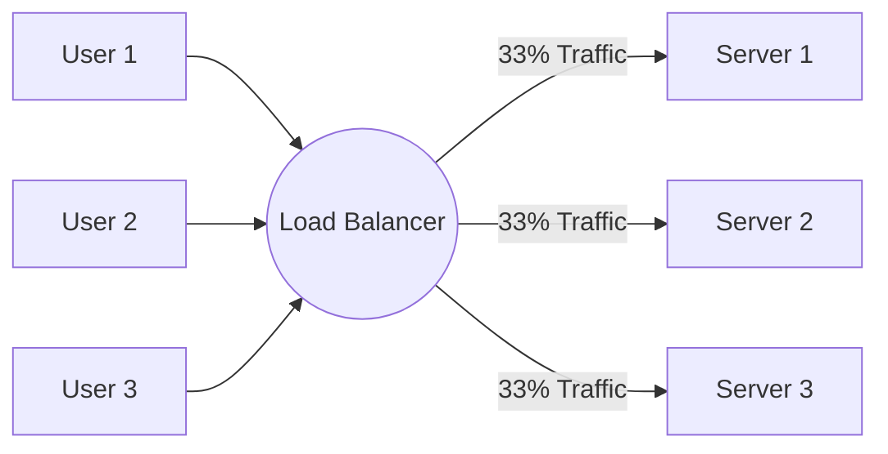

#### Layer 4 (L4) vs Layer 7 (L7) Load Balancers:
* **Layer 4 LB (Transport Layer):** Fast packet-level routing. Looks only at IP address and Port. Does not look inside the HTTP request.
* **Layer 7 LB (Application Layer):** Smart routing. Inspects the HTTP URL path, headers, and cookies (e.g., sends `/api/video` to Video Servers, and `/api/checkout` to Payment Servers).

#### Common Load Balancing Algorithms:
1. **Round Robin:** Sends requests in sequential order (Server 1 $\rightarrow$ Server 2 $\rightarrow$ Server 3 $\rightarrow$ Server 1...).
2. **Least Connections:** Sends the new request to whichever server is currently handling the lowest number of active connections.
3. **Consistent Hashing:** Hashes the client's User ID or IP to always route that specific user to the same server (great for caching).

---

### 2.2 Reverse Proxy vs Forward Proxy

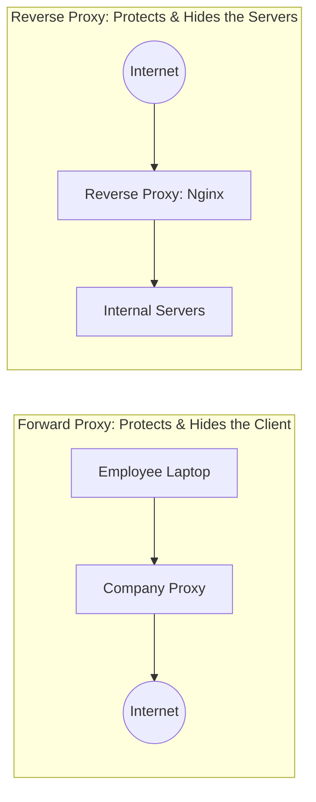

* **Forward Proxy:** Sits in front of clients. Used by universities and offices to block unwanted websites, cache files, and hide employee IPs.
* **Reverse Proxy (Nginx, Envoy, HAProxy):** Sits in front of servers. Provides SSL termination, DDoS protection, gzip compression, and security shielding.

---

### 2.3 Content Delivery Networks (CDNs)
A **CDN** is a globally distributed network of edge caching servers located in cities all over the world (Cloudflare, AWS CloudFront, Akamai).

* Without a CDN, an image hosted in a New York datacenter takes ~150ms to reach a user in Tokyo.
* With a CDN, the Tokyo user downloads the image from a local Tokyo edge server in just ~5ms!

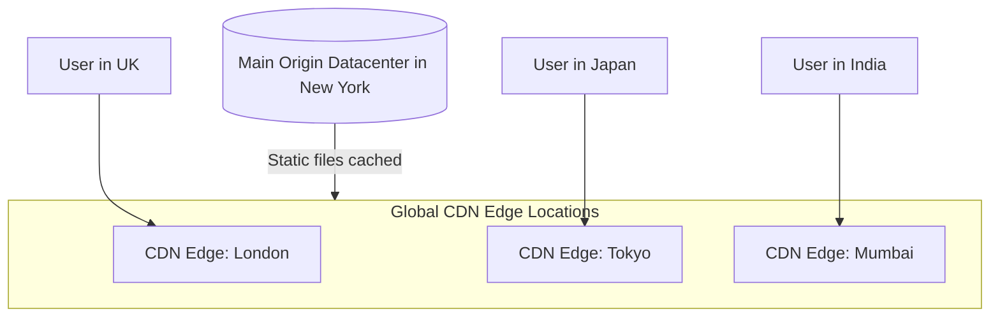

---

### 2.4 Distributed Caching (Redis / Memcached)
Accessing a hard drive database takes 5–20 milliseconds. Reading from memory (RAM) takes under 1 millisecond. A **Cache** stores popular data in RAM.

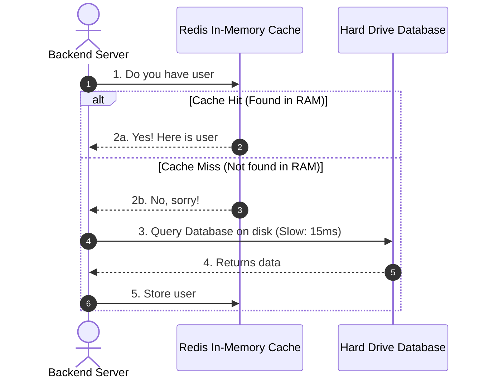

#### Cache Invalidation Strategies:
* **Cache-Aside (Lazy Loading):** App queries cache first. If missing, it fetches from DB and updates cache (shown above).
* **Write-Through:** App writes to cache and DB simultaneously.
* **Write-Behind (Write-Back):** App writes directly to cache; cache asynchronously writes to DB in bulk after a few seconds.

---

### 2.5 Databases: SQL vs NoSQL

| Feature | Relational Databases (SQL) | Non-Relational (NoSQL) |
| :--- | :--- | :--- |
| **Examples** | PostgreSQL, MySQL, Oracle | MongoDB, Cassandra, DynamoDB, Redis |
| **Data Structure** | Structured Tables with Strict Rows & Columns | Flexible JSON Documents, Key-Value, Graphs |
| **Schema** | Rigid (Alter Table required) | Dynamic & Flexible (Add fields on the fly) |
| **Scaling** | Typically Vertically (Add CPU/RAM) | Natively Horizontally (Add commodity nodes) |
| **Transactions** | Strong ACID compliance | Eventual consistency (BASE) |
| **Best Used For** | Financial ledgers, E-commerce orders, relational models | High-volume clickstreams, social feeds, user profiles |

---

### 2.6 Database Scaling: Replication & Sharding

When a database gets too big or receives too many read/write requests, we use two main techniques:

#### 1. Primary-Replica (Master-Slave) Replication (For Read-Heavy Apps)
Most web apps read data 10x to 100x more often than they write data (e.g., Twitter feed reads vs posting tweets).
* **Primary DB:** Handles all `INSERT`, `UPDATE`, `DELETE` (Writes).
* **Read Replicas:** Multiple copies that handle `SELECT` (Reads).

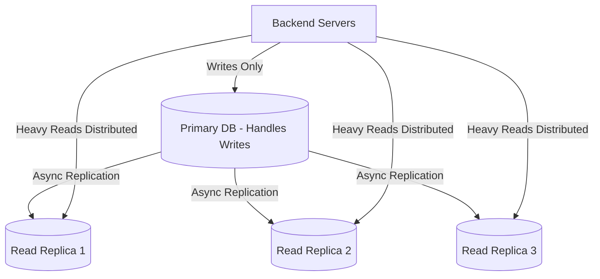

#### 2. Database Sharding (Horizontal Partitioning)
Splits one gigantic table into smaller pieces called **shards** across multiple database servers based on a **Shard Key** (like `User_ID`).

```
Shard 1: Stores User IDs 1 to 1,000,000
Shard 2: Stores User IDs 1,000,001 to 2,000,000
Shard 3: Stores User IDs 2,000,001 to 3,000,000
```

---

### 2.7 Message Queues & Event-Driven Architecture
A **Message Queue** (Apache Kafka, RabbitMQ, AWS SQS) decouples slow background jobs from the fast user experience.

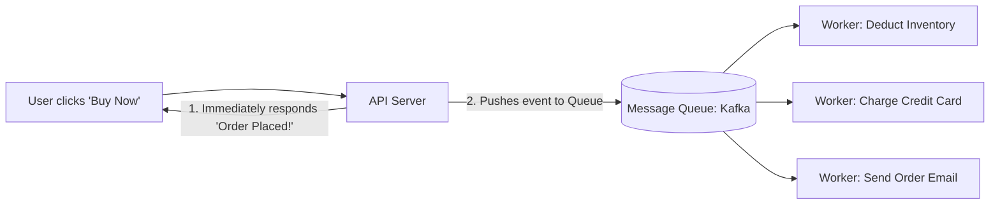

* **Why use it?** The user does not have to wait 5 seconds for emails and payment processors before seeing their confirmation page.

---

# 3. ⚡ Phase 3: Advanced Distributed Systems Architecture

### 3.1 Scaling Up vs Scaling Out

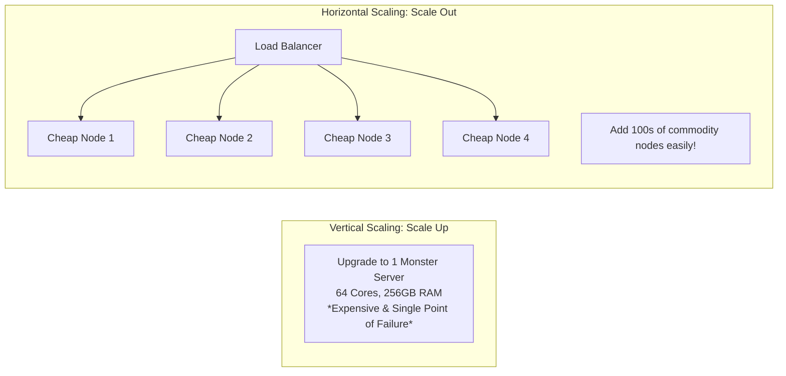

---

### 3.2 The CAP Theorem Made Simple
In any distributed system where data is replicated across multiple servers connected by physical network cables:

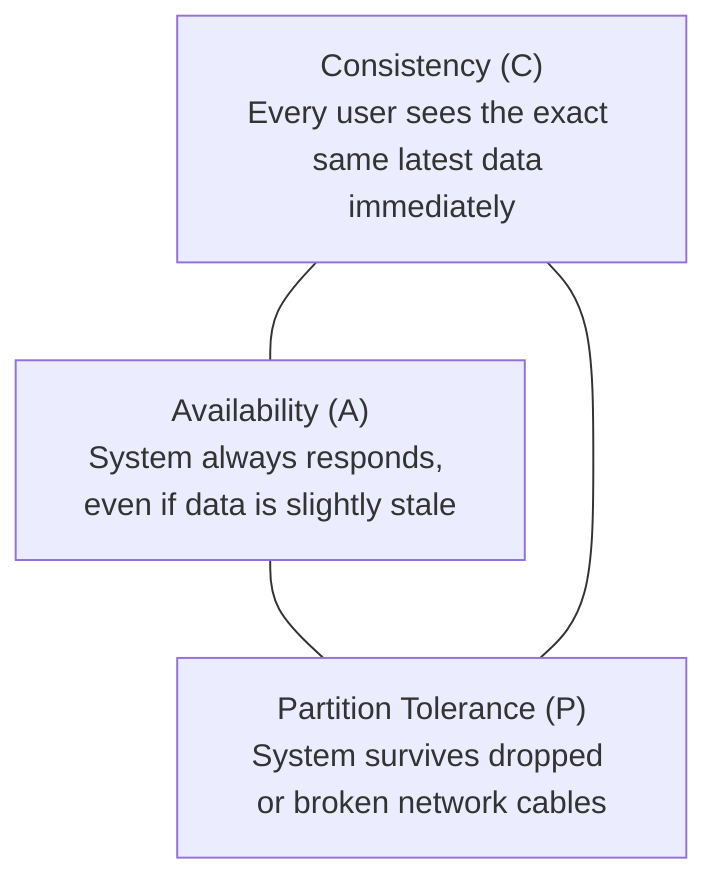

* **Reality:** Network cables and switches will inevitably fail. Therefore, **Partition Tolerance (P) is non-negotiable**.
* **The Choice:** When a network break occurs, you must choose between:
  * **CP (Consistency + Partition Tolerance):** Block the request or throw an error rather than returning stale data (Used by: Banks, stock markets, MongoDB).
  * **AP (Availability + Partition Tolerance):** Return the available data immediately, even if it is a few seconds old (Used by: Social media feeds, YouTube view counts, Cassandra).

---

### 3.3 API Gateways & Rate Limiting

An **API Gateway** acts as the single front door for all client requests entering your system.

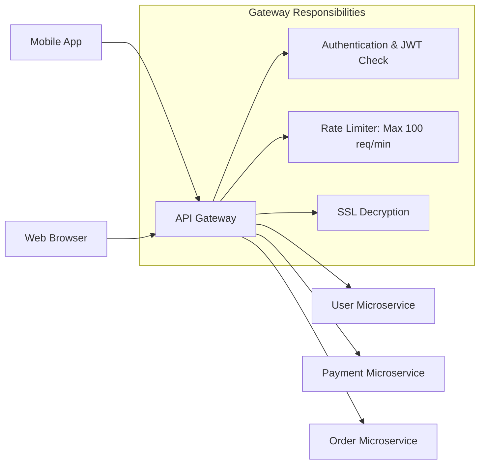

#### Common Rate Limiting Algorithms:
1. **Token Bucket:** Tokens are added to a bucket at a fixed rate. Each request takes a token. If the bucket is empty, the request is rejected with `HTTP 429 Too Many Requests`.
2. **Leaky Bucket:** Requests enter a bucket and flow out at a smooth, constant rate, smoothing traffic spikes.

---

### 3.4 Resiliency: Circuit Breaker & Retries
What happens when Service B crashes or slows to a crawl? Without protection, Service A runs out of threads waiting for B and crashes too (**Cascading Failure**).

```mermaid
stateDiagram-v2
    [*] --> Closed
    Closed --> Open: Failures exceed threshold (e.g. 50% errors)
    Open --> HalfOpen: Timeout expires (e.g. after 30 seconds)
    HalfOpen --> Closed: Test requests succeed!
    HalfOpen --> Open: Test requests fail again!

    note right of Closed: Normal operation: Requests flow through
    note right of Open: Fails fast immediately: Does not call broken service
    note right of HalfOpen: Sends canary probe requests to test health
```

---

# 4. 📐 Phase 4: Real-World System Design Blueprints

### Case Study 1: Design a URL Shortener (TinyURL)

#### 1. Functional Requirements:
* Given a long URL (e.g. `https://example.com/long/path/article?id=99`), generate a short alias (e.g. `https://tiny.url/x7K9b`).
* When visiting the short URL, redirect the user to the original long URL with `301 Moved Permanently`.

#### 2. Architecture Diagram:

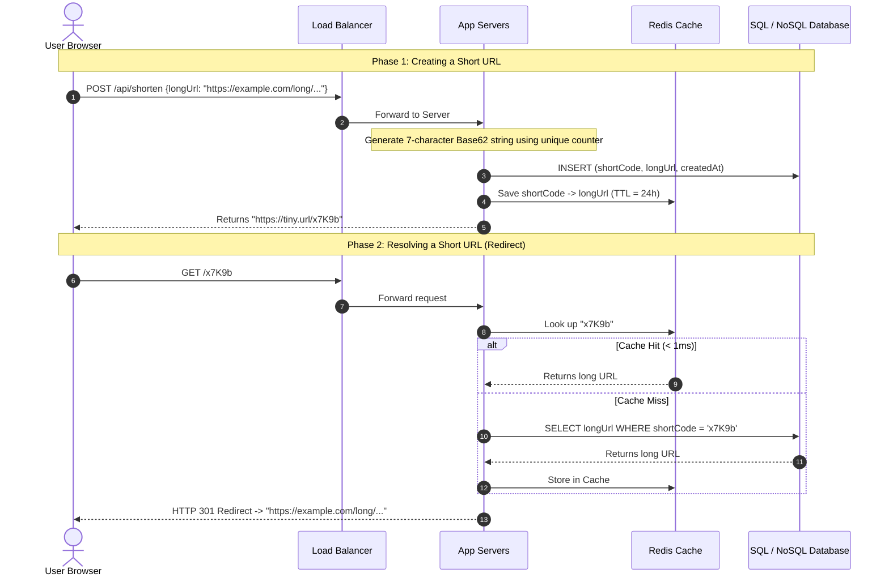

---

### Case Study 2: Design a Global Notification System

#### Requirements:
* Support sending millions of notifications across three channels: **Mobile Push**, **SMS**, and **Email**.
* Prevent duplicate notifications and handle third-party service downtime gracefully.

#### Architecture Blueprint:

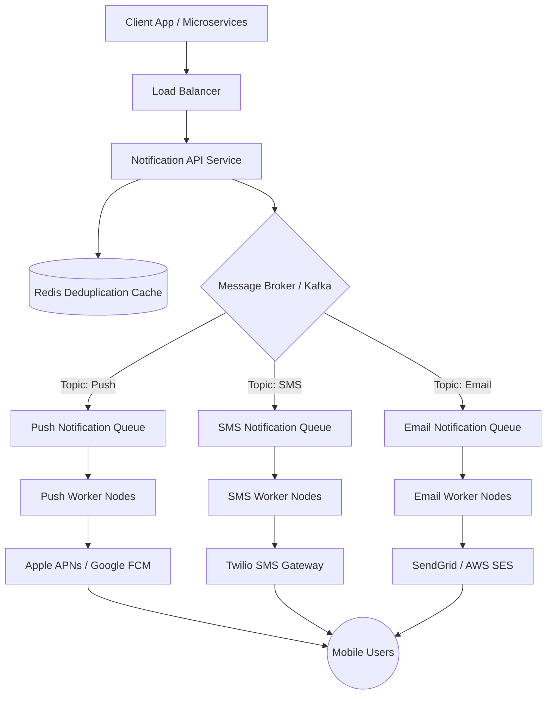

---

# 5. 🎯 Phase 5: The 4-Step System Design Interview Framework

When an interviewer asks you: *"How would you design YouTube / WhatsApp / Uber?"*, follow this proven 4-step framework:

```mermaid
graph TD
    Step1["Step 1: Clarify Scope & Requirements (5 mins)\n- What features are must-haves?\n- How many active users (DAU)?\n- Read-heavy or write-heavy?"]
    Step2["Step 2: Back-of-the-Envelope Estimation (5 mins)\n- Calculate Queries Per Second (QPS)\n- Calculate Storage needed per year\n- Calculate Bandwidth"]
    Step3["Step 3: High-Level Architecture (15 mins)\n- Draw Client, Load Balancer, Web Servers\n- Add Cache, Database (SQL/NoSQL)\n- Show end-to-end data flow"]
    Step4["Step 4: Deep Dive & Bottlenecks (20 mins)\n- How does the system scale to 10M users?\n- Single points of failure (SPOF)?\n- Data partitioning, replication, and failover"]

    Step1 --> Step2 --> Step3 --> Step4
```

### 🧠 Latency Numbers Every Software Engineer Must Know:
* **L1 Cache Reference:** `0.5 ns`
* **RAM (Memory) Read:** `100 ns`
* **Read 1 MB sequentially from RAM:** `250 µs`
* **Read 1 MB sequentially from SSD:** `1,000 µs (1 ms)`
* **Read 1 MB sequentially from HDD Disk:** `20,000 µs (20 ms)`
* **Send packet California $\rightarrow$ Netherlands $\rightarrow$ California:** `150 ms`
