# 🚀 Complete System Design Roadmap: Beginner → Expert
> **171 Topics | 12 Phases | 6 Stages | Master High-Level Design (HLD)**  
> *Every topic structured using the Standard 22-Section Architectural Presentation in Simple English*

---

## 🏛️ The Standard 22-Section Topic Presentation Framework

Every topic in this repository is presented using this rigorous 22-section engineering framework:

| Order | Section | Mandatory Presentation |
|---|---|---|
| **01** | **WHAT** | Simple definition + Technical definition |
| **02** | **WHY** | Core benefits & reasons to use in bullet points |
| **03** | **PROBLEM** | What breaks without it? Explanation + Before/After visual diagram |
| **04** | **ANALOGY** | Relatable real-life analogy (restaurant, highway, postal system) |
| **05** | **CONCEPTS** | Key terminology table with definitions & context |
| **06** | **ARCHITECTURE** | High-level system architecture diagram |
| **07** | **COMPONENTS** | Component table: Name, Role, Failure Impact |
| **08** | **WORKING** | Numbered execution steps + logic flowchart |
| **09** | **DATA FLOW** | End-to-end request sequence diagram |
| **10** | **TYPES** | Classification & breakdown comparison table |
| **11** | **COMPARISON** | Head-to-head comparison table against alternatives |
| **12** | **EXAMPLES** | Simple Example $\rightarrow$ Technical Payload $\rightarrow$ Real-world FAANG case study |
| **13** | **ADVANTAGES** | Explained pros in bullet points |
| **14** | **DISADVANTAGES** | Explained cons and drawbacks |
| **15** | **USE CASES** | Practical use-case scenario matrix |
| **16** | **PERFORMANCE** | Performance metrics, throughput, latency & tuning points |
| **17** | **SECURITY** | Security threats & mitigation table |
| **18** | **TRADE-OFFS** | Architectural decision matrix |
| **19** | **BEST PRACTICES** | Production engineering checklist |
| **20** | **COMMON MISTAKES** | "Mistake vs Correction" anti-pattern table |
| **21** | **INTERVIEW QUESTIONS** | Beginner $\rightarrow$ Intermediate $\rightarrow$ Advanced interview questions |
| **22** | **SUMMARY** | Key takeaway points + Quick revision table |

---

## 🗺️ Master Curriculum Tracker

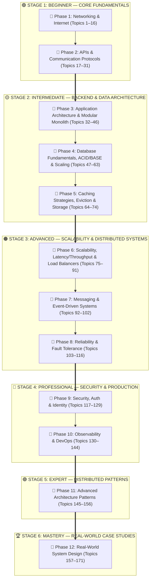

---

# 📚 22-Section Deep Dive Modules

---

# 🧱 MODULE 1: Application Architecture (Monolithic, Modular Monolith & Microservices)
*(Covering Phase 3: Topics 32–46)*

### 01. WHAT
* **Simple Definition:** Software architecture is how you organize your code and servers so that your team can build, change, and scale the app without breaking everything.
* **Technical Definition:** The structural blueprint of a software system, defining the internal modules, their responsibilities, communication protocols, boundaries, and deployment topology.

### 02. WHY
* **Team Scalability:** Allows multiple developers to work without stepping on each other's toes.
* **System Maintainability:** Isolates bugs so an error in the notification system doesn't crash user payments.
* **Cost Efficiency:** Lets you scale only the parts of the app that are experiencing heavy traffic.

### 03. PROBLEM (What Breaks Without It?)
Without a modular architecture, applications degrade into a **"Big Ball of Mud"**. Any function can query any database table, making changes risky and unpredictable.

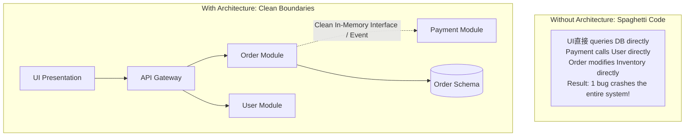

### 04. ANALOGY
* **Classic Monolith:** One giant studio apartment with no walls. The kitchen, bed, shower, and toilet are in the same room. Cheap to start, but messy and chaotic.
* **Microservices:** Building 5 separate houses across town. To go from the bedroom to the bathroom, you have to get in a car, pay tolls, and risk traffic jams (network latency).
* **Modular Monolith:** One large mansion with **solid walls and locked doors**. Everything lives under one roof (zero travel time), but each room is strictly private!

### 05. CONCEPTS

| Term | Definition | Real-World Context |
| :--- | :--- | :--- |
| **Coupling** | How dependent two components are on each other. | Low coupling = if Service A dies, Service B keeps running. |
| **Cohesion** | How closely related the code inside a single module is. | High cohesion = everything inside the `Payment` module handles payments only. |
| **Domain Boundary** | A logical fence separating business domains. | `User` module cannot write to `Order` tables directly. |
| **Deployment Unit** | The physical binary or container deployed to a server. | 1 container for Monolith vs 20 containers for Microservices. |

### 06. ARCHITECTURE

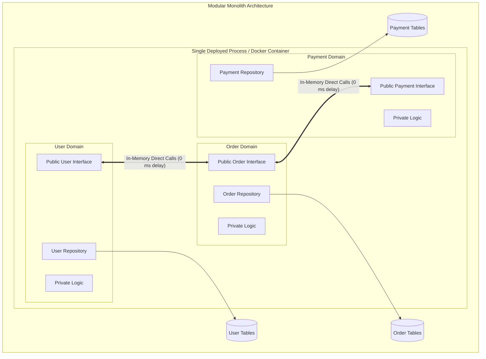

### 07. COMPONENTS

| Component | Role | Failure Impact |
| :--- | :--- | :--- |
| **Domain Module** | Encapsulates business logic for 1 domain | Contains bugs within that specific domain |
| **Public Interface** | The contract exposed to other modules | If signature changes, compilation errors warn you immediately |
| **Private Internals** | Hidden implementation details | Can be completely rewritten without affecting other modules |
| **Database Schemas** | Separated tables per module | Prevents cross-module database joins |

### 08. WORKING
1. Client sends an HTTP request (`POST /orders`).
2. The `Order Module` receives the request.
3. Instead of querying the user database directly, it calls the `User Module`'s public interface: `userService.isUserActive(userId)`.
4. The call runs in the **same CPU memory space** (instant execution, zero network delay).
5. The `Order Module` saves the order in its private tables and returns `201 Created`.

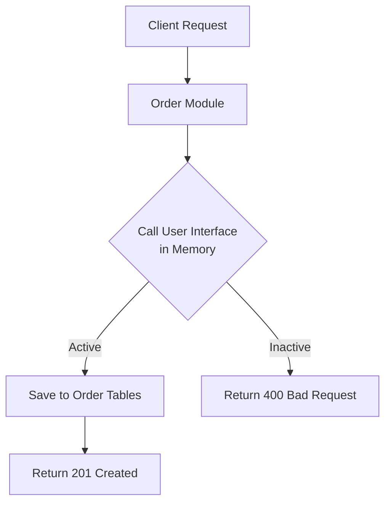

### 09. DATA FLOW

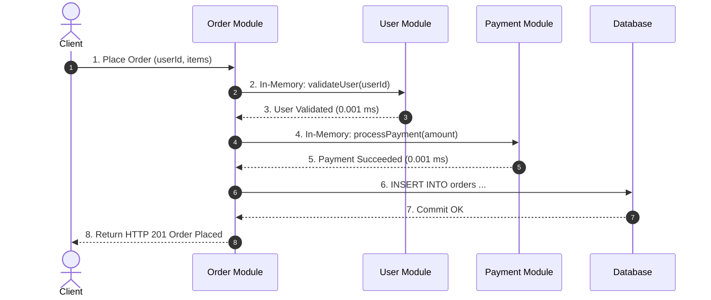

### 10. TYPES

```
Architecture Classifications:
├── Monolithic
│   ├── Classic (Spaghetti) Monolith
│   └── Modular Monolith (Strict internal boundaries)
├── Distributed
│   ├── Microservices (Network-separated services)
│   └── Service-Oriented Architecture (SOA with enterprise bus)
└── Serverless (Function-as-a-Service: AWS Lambda)
```

### 11. COMPARISON

| Feature | Classic Monolith | Modular Monolith | Microservices | Serverless |
| :--- | :--- | :--- | :--- | :--- |
| **Deployment Complexity** | Very Low (1 binary) | Very Low (1 binary) | High (Kubernetes, 20+ services) | Low to Medium |
| **Call Latency** | `0 ms` (In-memory) | `0 ms` (In-memory) | `5 - 50 ms` (Network hops) | `50 - 500 ms` (Cold starts) |
| **Data Transactions** | Easy ACID | Easy ACID | Hard (Distributed Saga) | Hard |
| **Team Autonomy** | Low | High | Very High | High |
| **Infrastructure Cost** | Very Cheap | Very Cheap | Expensive | Pay per execution |

### 12. EXAMPLES
* **Simple Example:** A single Node.js/Go app with separated folders (`/users`, `/orders`) where folders only export specific interfaces.
* **Technical Example:** A Java Spring Boot multi-module Maven project where `order-module` has a compile-time dependency on `user-api`, but zero access to `user-internal`.
* **Real-World Case Study:** **Shopify** famously runs one of the largest Ruby on Rails Modular Monoliths in the world, processing billions of dollars in Black Friday transactions without the complexity of microservices!

### 13. ADVANTAGES
* **Zero Network Latency:** No HTTP/gRPC overhead between internal components.
* **Simple Local Development:** Developers run `docker compose up` or one CLI command to run the whole app locally.
* **Easy Refactoring:** Changing a function signature across modules produces instant compile-time feedback.
* **Straightforward Debugging:** Single stack trace on errors; no need for distributed tracing tools.

### 14. DISADVANTAGES
* **Shared Resource Contention:** If the `Reporting` module eats 100% of the CPU, it slows down the `Checkout` module.
* **Single Deployment Unit:** Even a 1-line CSS fix requires building and redeploying the entire application.
* **Language Lock-in:** All modules must be written in the same programming language ecosystem.

### 15. USE CASES

| Scenario | Recommended Architecture | Why? |
| :--- | :--- | :--- |
| **Early Stage Startup / MVP** | Modular Monolith | Maximum iteration speed, zero DevOps overhead |
| **E-Commerce Platform (Shopify scale)** | Modular Monolith | High performance, simple ACID transactions |
| **500+ Engineers across 30 squads** | Microservices | Autonomous team deployment pipelines |
| **Sporadic Image Processing Jobs** | Serverless (Lambda) | Scale to zero when not in use |

### 16. PERFORMANCE
* **Memory Overhead:** Negligible; all modules share the same memory heap.
* **Throughput:** Typically 5x to 10x higher than microservices because no CPU time is wasted serializing/deserializing JSON over network sockets.
* **Tuning:** Use connection pooling for the shared database and run worker threads for asynchronous tasks.

### 17. SECURITY

| Threat | Impact | Mitigation |
| :--- | :--- | :--- |
| **Cross-Module Tampering** | Module A reads Module B's private data | Enforce package-private access modifiers & linting rules |
| **Resource Exhaustion** | One bad loop crashes the whole process | Set memory limits and timeouts on long-running queries |
| **Dependency Vulnerability** | Vulnerable library affects all modules | Scan dependencies with automated security tools (Snyk/Dependabot) |

### 18. TRADE-OFFS

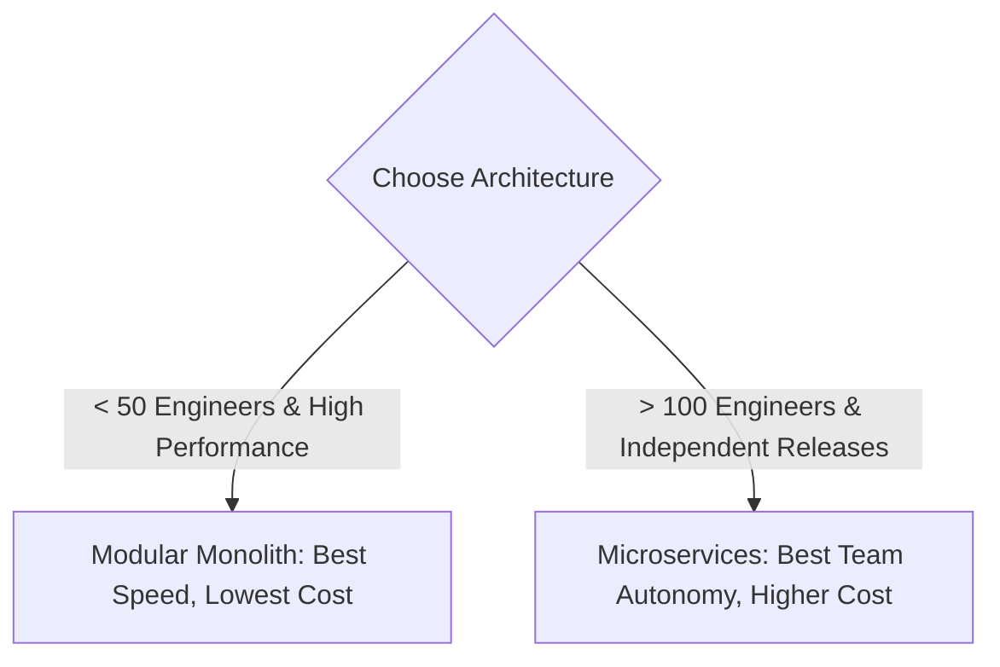

### 19. BEST PRACTICES
- [x] Never allow one module to query another module's database tables directly.
- [x] Use in-memory domain events for asynchronous decoupling.
- [x] Enforce module boundary rules in CI pipelines using architecture linting tools.
- [x] Keep database schemas separated logically by prefix (e.g. `user_`, `order_`).

### 20. COMMON MISTAKES

| Common Mistake | Why It Fails | How to Fix It |
| :--- | :--- | :--- |
| **Direct Database Joins across modules** | Re-creates spaghetti coupling in the database | Fetch IDs and perform application-level composition |
| **Splitting into microservices too early** | Spends 80% of time fixing network & K8s issues | Start with a Modular Monolith; split only when needed |
| **Circular Dependencies** | Module A calls B, and B calls A; causes deadlocks | Introduce an Event Bus or a shared Common module |

### 21. INTERVIEW QUESTIONS
* **Beginner:** What is the difference between a Monolith and Microservices?
  - *Answer:* A monolith packages all features into one deployed unit. Microservices split features into separate network-connected servers.
* **Intermediate:** What is a Modular Monolith and why would a company choose it over Microservices?
  - *Answer:* It enforces strict domain boundaries inside a single deployment unit, avoiding network latency, distributed transactions, and DevOps overhead.
* **Advanced:** How do you handle database transactions across two domains in a Modular Monolith without tight coupling?
  - *Answer:* Use the **Transactional Outbox Pattern** or publish an in-memory Domain Event after the primary transaction commits.

### 22. SUMMARY

```
Modular Monolith Revision Cheat Sheet:
├── What: Single deployment unit with strict internal domain boundaries.
├── Why: Microservices separation of concerns WITHOUT microservices network pain.
├── Speed: 0 ms internal call latency (in-memory calls).
├── Scaling: Scale vertically or scale horizontally as identical cloned nodes.
└── Rule of Thumb: Start here. Do not go to microservices until your team exceeds 100 engineers.
```

---

# ⚖️ MODULE 2: Scalability, Latency vs Throughput & Load Balancing
*(Covering Phase 6: Topics 75–91)*

### 01. WHAT
* **Simple Definition:** Scalability is the ability of your system to handle 10x or 1000x more users by adding more resources without slowing down.
* **Technical Definition:** The property of a distributed system to handle increased workload by augmenting computing resources (vertically or horizontally), maintaining acceptable Latency ($W$) and Throughput ($\lambda$).

### 02. WHY
* **Prevent Outages:** Stops servers from crashing when traffic spikes (e.g. flash sales, viral news).
* **Cost Efficiency:** Lets you add servers when busy and turn them off when idle (Auto-scaling).
* **High Availability:** Eliminates Single Points of Failure (SPOFs).

### 03. PROBLEM (What Breaks Without It?)
Without load balancing and horizontal scaling, when traffic spikes, a single server runs out of CPU and RAM. Connections queue up, latency skyrockets, and the server crashes with `HTTP 504 Gateway Timeout`.

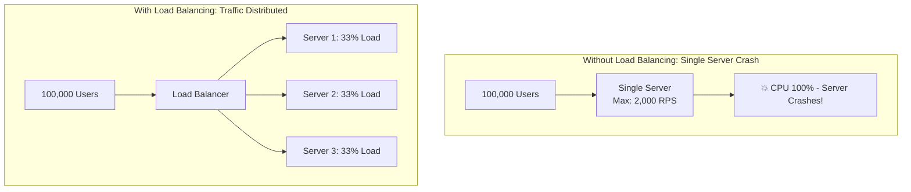

### 04. ANALOGY
* **Latency = The Speed Limit:** How fast one car can drive from City A to City B. (Lower is better).
* **Throughput = The Number of Highway Lanes:** How many total cars can pass the toll booth per minute. (Higher is better).
* Adding more lanes (horizontal scaling) lets more cars through, but does not increase the car's top speed!

### 05. CONCEPTS

| Term | Definition | Formula / Unit |
| :--- | :--- | :--- |
| **Latency** | Time taken for a single request to finish. | Milliseconds (`ms`) |
| **Throughput** | Number of requests completed per second. | `RPS` or `QPS` |
| **Little's Law** | The mathematical relationship between Concurrency, Latency, and Throughput. | $L = \lambda \times W$ |
| **L4 Load Balancing** | Fast packet-level routing based on IP and Port. | Transport Layer (TCP/UDP) |
| **L7 Load Balancing** | Smart content-aware routing based on HTTP URLs, cookies, and headers. | Application Layer (HTTP) |
| **Consistent Hashing** | Distributing keys across a hash ring so adding a node only moves $1/N$ keys. | Angle $0^\circ$ to $360^\circ$ |

### 06. ARCHITECTURE

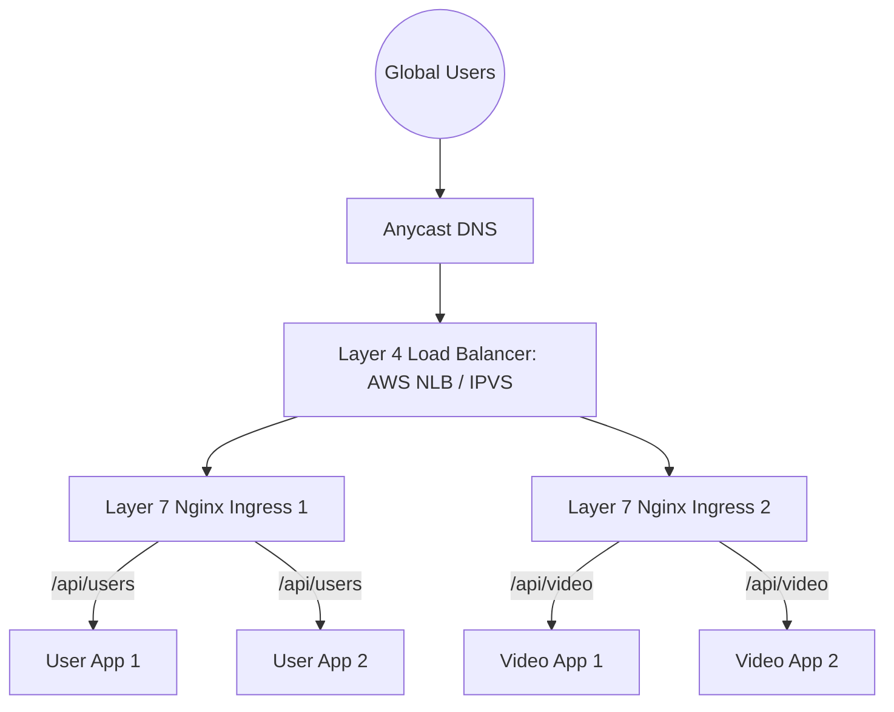

### 07. COMPONENTS

| Component | Role | Failure Impact |
| :--- | :--- | :--- |
| **L4 Load Balancer** | Blazing-fast packet forwarding across L7 proxies | If dead, secondary standby node takes over via VRRP |
| **L7 Load Balancer** | SSL termination, path routing, sticky sessions | If dead, L4 LB shifts traffic to remaining L7 proxies |
| **Stateless App Node** | Executes business logic | If dead, LB removes it from health-check pool |
| **Health Checker** | Pings `/health` endpoint every 5 seconds | Automatically stops sending traffic to unhealthy nodes |

### 08. WORKING: How Many Requests Can 1 Server Handle?
1. **Thread-per-Request (Spring/Tomcat):** Each request takes 1 OS thread (~1MB stack). A server with 4GB free RAM chokes at ~500 to 2,000 concurrent threads.
2. **Event-Driven Non-Blocking (Node.js/Go):** Go goroutines take only ~2KB. One machine can hold 50,000+ idle connections.
3. **Throughput Formula:**
   $$\text{Throughput (RPS)} = \frac{\text{Concurrent Threads}}{\text{Average Latency (seconds)}}$$
   * If Concurrency = 200 threads, Latency = `0.02s` (20ms) $\implies \mathbf{10,000 \text{ RPS}}$!
   * If Latency jumps to `0.2s` (200ms) $\implies \mathbf{1,000 \text{ RPS}}$ (90% throughput loss!).

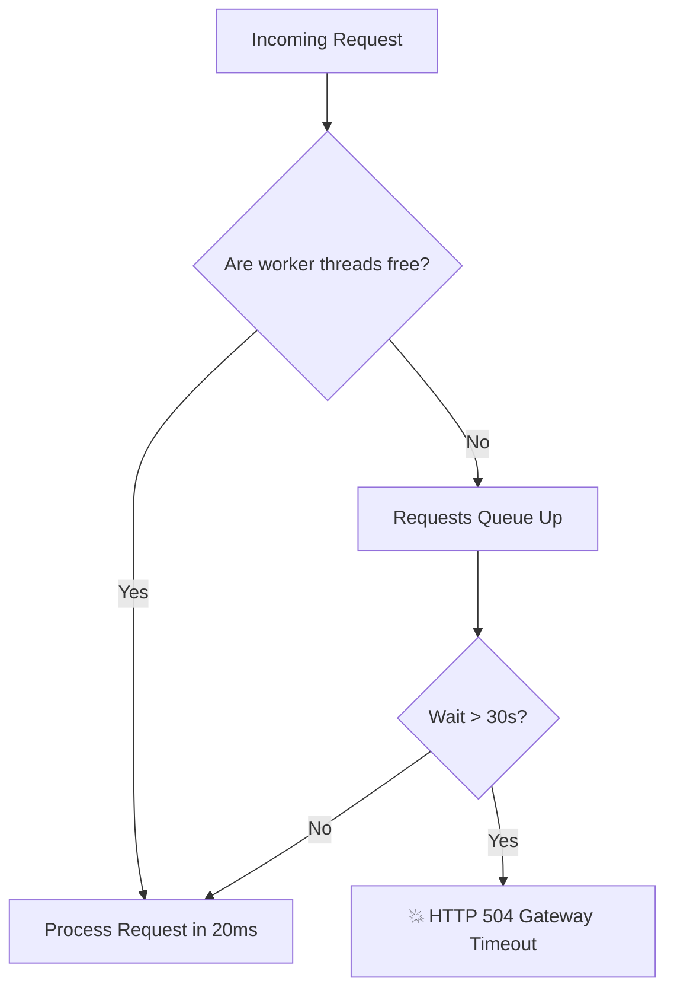

### 09. DATA FLOW

```mermaid
sequenceDiagram
    autonumber
    actor Client
    participant LB as Load Balancer (Nginx)
    participant Server1 as App Server 1
    participant Server2 as App Server 2

    Client->>LB: 1. HTTP Request: GET /profile
    Note over LB: Evaluates Least Connections algorithm
    LB->>Server1: 2. Forwards request to Server 1
    Server1-->>LB: 3. HTTP 200 OK + JSON
    LB-->>Client: 4. Returns response to Client
    Client->>LB: 5. Next Request: GET /profile
    Note over LB: Server 1 is busy; routes to Server 2
    LB->>Server2: 6. Forwards request to Server 2
    Server2-->>LB: 7. HTTP 200 OK + JSON
    LB-->>Client: 8. Returns response to Client
```

### 10. TYPES: Load Balancing Algorithms

| Algorithm | How It Works | Best For |
| :--- | :--- | :--- |
| **Round Robin** | Routes 1 $\rightarrow$ 2 $\rightarrow$ 3 sequentially | Identical servers with equal request sizes |
| **Least Connections** | Routes to server with fewest active connections | Long-lived WebSocket or database connections |
| **IP Hash** | Hashes Client IP to always hit the same server | Basic session stickiness without cookies |
| **Consistent Hashing** | Maps nodes & keys to a $360^\circ$ hash ring | Distributed caches (Redis) and partitioned databases |

### 11. COMPARISON: Vertical vs Horizontal Scaling

| Dimension | Vertical Scaling (Scale UP) | Horizontal Scaling (Scale OUT) |
| :--- | :--- | :--- |
| **How It Works** | Add more CPU cores & RAM to 1 machine | Add more commodity servers in parallel |
| **Hardware Limit** | Strict physical ceiling (e.g. 128 cores, 4TB RAM) | Virtually unlimited (thousands of servers) |
| **Fault Tolerance** | Single Point of Failure (Hardware crash = Downtime) | Highly fault-tolerant (1 server dies, 99 others run) |
| **Downtime** | Requires brief downtime to upgrade | Zero downtime (Rolling deployments) |
| **Best Used For** | Primary SQL Databases, Redis Caches, MVPs | Stateless API Web servers, Microservices, Big Data |

### 12. EXAMPLES
* **Simple Example:** Running two Node.js apps on ports 3000 and 3001 with Nginx alternating traffic between them.
* **Technical Example:** Consistent Hashing with virtual nodes: When adding Node 4 to a 3-node ring, only $1/4$ (25%) of keys are remapped instead of 100%!
* **Real-World Case Study:** **Netflix** uses Layer 7 Zuul edge proxies to dynamically route over 2 billion requests every single day across thousands of AWS EC2 instances.

### 13. ADVANTAGES
* **High Availability:** System keeps running even if multiple physical servers fail.
* **Elasticity:** Automatically scale down at night to save cloud infrastructure costs.
* **Rolling Deployments:** Upgrade code on Server 1, test it, then upgrade Server 2 with zero user interruption.

### 14. DISADVANTAGES
* **Distributed Complexity:** Requires stateless backend servers (sessions must be stored in Redis, not local server memory).
* **Data Consistency Challenges:** Database transactions become harder when data is distributed.

### 15. USE CASES

| Scenario | Solution | Why? |
| :--- | :--- | :--- |
| **Early MVP / Low Traffic** | Scale Vertically | Quickest to build, zero distributed overhead |
| **Stateless REST APIs** | Scale Horizontally with L7 LB | Dynamic auto-scaling based on CPU utilization |
| **Ultra-High Speed Packet Ingestion (10M packets/sec)** | Layer 4 Load Balancer | Avoids expensive HTTP parsing overhead |
| **Distributed Cache Sharding** | Consistent Hashing | Prevents cache avalanche when adding cache servers |

### 16. PERFORMANCE
* **Throughput Optimization:** Keep latency small! A 10ms decrease in DB latency can double your server's RPS capacity.
* **p99 Tail Latency:** Always measure the 99th percentile, not the average. If 1% of requests take 10 seconds, millions of users suffer.

### 17. SECURITY

| Threat | Mitigation |
| :--- | :--- |
| **DDoS Attack (Traffic Flood)** | L4/L7 rate limiting, SYN cookies, Cloudflare DDoS shield |
| **SSL Vulnerabilities** | Terminate SSL at the Load Balancer with modern TLS 1.3 ciphers |

### 18. TRADE-OFFS

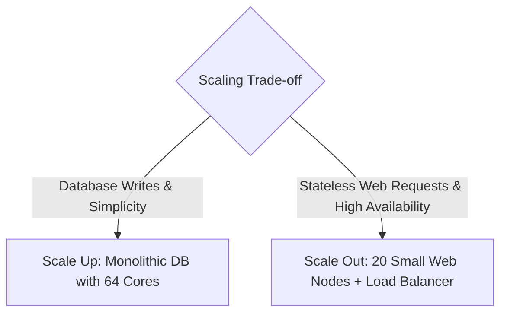

### 19. BEST PRACTICES
- [x] Keep application servers **strictly stateless** (Store sessions in Redis, files in S3).
- [x] Configure active health checks on Load Balancers (`/health` responding in < 200ms).
- [x] Use connection pooling between Load Balancers and backends to avoid TCP handshake storms.

### 20. COMMON MISTAKES

| Mistake | Consequence | Correction |
| :--- | :--- | :--- |
| **Storing user session in local memory** | User gets logged out when LB routes them to Server 2 | Store session tokens in centralized Redis cache |
| **Relying on Average Latency** | Misses tail latency bottlenecks (p99) | Set alerts based on p95 and p99 percentiles |
| **No health-check timeouts** | LB keeps sending traffic to frozen, dead servers | Configure 2-second timeout on health checks |

### 21. INTERVIEW QUESTIONS
* **Beginner:** What is the difference between Latency and Throughput?
  - *Answer:* Latency is how long one request takes (ms). Throughput is how many requests the system completes per second (RPS).
* **Intermediate:** What is the difference between Layer 4 and Layer 7 Load Balancing?
  - *Answer:* L4 routes at the transport layer using IP/Port (fast, blind to content). L7 routes at application layer using URLs, cookies, and headers (smart, content-aware).
* **Advanced:** How does Consistent Hashing solve the cache wipe problem when scaling cache nodes?
  - *Answer:* It maps servers and keys to a $360^\circ$ ring. Adding or removing a server only relocates $K/N$ keys to adjacent nodes, preventing full-cache eviction.

### 22. SUMMARY

```
Scalability Revision Cheat Sheet:
├── Latency vs Throughput: Little's Law -> Throughput = Concurrency / Latency.
├── Vertical: Bigger machine. Simple, no code change, but hard ceiling.
├── Horizontal: More machines. Infinite potential, resilient, requires stateless servers.
├── L4 LB: Fast packet routing (IP/Port).
└── L7 LB: Smart routing (HTTP Path, Cookies, SSL termination).
```

---

# ⚡ MODULE 3: Distributed Caching (Redis, Strategies & Eviction)
*(Covering Phase 5: Topics 64–74)*

### 01. WHAT
* **Simple Definition:** Caching is saving a copy of frequently needed data in super-fast temporary memory (RAM) so you don't have to fetch it from the slow database every time.
* **Technical Definition:** A hardware or software component that stores data in volatile memory (RAM), offering sub-millisecond read access times ($O(1)$) to alleviate persistent disk database I/O bottlenecks.

### 02. WHY
* **Blazing Speed:** RAM reads take ~100 nanoseconds; hard disk reads take 5–15 milliseconds (100,000x slower).
* **Database Protection:** Prevents 95% of read queries from ever touching the primary database.
* **Cost Reduction:** Reduces the size and cost of expensive database clusters.

### 03. PROBLEM (What Breaks Without It?)
Without a cache, every page refresh sends queries directly to the relational database disk. When 100,000 users visit at once, the database disk locks, CPU hits 100%, and the site crashes.

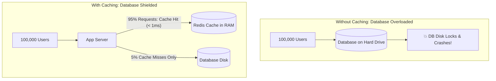

### 04. ANALOGY
* **Database = A massive public library basement:** You have to take the elevator down, search through aisles, and find a book on the shelf (takes 15 minutes).
* **Cache = The sticky note on your computer screen:** The 3 most important phone numbers you call every day are written right in front of your eyes (takes 1 second).

### 05. CONCEPTS

| Term | Definition | Impact |
| :--- | :--- | :--- |
| **Cache Hit** | The requested data was found in RAM. | Instant response (< 1ms) |
| **Cache Miss** | The data was not in RAM; must read from disk DB. | Slow response (15ms), then data is saved to cache |
| **TTL (Time to Live)** | The lifespan of a cache key before it self-destructs. | Prevents stale data from lingering forever |
| **Cache Invalidation** | Removing or updating old data in the cache. | "There are only two hard things in Computer Science: cache invalidation and naming things." |

### 06. ARCHITECTURE

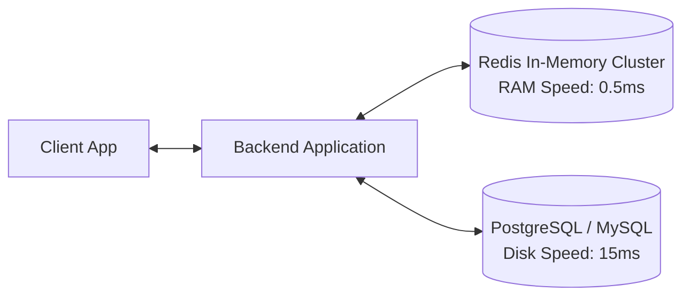

### 07. COMPONENTS

| Component | Role | Failure Impact |
| :--- | :--- | :--- |
| **In-Memory Cache (Redis)** | Stores serialized key-value pairs in RAM | If dead, app falls back to database (DB load spikes) |
| **Cache Client Library** | Handles hashing, connection pooling, and serialization | If misconfigured, causes connection leaks |
| **Persistent Database** | Single source of truth on disk | Permanent storage |

### 08. WORKING: The 5 Caching Strategies

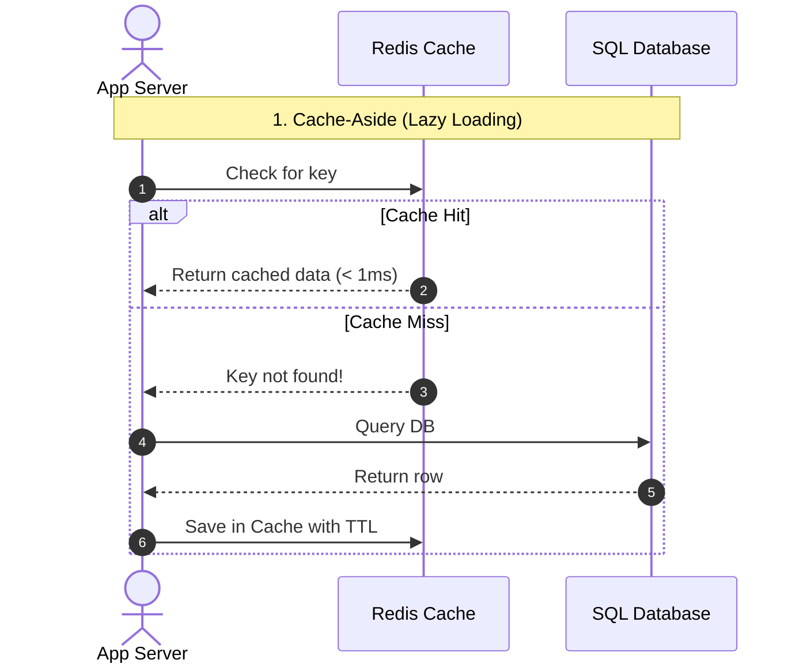

#### Detailed Breakdown of the 5 Patterns:
1. **Cache-Aside (Lazy Loading):** App queries cache first. On miss, it fetches from DB and writes to cache. Only requested data is cached.
2. **Read-Through:** App talks only to the cache. The cache library transparently fetches from DB on a miss.
3. **Write-Through:** App writes to cache; the cache immediately and synchronously writes to DB before confirming success. Zero stale data, but slower writes.
4. **Write-Back (Write-Behind):** App writes to cache immediately; cache asynchronously flushes batch writes to DB in the background. Ultra-fast writes, but risk of data loss if cache crashes.
5. **Write-Around:** App writes directly to DB, bypassing cache. Prevents cache from being flooded with data that isn't read frequently.

### 09. DATA FLOW: Write-Back Caching

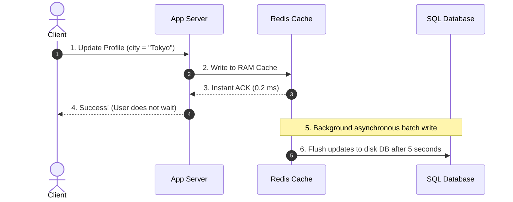

### 10. TYPES: Cache Eviction Policies

| Eviction Policy | How It Works | Best For |
| :--- | :--- | :--- |
| **LRU (Least Recently Used)** | Evicts items that haven't been accessed for the longest time | General-purpose web apps (most popular) |
| **LFU (Least Frequently Used)** | Tracks access counters. Evicts items accessed least often | Stable access patterns (popular videos) |
| **FIFO (First In First Out)** | Evicts oldest items regardless of usage | Sequential data streams |
| **TTL Expiration** | Keys automatically expire after a set time window | Temporary session tokens, OTPs |

### 11. COMPARISON: Redis vs Memcached

| Feature | Redis | Memcached |
| :--- | :--- | :--- |
| **Data Structures** | Strings, Hashes, Lists, Sets, Sorted Sets, Bitmaps | Simple Key-Value Strings only |
| **Disk Persistence** | Yes (RDB Snapshots & AOF Write Logs) | No (Purely volatile; lost on reboot) |
| **Architecture** | Single-threaded event loop (I/O threads in v6+) | Multi-threaded |
| **High Availability** | Redis Sentinel & Native Clustering | Client-side sharding |
| **Pub/Sub Messaging** | Supported out of the box | Not supported |

### 12. EXAMPLES
* **Simple Example:** `redis.set("user:42", jsonString, "EX", 3600);` (Saves user 42 for 1 hour).
* **Technical Example:** Implementing an LRU Cache in $O(1)$ time using a **Hash Map + Doubly Linked List**.
* **Real-World Case Study:** **Twitter (X)** stores the home timeline of every active user in Redis RAM clusters, allowing users to load tweets in under 10ms!

### 13. ADVANTAGES
* Drastically reduces database read pressure.
* Provides sub-millisecond response latency.
* Protects systems against viral spikes in traffic.

### 14. DISADVANTAGES
* **Stale Data:** Risk that cache contains old data if the database was updated directly.
* **Memory Cost:** RAM is significantly more expensive per gigabyte than SSD disk storage.
* **Complexity:** Requires handling eviction, stampedes, and cache warmups.

### 15. USE CASES

| Scenario | Strategy / Eviction | Why? |
| :--- | :--- | :--- |
| **User Authentication Sessions** | Redis with TTL (24h) | Fast validation on every HTTP request |
| **Gaming Leaderboard** | Redis Sorted Sets (`ZADD/ZRANGE`) | Real-time score ranking in $O(\log N)$ |
| **E-Commerce Product Details** | Cache-Aside with LRU Eviction | Products read millions of times, rarely changed |
| **High-Volume IoT Ingestion** | Write-Back Caching | Absorbs write spikes and writes to DB in batches |

### 16. PERFORMANCE: The 3 Critical Cache Gotchas

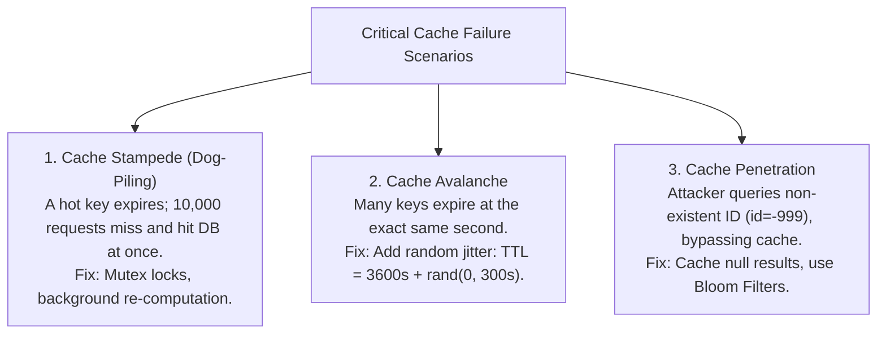

### 17. SECURITY

| Threat | Mitigation |
| :--- | :--- |
| **Unauthenticated Redis Access** | Enable `requirepass` password, bind only to `127.0.0.1` or private VPC |
| **Sensitive Data Exposure** | Encrypt sensitive cache values before writing; do not cache credit cards |

### 18. TRADE-OFFS

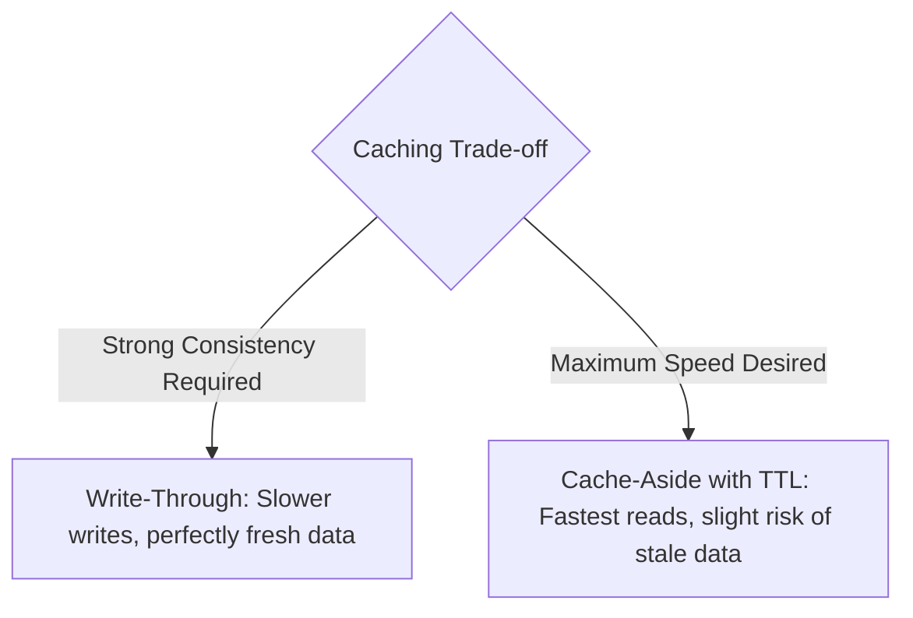

### 19. BEST PRACTICES
- [x] Always set a **TTL** on every cache key to prevent memory leaks.
- [x] Add **random jitter** to expiration times to avoid Cache Avalanches.
- [x] Use **Bloom Filters** to stop Cache Penetration from querying non-existent keys.

### 20. COMMON MISTAKES

| Mistake | Consequence | Correction |
| :--- | :--- | :--- |
| **No TTL on keys** | Redis runs out of memory (OOM crash) | Always specify expiration time |
| **Using cache as primary database** | Data is lost on crash (unless using persistence) | Treat cache as secondary speed booster |
| **Caching dynamic unshared data** | Wastes expensive RAM on single-use data | Only cache frequently read, shared items |

### 21. INTERVIEW QUESTIONS
* **Beginner:** What is the difference between Cache-Aside and Write-Through caching?
  - *Answer:* Cache-Aside loads data on read miss. Write-Through writes to cache and DB simultaneously.
* **Intermediate:** How do you prevent a Cache Stampede when a celebrity tweet expires?
  - *Answer:* Use distributed mutex locks so only 1 request queries the DB while others wait, or re-compute the cache key asynchronously before it expires.
* **Advanced:** Explain how a Bloom Filter prevents Cache Penetration.
  - *Answer:* A Bloom filter is a space-efficient probabilistic data structure that quickly tells if an element definitely does *not* exist in the database, blocking malicious queries before they hit the DB.

### 22. SUMMARY

```
Caching Revision Cheat Sheet:
├── Speed: RAM is 100,000x faster than disk.
├── Strategy: Cache-Aside is the universal default.
├── Eviction: LRU (Least Recently Used) is the most popular eviction policy.
├── Avalanche Defense: Add random jitter to TTL.
└── Penetration Defense: Bloom Filters + cache null values.
```

---

# 🗄️ MODULE 4: Databases, ACID vs BASE, The CAP Theorem & Sharding
*(Covering Phase 4: Topics 47–63)*

### 01. WHAT
* **Simple Definition:** A database is a safe, permanent storage system for your data. Scaling it means spreading reads and writes across multiple servers without losing or corrupting data.
* **Technical Definition:** A structured electronic system that manages data persistence, concurrency control, and query optimization, governed by either **ACID** (strong consistency) or **BASE** (eventual consistency) models under **CAP theorem** constraints.

### 02. WHY
* **Reliability:** Data must never disappear, even during power cuts or server crashes.
* **Concurrency:** Allows millions of users to read and update data at the exact same millisecond.
* **Query Performance:** Indexes allow finding 1 row out of 100 million in under 5 milliseconds.

### 03. PROBLEM (What Breaks Without It?)
A single database server has limits. When tables grow to 500 million rows, disk I/O saturates, writes lock the tables, queries take 30 seconds, and the database runs out of disk space.

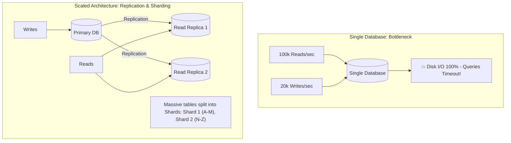

### 04. ANALOGY
* **Replication (Primary-Replica):** A newspaper editor (Primary) writes the daily news. Printing presses make 10,000 copies (Replicas) so thousands of people can read at the same time without bothering the editor.
* **Sharding (Partitioning):** An encyclopedia is too heavy for 1 book. You split it into 26 volumes: Volume A, Volume B... Volume Z.

### 05. CONCEPTS

| Term | Definition | Context |
| :--- | :--- | :--- |
| **ACID** | Atomicity, Consistency, Isolation, Durability | The strict gold standard for banking and financial ledgers |
| **BASE** | Basically Available, Soft state, Eventual consistency | The distributed standard for social feeds and big data |
| **Shard Key** | The column used to split rows across servers | e.g. `user_id` or `country_code` |
| **Read Replica** | A read-only copy of the primary database | Absorbs heavy `SELECT` queries |
| **Connection Pool** | Reusable pool of database connections | Prevents opening/closing TCP sockets per query |

### 06. ARCHITECTURE: Sharding + Read Replicas

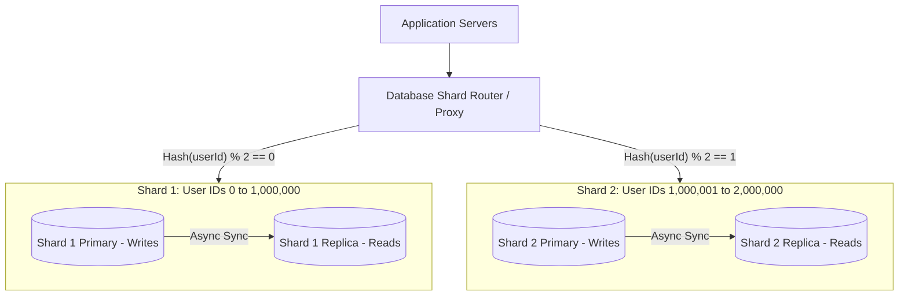

### 07. COMPONENTS

| Component | Role | Failure Impact |
| :--- | :--- | :--- |
| **Primary (Master) Node** | Handles all data modifications (`INSERT`, `UPDATE`, `DELETE`) | Automatic failover promotes a replica to primary |
| **Read Replicas** | Serve high-volume `SELECT` queries | If one replica dies, other replicas pick up the slack |
| **Shard Router** | Evaluates the Shard Key to direct queries to the right shard | High-availability proxy cluster required |

### 08. WORKING: The CAP Theorem Explained

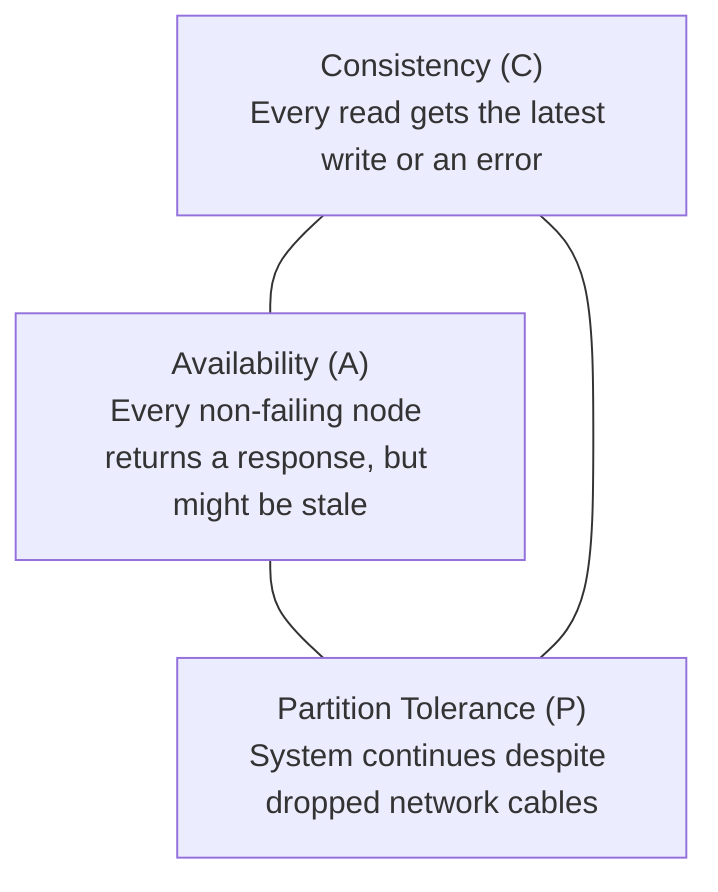

> [!IMPORTANT]
> **Network cables will inevitably fail.** Therefore, **Partition Tolerance (P) is mandatory**.
> When a network split occurs between Node 1 and Node 2, you MUST choose:
> * **CP (Consistency + Partition Tolerance):** Block the user or return an error until nodes can synchronize. (Banks, MongoDB, HBase).
> * **AP (Availability + Partition Tolerance):** Return the local data immediately, even if it is a few seconds stale. (Social feeds, Cassandra, DynamoDB).

### 09. DATA FLOW: Replication Lag

```mermaid
sequenceDiagram
    autonumber
    actor Alice
    actor Bob
    participant Master as Primary Database
    participant Replica as Read Replica

    Alice->>Master: 1. Update status: "I love System Design!"
    Master-->>Alice: 2. Commit OK (200 OK)
    Note over Master,Replica: Network delay: Replication Lag (~100 ms)
    Bob->>Replica: 3. Read Alice's status
    Replica-->>Bob: 4. Returns OLD status! (Alice hasn't updated yet)
    Master->>Replica: 5. Replication packet arrives & syncs
    Bob->>Replica: 6. Read Alice's status again
    Replica-->>Bob: 7. Returns "I love System Design!" (Eventually Consistent)
```

### 10. TYPES: Sharding Strategies

| Strategy | How It Works | Pros | Cons |
| :--- | :--- | :--- | :--- |
| **Range-Based** | Shard 1: A–F, Shard 2: G–M... | Easy to query ranges of data | Uneven distribution (Hotspots on popular letters) |
| **Hash-Based** | `Hash(key) % NumberOfShards` | Perfectly even distribution | Cross-shard range queries are very slow |
| **Directory-Based** | Lookup service maps keys to shards | Highly flexible | Lookup service is a Single Point of Failure |

### 11. COMPARISON: ACID vs BASE

| Property | ACID (Relational SQL) | BASE (Distributed NoSQL) |
| :--- | :--- | :--- |
| **Consistency** | **Strong Consistency** (Immediate) | **Eventual Consistency** (Syncs over time) |
| **Performance** | Slower (Locks and multi-phase commits) | Extremely Fast (Writes complete locally in RAM) |
| **Availability** | Lower under network partition (CP) | High availability guaranteed (AP) |
| **Best For** | Financial transfers, Order checkouts | YouTube view counts, Social feeds, Chat history |

### 12. EXAMPLES
* **Simple Example:** Configuring a MySQL replica by enabling the binary log (`binlog`) on the master.
* **Technical Example:** Designing a Shard Key: Hashing `user_id` ensures that all data for a specific user lives on the exact same database shard, avoiding cross-shard joins!
* **Real-World Case Study:** **Instagram** sharded their PostgreSQL databases by creating custom 64-bit IDs using a millisecond timestamp + shard ID to support hundreds of millions of users without locking.

### 13. ADVANTAGES
* **Scale Reads:** Adding 5 read replicas provides 5x more read throughput.
* **Scale Writes:** Sharding splits write traffic across independent disks.
* **Disaster Recovery:** If Datacenter A floods, Replicas in Datacenter B are promoted instantly.

### 14. DISADVANTAGES
* **Replication Lag:** Replicas may serve slightly stale data for a few hundred milliseconds.
* **No Cross-Shard Joins:** Performing SQL `JOIN` across two physical database machines is slow and complicated.
* **Re-sharding Overhead:** Adding new shards requires complex data migration.

### 15. USE CASES

| Scenario | Database Approach | Why? |
| :--- | :--- | :--- |
| **Bank Account Transfers** | SQL with ACID transactions | Zero tolerance for lost money or partial writes |
| **E-Commerce Product Catalog** | Master-Replica SQL | 99% reads, 1% updates; replicas scale reads effortlessly |
| **Global Analytics Clickstream** | NoSQL with BASE (Cassandra) | Massive write throughput, eventual consistency is fine |
| **500M User Social App** | Sharded Database by `user_id` | Splits write load across 50 separate servers |

### 16. PERFORMANCE
* **Connection Pooling:** Always use tools like HikariCP or PgBouncer. Opening a new database TCP connection takes 50ms; picking from a pool takes 0.1ms!
* **Indexing:** Adding an index on `user_id` converts an $O(N)$ full-table scan into an $O(\log N)$ B-Tree lookup.

### 17. SECURITY

| Threat | Mitigation |
| :--- | :--- |
| **SQL Injection** | Always use **Parameterized Queries (Prepared Statements)**; never concatenate raw strings |
| **Database Ransomware** | Keep automated daily backups in separate, read-only S3 buckets with Object Lock |

### 18. TRADE-OFFS

```mermaid
graph TD
    Decision{Database Trade-off}
    Decision -->|Strong Consistency & Complex Queries| SQL[SQL: PostgreSQL / MySQL]
    Decision -->|Massive Write Volume & Horizontal Scale| NoSQL[NoSQL: Cassandra / DynamoDB]
```

### 19. BEST PRACTICES
- [x] Never perform database migrations during peak traffic hours.
- [x] Pick a Shard Key with high cardinality (e.g. `user_id`, NOT `country` or `gender` which cause severe hotspots).
- [x] Always read your own writes: After a user edits their profile, route their next read to the Primary DB to prevent replication lag confusion.

### 20. COMMON MISTAKES

| Mistake | Consequence | Correction |
| :--- | :--- | :--- |
| **Missing Indexes on Foreign Keys** | Queries take 20 seconds as tables grow | Index all columns used in `WHERE` and `JOIN` |
| **Cross-Shard Joins** | Severely degrades network and CPU | Denormalize data or perform joins in application code |
| **Writing to Read Replicas** | Crashes replication sync | Enforce read-only permissions on replica users |

### 21. INTERVIEW QUESTIONS
* **Beginner:** What does ACID stand for?
  - *Answer:* Atomicity (all or nothing), Consistency (rules enforced), Isolation (concurrent independence), Durability (saved permanently).
* **Intermediate:** What is replication lag and how do you handle it in a user-facing app?
  - *Answer:* The delay for writes on the master to reach replicas. Solution: Route users to read from the master for 2 seconds after they perform a write.
* **Advanced:** How would you design a sharding strategy for an app like Twitter?
  - *Answer:* Shard by `user_id` so all of a user's tweets live together. For the home feed, use an asynchronous fan-out service (Message Queue + Redis) rather than querying all shards.

### 22. SUMMARY

```
Databases Revision Cheat Sheet:
├── SQL vs NoSQL: ACID relational rigor vs horizontal flexible scaling.
├── Replication: Scales reads. Writes go to Master, reads go to Replicas.
├── Sharding: Scales writes and storage by splitting rows across physical machines.
├── CAP Theorem: When network partitions happen, pick Consistency (CP) or Availability (AP).
└── Performance Rule: Index your query columns and always use connection pooling.
```
