# The Complete Engineering Guide to Servers: Architecture, Capacity, Performance & Scaling

[🏠 Back to System Design Hub](./README.md)

---

## 📖 Executive Table of Contents

1. [Server Basics: How Servers Work Internally](#1-server-basics-how-servers-work-internally)
2. [Server Capacity: Hardware vs. Workload Formulas](#2-server-capacity-hardware-vs-workload-formulas)
3. [Latency: Analysis, Percentiles & Reduction Techniques](#3-latency-analysis-percentiles--reduction-techniques)
4. [Throughput: RPS Calculations & Little's Law](#4-throughput-rps-calculations--littles-law)
5. [Concurrency: Handling Thousands to Millions of Connections](#5-concurrency-handling-thousands-to-millions-of-connections)
6. [Scaling Roadmap: From 1,000 to 10,000,000 DAU](#6-scaling-roadmap-from-1000-to-10000000-dau)
7. [Database Performance: Eliminating the Ultimate Bottleneck](#7-database-performance-eliminating-the-ultimate-bottleneck)
8. [Load Testing & Verification: k6 & JMeter Playbooks](#8-load-testing--verification-k6--jmeter-playbooks)
9. [Capacity Planning & Cost Estimation Framework](#9-capacity-planning--cost-estimation-framework)
10. [High-Scale Server Architecture Components](#10-high-scale-server-architecture-components)
11. [Observability & Monitoring: RED & USE Metrics](#11-observability--monitoring-red--use-metrics)
12. [Reliability Engineering: Spikes, Rate Limiting & Failover](#12-reliability-engineering-spikes-rate-limiting--failover)
13. [Deep Optimization: Kernel, Network & Application Runtimes](#13-deep-optimization-kernel-network--application-runtimes)
14. [Real-World System Design: 1 Million Registered Users Backend](#14-real-world-system-design-1-million-registered-users-backend)
15. [Production Troubleshooting & Diagnostic Runbook](#15-production-troubleshooting--diagnostic-runbook)

---

## 1. Server Basics: How Servers Work Internally

At its simplest, a **server** is a physical computer or virtual machine (VM) running an operating system (Linux, Windows, etc.) that continuously executes a program listening for incoming requests over a network, processes them according to business rules, and returns responses.

### 1.1 Physical Hardware to Operating System Kernel

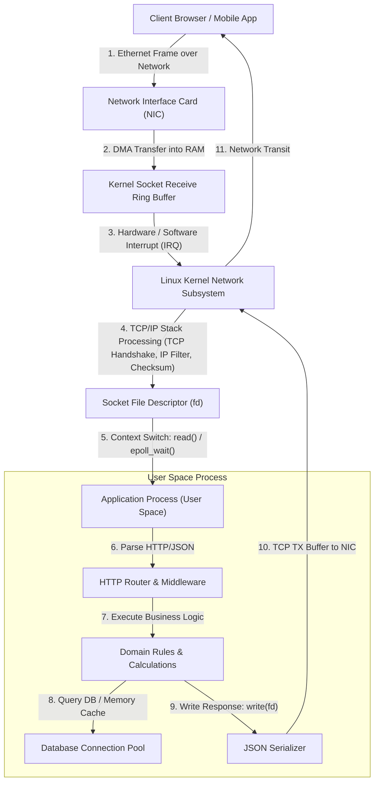

### 1.2 Step-by-Step Life of a Single Request

When a user opens `https://myapp.com/api/products/42`:
1. **Network Ingestion:** The client transmits a TCP segment. The physical Network Interface Card (NIC) converts optical/copper electrical signals into digital bytes and writes them directly into host RAM via **Direct Memory Access (DMA)** without taxing the CPU.
2. **Interrupt & Protocol Processing:** The NIC fires an interrupt to the CPU. The OS kernel's network driver inspects the packet, validates the Ethernet frame, verifies the IP header, reassembles TCP segments in sequence, and places raw bytes into the socket's receive buffer (`SO_RCVBUF`).
3. **User-Space Transition:** The application server (written in C++, Go, Java, or Node.js) waits on a socket file descriptor using an event multiplexer (e.g., Linux `epoll`). The kernel wakes up the server thread.
4. **Parsing & Authentication:** The runtime reads the HTTP stream, verifies TLS cryptographic certificates, parses headers and query parameters, and validates JWT or session cookies.
5. **Business Logic Execution:** The server computes pricing, checks inventory, and formats output. If external data is required, it communicates across the network to a database or cache.
6. **Response Transmission:** The runtime writes the payload into the socket send buffer (`SO_SNDBUF`). The kernel segments the data into TCP packets, appends headers, and commands the NIC to send the bytes back to the user.

---

## 2. Server Capacity: Hardware vs. Workload Formulas

One of the most dangerous mistakes in software engineering is guessing server capacity (e.g., *"A 4-core server can probably handle 5,000 users"*). In reality, server capacity is determined strictly by **laws of physics and mathematics**:
* How many CPU cycles each request consumes (**CPU-bound time**).
* How long each request waits on external systems (**I/O-bound time**).
* How much RAM is held in memory for each open connection and in-flight request.

### 2.1 CPU-Bound vs. I/O-Bound Workloads

| Attribute | CPU-Bound Workload | I/O-Bound Workload |
|---|---|---|
| **What it does** | Cryptography, image resizing, machine learning, heavy JSON serialization, sorting in memory | Querying PostgreSQL, fetching Redis keys, making downstream HTTP calls, writing to disk |
| **Where time is spent** | On the CPU core computing instructions ($90\%+$ CPU utilization) | Waiting on the network or disk ($5\text{–}15\%$ CPU, thread blocked or idling) |
| **Limiting Factor** | CPU clock speed, core count, instruction cache efficiency | Network bandwidth, socket buffer memory, connection pool sizes, database concurrency |
| **Example Request Latency** | $20\,\text{ms}$ CPU time, $2\,\text{ms}$ I/O time | $2\,\text{ms}$ CPU time, $48\,\text{ms}$ DB wait time |

### 2.2 Mathematical Formula for Real Server Throughput

The theoretical maximum Requests Per Second ($RPS_{\text{max}}$) a server can execute is:

$$\text{RPS}_{\text{max}} = \frac{N_{\text{cores}} \times \text{Target CPU Utilization}}{\text{CPU Time Per Request (seconds)}}$$

> [!NOTE]
> **Example Calculation:**
> If a 4-core server processes an API call that requires **$4\,\text{ms}$ ($0.004\,\text{s}$)** of actual CPU execution time, and we target a safe **$75\%$ ($0.75$)** peak CPU utilization:
>
> $$\text{RPS}_{\text{max}} = \frac{4 \times 0.75}{0.004} = \frac{3.0}{0.004} = 750\text{ RPS}$$
>
> Even if total request latency is $50\,\text{ms}$ (because $46\,\text{ms}$ is spent waiting on PostgreSQL), the CPU can only ever start and finish $750$ requests per second per 4 cores before reaching $75\%$ CPU usage!

### 2.3 Comprehensive Hardware Capacity Table

The following table provides realistic benchmarks across common cloud Virtual Machines (e.g., AWS c6i/c7g, GCP c3, DigitalOcean, Hetzner) running production Linux kernels with optimized TCP stacks.

| CPU Cores | RAM | Workload Type | Avg CPU Time/Req | Concurrency Limit | Sustained RPS (70% CPU) | Concurrent Active Users | Verification Method |
|:---:|:---:|---|:---:|:---:|:---:|:---:|---|
| **1 Core** | **1 GB** | Lightweight API (Go / Rust) | $0.8\,\text{ms}$ | 1,024 sockets | **$875$ RPS** | 5,000 – 15,000 | k6 HTTP benchmarking |
| **1 Core** | **2 GB** | Dynamic Script (Python / Ruby) | $15\,\text{ms}$ | 256 sockets | **$45$ RPS** | 500 – 1,500 | k6 load test |
| **2 Cores** | **4 GB** | Microservice (Node.js / Express) | $3.5\,\text{ms}$ | 4,096 sockets | **$400$ RPS** | 4,000 – 10,000 | Apache JMeter |
| **4 Cores** | **8 GB** | Enterprise API (Java Spring Boot) | $4.0\,\text{ms}$ | 10,000 sockets | **$700$ RPS** | 10,000 – 30,000 | k6 sustained ramp |
| **4 Cores** | **8 GB** | High-Perf API (Go / Gin / Fastify)| $1.0\,\text{ms}$ | 20,000 sockets | **$2,800$ RPS** | 40,000 – 80,000 | wrk / k6 |
| **8 Cores** | **16 GB**| E-commerce Order Flow (Mixed) | $5.0\,\text{ms}$ | 30,000 sockets | **$1,120$ RPS** | 25,000 – 60,000 | JMeter distributed |
| **16 Cores**| **32 GB**| High-Throughput Auth / Gateway | $1.2\,\text{ms}$ | 65,000 sockets | **$9,300$ RPS** | 150,000 – 300,000 | k6 multi-agent |
| **32 Cores**| **64 GB**| High-Volume FinTech Processing | $2.5\,\text{ms}$ | 150,000 sockets | **$8,960$ RPS** | 200,000 – 500,000 | Locust cluster |
| **64 Cores**| **128 GB**| Edge Proxy / Reverse Proxy (Nginx)| $0.15\,\text{ms}$ | 500,000 sockets | **$298,000$ RPS**| 1,500,000+ | wrk2 rate-limited |

*Note on "Concurrent Active Users": An active user browsing a website typically executes 1 action every 10–30 seconds. Therefore, a server delivering $1,000\text{ RPS}$ can comfortably support $1,000 \times 20 = 20,000$ concurrent browsing users.*

### 2.4 RAM Capacity: The Connection Cost Equation

RAM does not determine how fast a CPU runs calculations; **RAM determines how many simultaneous connections and in-flight buffers the server can hold in memory without swapping or triggering the Linux Out-Of-Memory (OOM) Killer**.

$$\text{Total RAM Required} = \text{OS Overhead} + \text{Runtime Base Memory} + (\text{Active Connections} \times \text{Memory Per Connection})$$

* **Linux OS Kernel Base:** $\sim 300\text{ MB} - 500\text{ MB}$.
* **App Process Base (Heap):** Go/Rust $\sim 30\text{ MB}$, Node.js $\sim 80\text{ MB}$, Java JVM $\sim 512\text{ MB} - 2\text{ GB}$.
* **Per-Connection Socket Buffer:** Each open TCP connection allocates a read buffer (`rmem`) and write buffer (`wmem`), typically $4\text{ KB} - 16\text{ KB}$ each.
* **Per-Thread Stack Memory:** 
  * Multi-threaded servers (Java, C++, Apache Tomcat): $1\text{ MB}$ per thread. 1,000 concurrent threads consume $\approx 1\text{ GB}$ of RAM just for thread stacks!
  * Event-driven or Coroutine runtimes (Node.js, Go goroutines): Goroutines start at just $2\text{ KB} - 4\text{ KB}$ per connection. 100,000 connections consume only $\approx 400\text{ MB}$ of RAM!

---

## 3. Latency: Analysis, Percentiles & Reduction Techniques

### 3.1 What is Latency?

**Latency** is the total time elapsed from the moment a client initiates a request until the complete response is received and rendered by the client. It is measured in milliseconds ($\text{ms}$) or microseconds ($\mu\text{s}$).

$$\text{Total Latency} = T_{\text{DNS}} + T_{\text{TCP Handshake}} + T_{\text{TLS Handshake}} + T_{\text{Request Transit}} + T_{\text{Server Queue}} + T_{\text{Server Processing}} + T_{\text{Response Transit}}$$

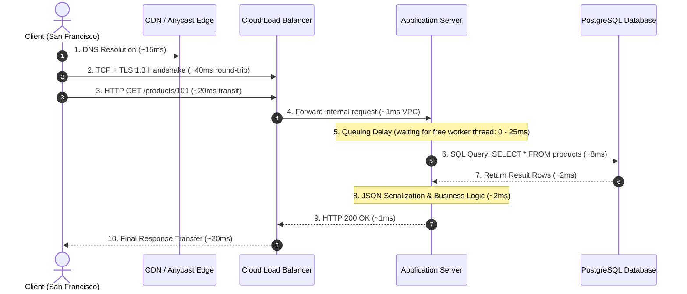

### 3.2 Why Averages are Dangerous: The Percentile Rule

Never measure latency using averages! If 99 users experience $10\,\text{ms}$ latency, but 1 user experiences $10,000\,\text{ms}$ ($10\text{ seconds}$), the average latency is:

$$\text{Average Latency} = \frac{(99 \times 10) + 10,000}{100} = \frac{10,990}{100} = 109.9\,\text{ms}$$

The average appears "acceptable" ($\sim 110\,\text{ms}$), but $1\%$ of your highest-value users are suffering through a complete application freeze!

#### Latency Percentiles Explained
* **p50 (Median):** The latency experienced by the 50th percentile of users. Exactly half the requests are faster, and half are slower.
* **p90:** $90\%$ of requests complete faster than this number.
* **p95:** The threshold for acceptable experience under peak operational loads.
* **p99 (The Tail Latency):** The slowest $1\%$ of requests. In an e-commerce platform with 10 million daily visits, the p99 affects **100,000 customer sessions every single day**!
* **p99.9:** Extreme edge cases caused by Garbage Collection (GC) pauses, disk IOPS throttling, network packet drops, or database lock contention.

### 3.3 Root Causes of Latency & Specific Remedies

| Latency Bottleneck | Root Cause | Engineering Solution |
|---|---|---|
| **Queuing Delay** | Arrival rate exceeds thread pool capacity; requests wait in queue | Scale horizontally, switch to non-blocking async I/O, enable load shedding |
| **Geographic Distance** | Speed-of-light propagation across long-distance fiber ($5\,\text{ms}$ per $1,000\,\text{km}$) | Deploy CDN (Cloudflare/CloudFront) for static assets and Edge API caching |
| **Database Lock Contention** | Multiple concurrent transactions writing to the same database row | Reduce transaction scope, use optimistic locking, queue writes via Redis/Kafka |
| **Garbage Collection (GC) Churn**| High object allocation rates cause Stop-The-World (STW) pauses in JVM/Go | Reuse memory buffers (`sync.Pool`), tune JVM ZGC/Shenandoah low-latency collectors |
| **TCP / TLS Handshake Overhead** | New TCP connection opened for every single HTTP request | Enable HTTP/2 or HTTP/3, configure `Keep-Alive: timeout=65`, use TLS Session Resumption |
| **N+1 Database Queries** | An ORM queries 1 parent record and executes 100 individual SQL queries | Use SQL `JOIN` or batched eager fetching (`IN (?, ?, ?...)`), implement Dataloader |

---

## 4. Throughput: RPS Calculations & Little's Law

### 4.1 What is Throughput?

**Throughput** measures the volume of work a system successfully completes in a given time interval. For web servers, it is expressed as **Requests Per Second (RPS)** or **Queries Per Second (QPS)**.

### 4.2 Little's Law: The Golden Formula of Server Concurrency

Discovered by mathematician John Little in 1961, **Little's Law** describes queueing systems in steady state:

$$L = \lambda \times W$$

Where:
* $L$ = **Concurrent Requests In-Flight** inside the server at any given instant.
* $\lambda$ = **Throughput (Arrival Rate)** in Requests Per Second ($\text{RPS}$).
* $W$ = **Average Latency (Service Time)** in seconds.

Rearranging the formula gives the fundamental server throughput equations:

$$\text{RPS} = \frac{L}{W} \quad \text{and} \quad L = \text{RPS} \times W$$

#### Real-World Mathematical Examples

**Scenario A: Fast Microservice ($W = 20\,\text{ms} = 0.02\,\text{s}$)**
If our server thread pool holds $100$ concurrent requests ($L = 100$):

$$\text{RPS} = \frac{100}{0.02} = 5,000\text{ RPS}$$

**Scenario B: Slow Database Dependency ($W = 200\,\text{ms} = 0.2\,\text{s}$)**
If downstream PostgreSQL slows down, increasing latency from $20\,\text{ms}$ to $200\,\text{ms}$:

$$\text{RPS} = \frac{100}{0.2} = 500\text{ RPS}$$

> [!CAUTION]
> **The Domino Collapse:** When latency increases by $10\times$ (from $20\,\text{ms}$ to $200\,\text{ms}$), server throughput immediately drops by $90\%$ for the same concurrency level! Incoming requests pile up in queues, memory fills, and the server crashes. **Latency is the enemy of throughput.**

---

## 5. Concurrency: Handling Thousands to Millions of Connections

How does a single physical server run simultaneously for 100,000+ connected clients without stalling? The evolution of server concurrency models solves the classic **C10K problem** (handling 10,000 concurrent connections) and the modern **C10M problem** (handling 10 million concurrent connections).

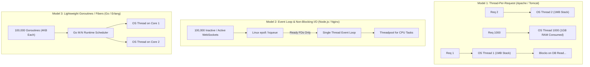

### 5.1 Model 1: Multi-Threaded Blocking I/O (Thread-per-Request)
* **Used by:** Classic Apache HTTP Server, older Java Tomcat, PHP-FPM.
* **Mechanism:** When a request arrives, the OS spawns or allocates a dedicated operating system thread. If the request executes a database query that takes $100\,\text{ms}$, the entire thread sits idle in a blocked state.
* **Ceiling:** The Linux kernel struggles when managing more than $\sim 2,000 - 5,000$ active OS threads due to CPU context switching overhead (saving and restoring CPU register state) and memory consumption ($1\text{ MB}$ per thread).

### 5.2 Model 2: Event-Driven Non-Blocking I/O (The Reactor Pattern)
* **Used by:** Nginx, Node.js, Redis, Netty (Java).
* **Mechanism:** A single thread (or one thread per CPU core) runs an infinite loop. When an I/O operation (socket read, file access) is requested, the application registers the socket file descriptor with the kernel via `epoll_ctl` and immediately moves on to serve the next customer.
* **The Magic of `epoll`:** Unlike old POSIX `select()` or `poll()` which scanned all $100,000$ file descriptors linearly ($O(N)$), Linux `epoll` is an $O(1)$ event notification mechanism. The kernel uses internal callback queues to hand the application only the specific descriptors that have new bytes waiting.

### 5.3 Model 3: User-Space Coroutines (M:N Green Threads)
* **Used by:** Go (Goroutines), Elixir/Erlang (BEAM processes), Java 21+ (Virtual Threads / Project Loom).
* **Mechanism:** Combines the simple synchronous coding style of Model 1 with the ultra-low memory efficiency of Model 2. 
* **How it works:** The runtime manages $M$ user-space coroutines multiplexed onto $N$ real OS kernel threads. When a goroutine calls `db.Query()`, the Go runtime automatically parks the goroutine, frees the underlying CPU core to execute another goroutine, and re-activates the original goroutine when the database response packet arrives.

---

## 6. Scaling Roadmap: From 1,000 to 10,000,000 DAU

Scaling is not a one-step operation. Attempting to build a multi-region distributed microservices cluster for an early-stage application wastes financial capital and developer velocity. A system must evolve through distinct architectural phases.

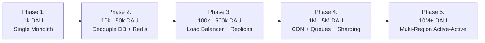

### 6.1 Phase 1: 1,000 Daily Active Users (DAU)
* **Traffic Profile:** $\approx 10\text{–}20\text{ Requests/Min}$, Peak $\approx 5\text{ RPS}$.
* **Architecture:** Single Virtual Machine ($2\text{ vCPU}, 4\text{ GB RAM}$).
* **Stack:** App server, web server (Nginx), and PostgreSQL all running on the same host (or managed PaaS like Render/Heroku).
* **Backups:** Automated nightly database snapshot to S3.

### 6.2 Phase 2: 10,000 to 50,000 DAU
* **Traffic Profile:** Peak $\approx 50\text{–}150\text{ RPS}$.
* **Architecture Change:** Separate the database onto its own dedicated server.
* **Components Added:**
  * **App VM:** $4\text{ vCPU}, 8\text{ GB RAM}$.
  * **Database VM:** $4\text{ vCPU}, 16\text{ GB RAM}$ (SSD-backed storage).
  * **In-Memory Cache:** Introduce Redis on a small instance ($2\text{ GB}$) to cache repeated queries, user sessions, and hot product lookups.
  * **Cache Hit Ratio Target:** $> 80\%$.

### 6.3 Phase 3: 100,000 to 500,000 DAU
* **Traffic Profile:** Peak $\approx 500\text{–}1,500\text{ RPS}$.
* **Architecture Change:** The application tier becomes completely **stateless**.
* **Components Added:**
  * **Load Balancer:** AWS ALB or HAProxy distributing traffic with Round-Robin or Least Connections.
  * **App Server Cluster:** 3 to 6 stateless application instances behind an Auto-Scaling Group (ASG).
  * **Database Read Replicas:** 1 Primary DB (handles `INSERT`, `UPDATE`, `DELETE`) with 2 Read Replicas (handle `SELECT` queries) using PostgreSQL streaming replication.

### 6.4 Phase 4: 1,000,000 to 5,000,000 DAU
* **Traffic Profile:** Sustained $2,000\text{ RPS}$, Peak $5,000\text{–}10,000\text{ RPS}$.
* **Architecture Change:** Offload static and dynamic assets to the edge, introduce asynchronous processing.
* **Components Added:**
  * **Content Delivery Network (CDN):** Cloudflare / CloudFront terminates TLS and caches $95\%+$ of images, videos, CSS, and static assets.
  * **Message Queue / Event Bus:** RabbitMQ, Kafka, or AWS SQS. Critical paths return immediately (`HTTP 202 Accepted`), and background workers process emails, PDF creation, and analytics.
  * **Database Partitioning / Read Replica Pool:** Connection pooling via PgBouncer, partition massive tables (e.g., `orders`, `audit_logs`) by date or user ID.

### 6.5 Phase 5: 10,000,000+ DAU (Global Scale)
* **Traffic Profile:** $30,000\text{–}100,000+\text{ RPS}$ global load.
* **Architecture Change:** Multi-region active-active deployment.
* **Components Added:**
  * **Global Server Load Balancing (GSLB) / Anycast DNS:** Routes users to the nearest geographical datacenter (e.g., US-East, EU-Central, AP-South).
  * **Database Sharding:** Consistent hashing across independent database clusters partitioned by `user_id`.
  * **Global Caching & Distributed Edge Functions:** Cloudflare Workers or AWS Lambda@Edge executing auth verification and localized routing at edge points of presence (PoPs).

---

## 7. Database Performance: Eliminating the Ultimate Bottleneck

In $95\%$ of web applications, the application server is not the bottleneck—the **database** is. Application servers are easy to scale horizontally (just spin up 5 more stateless Docker containers). Scaling a stateful relational database with strong ACID transactions is far harder.

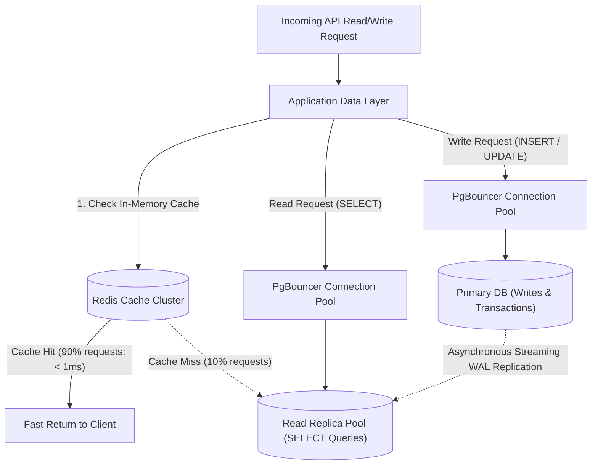

### 7.1 Database Connection Pooling (Why Direct Connections Kill DBs)

Opening a PostgreSQL or MySQL connection requires:
1. TCP 3-way handshake.
2. TLS cryptographic handshake.
3. Authentication and password verification.
4. Spawning a dedicated server backend process (in PostgreSQL, each connection allocates $5\text{–}10\text{ MB}$ of memory).

If 1,000 clients connect directly to PostgreSQL simultaneously, the database exhausts its file descriptors and crashes under memory pressure.

**The Solution:** Use a connection pooler (e.g., **PgBouncer** or **HikariCP** in Java):
* The application maintains a persistent pool of 50–100 open, warmed connections to the database.
* Thousands of incoming HTTP requests borrow a connection for $2\,\text{ms}$, execute their SQL query, and immediately return it to the pool.

### 7.2 B-Tree Indexing Rules for 100x Speedup

Without an index, querying a table with 10 million rows forces a **Full Table Scan (Sequential Scan)**: the database reads every single gigabyte of disk blocks sequentially ($O(N)$ time, taking $5\text{–}30\text{ seconds}$).

A **B-Tree index** organizes values into a balanced, sorted tree ($O(\log N)$ time, resolving in $< 1\,\text{ms}$ with 3 or 4 page lookups).

```sql
-- ❌ BAD: No index on foreign key or status
-- Scans all 10,000,000 rows
SELECT id, total_amount, created_at 
FROM orders 
WHERE user_id = 94821 AND status = 'COMPLETED';

-- ✅ FIX: Create a Composite (Multi-Column) Index
-- Place Equality columns first, Range columns second!
CREATE INDEX idx_orders_user_status_created 
ON orders (user_id, status, created_at DESC);
```

### 7.3 Read Replicas & CQRS (Command Query Responsibility Segregation)

For read-heavy applications ($90\%$ reads, $10\%$ writes):
* **Primary Instance:** Accepts `INSERT`, `UPDATE`, `DELETE`. Writes changes to the Write-Ahead Log (WAL).
* **Read Replicas:** 2 to 5 read-only nodes continuously streaming WAL changes from the Primary. Application routing sends all `SELECT` queries to replica IP addresses, multiplying read capacity by $500\%+$.

---

## 8. Load Testing & Verification: k6 & JMeter Playbooks

You cannot claim a server handles $10,000$ users until you have actively broken the server in a controlled load-testing environment.

### 8.1 The 5 Types of Performance Tests

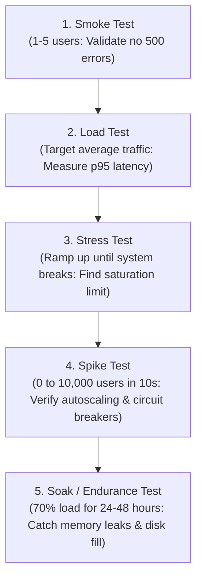

### 8.2 Production k6 Load-Testing Script (`load_test.js`)

[k6](https://k6.io/) is a modern, developer-centric open-source load-testing tool written in Go that executes test scenarios scripted in JavaScript.

```javascript
import http from 'k6/http';
import { check, sleep } from 'k6';

// 1. Test Execution Configuration
export const options = {
  stages: [
    { duration: '2m', target: 200 },  // Ramp-up to 200 virtual users over 2 minutes
    { duration: '5m', target: 200 },  // Stay at 200 users (Sustained Load)
    { duration: '2m', target: 1000 }, // Ramp-up to 1,000 users (Stress Phase)
    { duration: '5m', target: 1000 }, // Hold 1,000 users
    { duration: '2m', target: 0 },    // Ramp-down to 0
  ],
  thresholds: {
    http_req_duration: ['p(95)<150', 'p(99)<300'], // 95% of requests must finish within 150ms!
    http_req_failed: ['rate<0.01'],                 // Error rate must stay below 1%
  },
};

const BASE_URL = 'https://api.myapp.com';

export default function () {
  const params = {
    headers: {
      'Content-Type': 'application/json',
      'Authorization': 'Bearer test-token-xyz',
    },
    timeout: '5s',
  };

  // Step 1: Fetch user profile
  const profileRes = http.get(`${BASE_URL}/api/v1/user/profile`, params);
  check(profileRes, {
    'profile status is 200': (r) => r.status === 200,
    'profile response under 100ms': (r) => r.timings.duration < 100,
  });

  sleep(1); // User think time (1 second)

  // Step 2: Query product search
  const searchRes = http.get(`${BASE_URL}/api/v1/products?category=electronics&page=1`, params);
  check(searchRes, {
    'search status is 200': (r) => r.status === 200,
  });

  sleep(2);
}
```

### 8.3 Executing and Interpreting Results

Run the test from an independent machine (never run the load generator on the same server being tested!):
```bash
k6 run load_test.js
```

#### What to Look for in Output Metrics:
* **The Knee in the Curve (Saturation Point):** As Virtual Users (VUs) increase, throughput (RPS) will increase linearly. At a certain point, throughput will plateau while p95 latency spikes vertically upwards. That exact plateau is your **maximum real server capacity**.
* **HTTP 429 vs. HTTP 502/504:**
  * Returning `HTTP 429 Too Many Requests` indicates healthy rate-limiting and backpressure.
  * Returning `HTTP 502 Bad Gateway` or `HTTP 504 Gateway Timeout` indicates backend server thread exhaustion, worker crashes, or database timeouts.

---

## 9. Capacity Planning & Cost Estimation Framework

Let's work through a real-world mathematical capacity planning exercise for a mid-sized production application.

### 9.1 Baseline Application Requirements
* **Registered Users:** $2,000,000$ users.
* **Daily Active Users (DAU):** $150,000$ users ($7.5\%$ of registered base).
* **Average User Activity:** Active user makes $30$ API requests during an average $15\text{-minute}$ session.
* **Peak Hour Ratio:** $40\%$ of daily traffic arrives during a concentrated 4-hour evening window ($18:00 - 22:00$).
* **Average Response Payload:** $25\text{ KB}$ per API response.

### 9.2 Step-by-Step Mathematical Derivations

#### Step 1: Calculate Total Daily Requests
$$\text{Total Daily Requests} = 150,000\text{ DAU} \times 30\text{ requests} = 4,500,000\text{ requests/day}$$

#### Step 2: Calculate Average & Peak RPS
Average RPS across a full 24-hour day:
$$\text{Average RPS} = \frac{4,500,000\text{ requests}}{86,400\text{ seconds}} \approx 52.1\text{ RPS}$$

Peak 4-hour traffic volume:
$$\text{Peak Window Requests} = 4,500,000 \times 0.40 = 1,800,000\text{ requests}$$
$$\text{Peak 4-Hour RPS} = \frac{1,800,000}{4 \times 3,600\text{ seconds}} = \frac{1,800,000}{14,400} = 125\text{ RPS}$$

Accounting for a $3\times$ flash spike during sales or breaking events:
$$\text{Design Target Peak RPS} = 125 \times 3 = 375\text{ Peak RPS}$$

#### Step 3: Compute Application Server CPU & Count Requirements
Suppose profiling reveals each request consumes an average of **$8\,\text{ms}$ ($0.008\,\text{s}$)** of CPU time.
To handle $375\text{ RPS}$ at a safe peak target of $60\%$ CPU utilization:

$$\text{Total CPU Cores Needed} = \frac{\text{Peak RPS} \times \text{CPU Time Per Req}}{\text{Target CPU Utilization}} = \frac{375 \times 0.008}{0.60} = \frac{3.0}{0.60} = 5\text{ CPU Cores}$$

Using standard cloud instances ($2\text{ vCPU}, 4\text{ GB RAM}$ per instance):
$$\text{Base Instances} = \frac{5\text{ cores}}{2\text{ cores/instance}} = 2.5 \implies 3\text{ Instances}$$

**High Availability & Redundancy ($N+1$ Rule):** 
Always add at least 1 extra instance so the system tolerates a complete node crash without degradation:
$$\text{Total App Instances} = 3 + 1 = 4\text{ Instances (each 2 vCPU, 4 GB RAM)}$$

#### Step 4: Network Bandwidth Calculation
$$\text{Peak Bandwidth} = 375\text{ RPS} \times 25\text{ KB} = 9,375\text{ KB/s} = 9.375\text{ MB/s} = 75\text{ Mbps (Megabits per second)}$$
A standard $1\text{ Gbps}$ cloud network interface handles this with $> 90\%$ overhead headroom.

### 9.3 Monthly Cloud Cost Estimation (Realistic Breakdown)

| Infrastructure Component | Specification | Quantity | Monthly Unit Cost | Total Monthly Cost |
|---|---|:---:|:---:|:---:|
| **Application VMs** | 2 vCPU, 4 GB RAM (AWS c6i.large / Hetzner CPX21) | 4 | $\$24$ | $\$96$ |
| **Primary Database** | 4 vCPU, 16 GB RAM, 200 GB NVMe SSD | 1 | $\$110$ | $\$110$ |
| **Read Replica DB** | 4 vCPU, 16 GB RAM, 200 GB NVMe SSD | 1 | $\$110$ | $\$110$ |
| **In-Memory Cache** | Redis Cluster (4 GB RAM) | 1 | $\$35$ | $\$35$ |
| **Load Balancer** | Cloud Managed ALB / HAProxy | 1 | $\$22$ | $\$22$ |
| **Object Storage** | S3 / Cloudflare R2 (Static Assets + Backups) | 500 GB | $\$0.015/\text{GB}$ | $\$8$ |
| **CDN & DDoS** | Cloudflare Pro | 1 domain | $\$25$ | $\$25$ |
| **Observability** | Managed Prometheus / Grafana / Datadog (Logs) | - | Shared | $\$45$ |
| **Estimated Total** | *Complete High-Availability Infrastructure* | - | - | **$\approx \$451\text{ / month}$** |

---

## 10. High-Scale Server Architecture Components

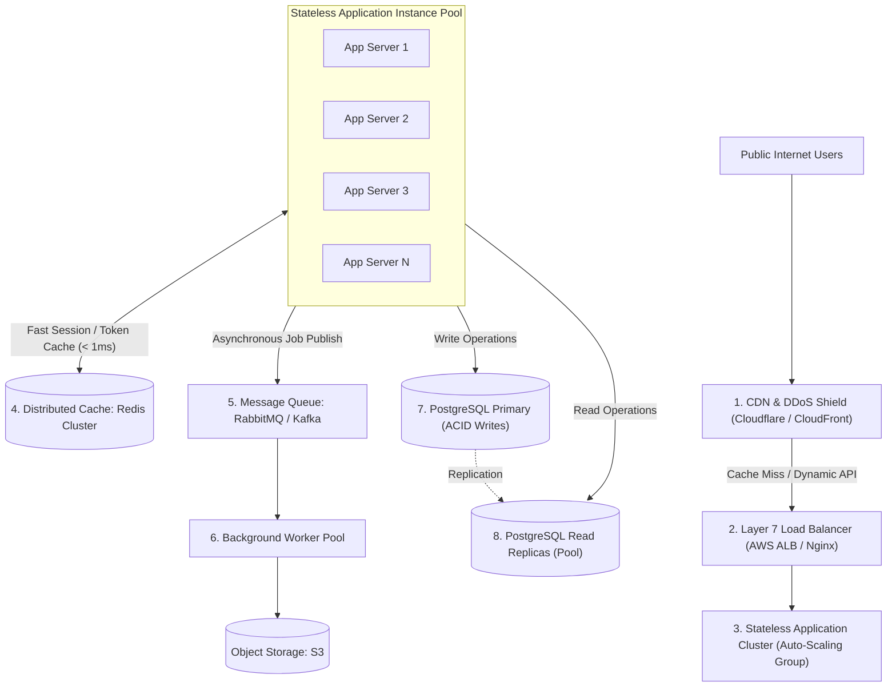

### 10.1 Load Balancers: Layer 4 vs. Layer 7

* **Layer 4 (Transport Layer - TCP/UDP):**
  * Operates strictly on IP addresses and TCP ports without inspecting packet payloads.
  * Extremely fast (millions of packets per second, microsecond latency).
  * Example: AWS Network Load Balancer (NLB), HAProxy TCP mode, Linux LVS.
* **Layer 7 (Application Layer - HTTP/HTTPS):**
  * Decrypts TLS, parses HTTP headers, inspects cookies, URL paths, and JSON bodies.
  * Enables intelligent routing: `/api/v1/orders` routes to Order Cluster, `/api/v1/search` routes to Elasticsearch Cluster.
  * Terminates SSL/TLS so backend servers communicate in plain HTTP over isolated private subnets.
  * Example: AWS Application Load Balancer (ALB), Nginx, Envoy, Traefik.

### 10.2 Redis: 5 Crucial Superpowers in Server Architecture
1. **Response Caching (Cache-Aside):** Stores the JSON results of expensive SQL queries.
2. **Session Storage:** Stores authenticated user sessions or JWT revocation blacklists across all stateless instances.
3. **Distributed Locks (`Redlock`):** Prevents double-spending or duplicate order processing when two requests arrive simultaneously.
4. **Rate Limiting:** Sliding-window counters blocking abusive IPs.
5. **Real-time Leaderboards & Queues:** In-memory sorted sets (`ZSET`) and lightweight pub/sub.

### 10.3 Content Delivery Networks (CDNs)
A CDN deploys hundreds of Edge Point-of-Presence (PoP) datacenters across the world. When a user in Tokyo requests an image from a company hosted in Virginia:
* Without CDN: Data travels $11,000\,\text{km}$ across undersea cables, taking $180\,\text{ms}$ per packet round-trip.
* With CDN: The Tokyo user fetches the image from a Tokyo CDN node in **$3\,\text{ms}$**!

---

## 11. Observability & Monitoring: RED & USE Metrics

You cannot fix what you cannot see. High-performance engineering relies on two foundational monitoring frameworks.

### 11.1 The RED Method (For Request-Driven Services)
Proposed by Tom Wilkie, the RED method tracks client-facing software health:
* **Rate ($\text{R}$):** The number of incoming requests per second ($RPS$).
* **Errors ($\text{E}$):** The number of requests that fail (HTTP $5\text{xx}$ server errors and $4\text{xx}$ client errors).
* **Duration ($\text{D}$):** The latency distribution of requests (specifically p50, p95, and p99).

### 11.2 The USE Method (For Hardware & Infrastructure Resources)
Proposed by Brendan Gregg (Netflix performance architect), the USE method analyzes every physical and virtual resource (CPU, Memory, Disk, Network):
* **Utilization ($\text{U}$):** The average time the resource was actively busy (e.g., CPU is $78\%$ utilized).
* **Saturation ($\text{S}$):** The degree to which extra work is forced to wait in a queue because the resource is $100\%$ busy (e.g., Linux CPU Run Queue length $> \text{Core Count}$).
* **Errors ($\text{E}$):** The count of physical or software errors (e.g., dropped network interface packets, disk write retry failures).

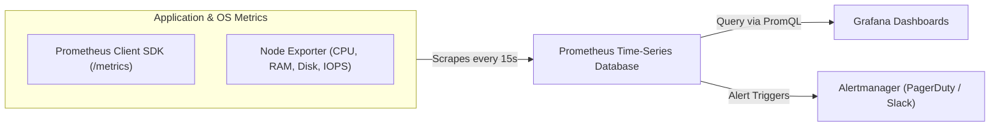

### 11.3 Essential Prometheus Alert Rules

```yaml
groups:
  - name: server_critical_alerts
    rules:
      # Alert if error rate exceeds 2% for 3 minutes
      - alert: HighHttpErrorRate
        expr: (sum(rate(http_requests_total{status=~"5.."}[2m])) / sum(rate(http_requests_total[2m]))) * 100 > 2
        for: 3m
        labels:
          severity: critical
        annotations:
          summary: "API Server 5xx Error Rate is {{ $value }}%"

      # Alert if p95 latency exceeds 500ms
      - alert: HighP95Latency
        expr: histogram_quantile(0.95, sum(rate(http_request_duration_seconds_bucket[2m])) by (le)) > 0.5
        for: 5m
        labels:
          severity: warning
        annotations:
          summary: "p95 Latency has spiked above 500ms"
```

---

## 12. Reliability Engineering: Spikes, Rate Limiting & Failover

### 12.1 Circuit Breaker Pattern

When an external dependency (e.g., a 3rd-party credit card gateway or recommendation service) slows down, incoming requests continue waiting until the server exhausts all worker threads and collapses.

A **Circuit Breaker** wraps external calls in a state machine:

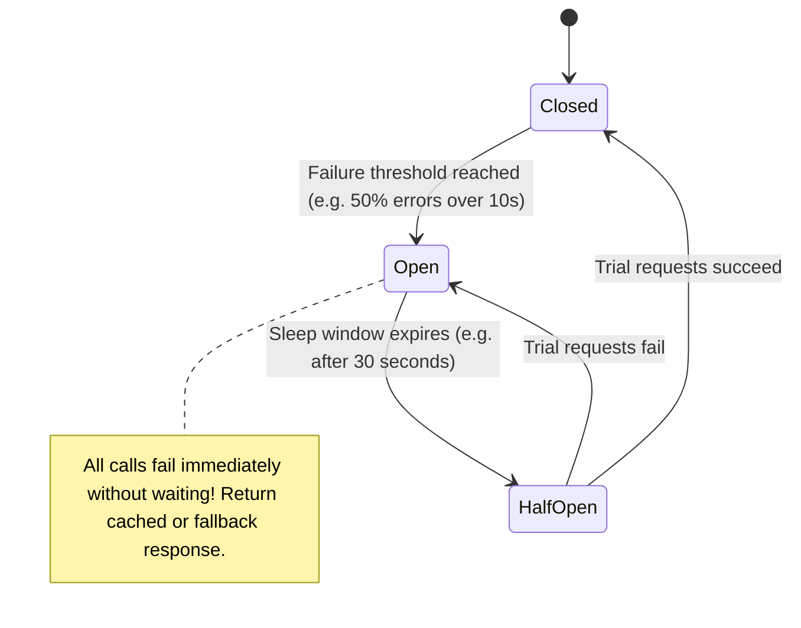

### 12.2 Token Bucket Rate-Limiting Algorithm

To protect the server from scraping bots, DDoS floods, and runaway client loops, deploy the **Token Bucket** algorithm (commonly implemented via Redis and Lua scripts):

```go
// Conceptual Go implementation of Token Bucket Rate Limiter
type TokenBucket struct {
    capacity     int64      // Maximum bucket capacity
    tokens       float64    // Current available tokens
    refillRate   float64    // Tokens added per second
    lastRefill   time.Time  // Timestamp of last replenishment
    mu           sync.Mutex
}

func (tb *TokenBucket) Allow() bool {
    tb.mu.Lock()
    defer tb.mu.Unlock()

    now := time.Now()
    elapsed := now.Sub(tb.lastRefill).Seconds()
    tb.lastRefill = now

    // Add new tokens based on elapsed time
    tb.tokens = math.Min(float64(tb.capacity), tb.tokens + elapsed*tb.refillRate)

    if tb.tokens >= 1.0 {
        tb.tokens -= 1.0
        return true // Request allowed
    }
    return false // Rate limit exceeded! Return HTTP 429
}
```

---

## 13. Deep Optimization: Kernel, Network & Application Runtimes

### 13.1 Linux Kernel TCP Tuning (`/etc/sysctl.conf`)

Default Linux kernel network settings are tuned for low-memory desktop workstations from 2005. Production servers must be tuned to handle massive network throughput:

```ini
# Increase maximum open file descriptors across the OS
fs.file-max = 2097152

# Increase connection backlog queue for rapid TCP handshakes
net.core.somaxconn = 65535
net.ipv4.tcp_max_syn_backlog = 65535

# Re-use TIME_WAIT sockets for new outgoing connections
net.ipv4.tcp_tw_reuse = 1

# Expand TCP socket buffer memory (min, default, max bytes)
net.ipv4.tcp_rmem = 4096 87380 16777216
net.ipv4.tcp_wmem = 4096 65536 16777216

# Increase network interface input queue
net.core.netdev_max_backlog = 250000
```

### 13.2 Zero-Copy File Transfers (`sendfile`)

In traditional file serving (e.g., serving a $50\text{ MB}$ video file):
1. Kernel reads file from disk into kernel page cache.
2. Kernel copies data across boundary into user-space application memory (`read()`).
3. Application copies data back across boundary into kernel socket buffer (`write()`).
4. Kernel copies data to NIC.
*Total: 4 context switches, 3 memory copies.*

**The Optimization:** The Linux `sendfile()` system call performs a **Zero-Copy Transfer**:
```c
// Direct kernel-to-socket transfer: Zero user-space copies!
sendfile(socket_fd, file_fd, &offset, count);
```
The data is piped directly from the disk page cache to the NIC ring buffer, reducing CPU utilization to near zero!

---

## 14. Real-World System Design: 1 Million Registered Users Backend

Let's design a complete production backend for a modern web and mobile SaaS platform with **1 Million Registered Users**.

### 14.1 Traffic & Scale Profile
* **Registered Users:** $1,000,000$
* **DAU ($10\%$):** $100,000$ daily active users
* **Peak RPS:** $\approx 1,200\text{ RPS}$
* **Data Volume:** $50\text{ GB}$ core relational data, $1.5\text{ TB}$ user-uploaded images and documents

### 14.2 Complete System Blueprint

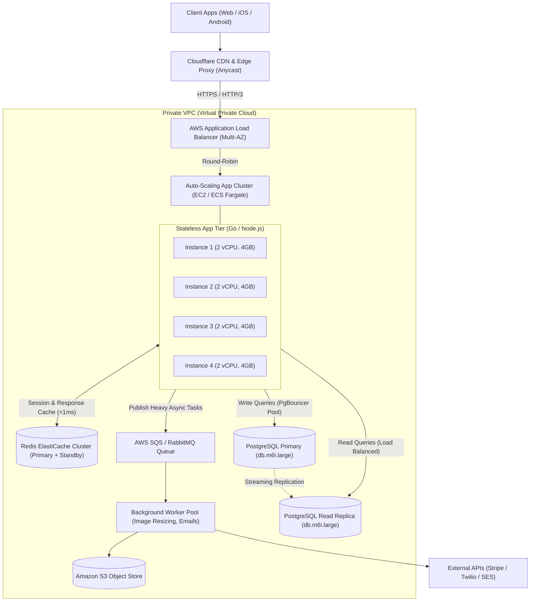

### 14.3 Component Sizing & Architectural Decisions
1. **Application Tier:** 4 stateless instances ($2\text{ vCPU}, 4\text{ GB RAM}$ each) deployed across 2 Availability Zones (AZs) for high availability. Minimum 2 nodes, auto-scaling up to 8 nodes during high-traffic sales events.
2. **Database Tier:** Managed PostgreSQL (`db.m6i.large`: $2\text{ vCPU}, 8\text{ GB RAM}$, NVMe SSD storage with Provisioned IOPS). One Primary instance for ACID transactions, one Read Replica in a separate AZ for read queries and instant failover.
3. **Caching Layer:** Redis cluster ($2\text{ nodes}$, $3.5\text{ GB RAM}$ each) configured with LRU (Least Recently Used) cache eviction.
4. **Storage Tier:** User profile pictures and PDF attachments uploaded directly from mobile clients to Amazon S3 via **Presigned URLs**, completely bypassing the application server and saving massive CPU and bandwidth!

---

## 15. Production Troubleshooting & Diagnostic Runbook

When production slows down or users report errors, use this battle-tested diagnostic procedure to pinpoint the root cause within minutes.

### 15.1 The 4-Step Triage Matrix

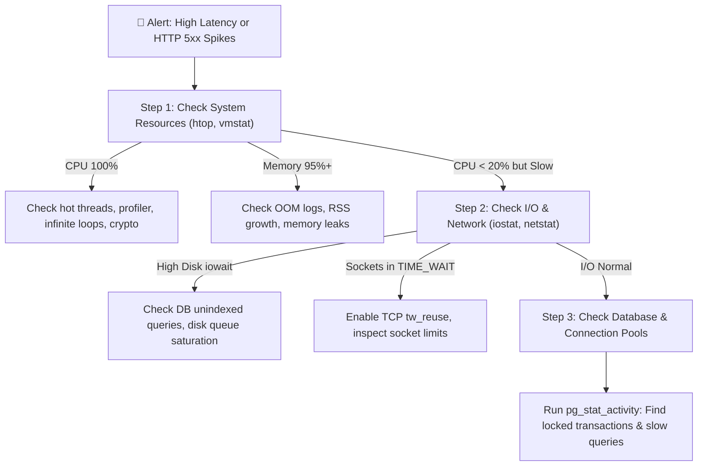

### 15.2 The Production Command-Line Toolkit

#### 1. Inspect Instant CPU & Process Saturation
```bash
# View interactive process tree, per-core CPU and memory utilization
htop

# Check 1-minute, 5-minute, and 15-minute system load averages
uptime
# RULE: If 1-minute load average > Number of CPU Cores, the CPU is saturated!
```

#### 2. Check Memory & Swap Activity
```bash
# Check memory in Megabytes
free -m

# Inspect virtual memory statistics every 2 seconds
vmstat 2
# RULE: If 'si' (swap-in) or 'so' (swap-out) are greater than 0, your server
# is swapping RAM to disk. Performance will degrade by 1,000x!
```

#### 3. Diagnose Disk I/O Bottlenecks
```bash
# Check I/O statistics per device every 1 second
iostat -xz 1
# KEY METRIC: %util. If %util is near 100%, your disk storage is saturated!
# KEY METRIC: await. Average time for I/O requests to complete in milliseconds.
```

#### 4. Diagnose Socket Exhaustion
```bash
# Count active network sockets grouped by TCP state
ss -s

# Count sockets in TIME_WAIT or CLOSE_WAIT
ss -tan | awk '{print $1}' | sort | uniq -c
```

#### 5. Find Active Slow Database Queries in PostgreSQL
```sql
-- Find running queries taking longer than 2 seconds
SELECT 
    pid, 
    now() - pg_stat_activity.query_start AS duration, 
    query, 
    state 
FROM pg_stat_activity 
WHERE (now() - pg_stat_activity.query_start) > interval '2 seconds'
  AND state != 'idle'
ORDER BY duration DESC;

-- Kill a hung runaway query causing table locks
SELECT pg_cancel_backend(14920);
```

---

## 🏁 Summary Checklist: Building Bulletproof Servers

- [ ] **Always Measure in Percentiles:** Track p50, p95, and p99 latency rather than meaningless averages.
- [ ] **Enforce Little's Law:** Calculate expected concurrency ($L = \text{RPS} \times W$) to size thread pools and socket limits.
- [ ] **Never Let App Servers Hold State:** Store sessions in Redis so instances can be scaled and terminated dynamically.
- [ ] **Use Connection Pools:** Place PgBouncer or HikariCP between application instances and the database.
- [ ] **Index All Foreign Keys & Query Filters:** Eliminate Full Table Scans with composite B-Tree indexes.
- [ ] **Protect Downstream Systems:** Implement Token Bucket rate limiting and Circuit Breakers.
- [ ] **Tune the OS Kernel:** Increase `somaxconn`, open file limits, and socket buffer sizes before running load tests.
- [ ] **Verify with Load Tests:** Validate capacity with k6 before declaring a system production-ready!
